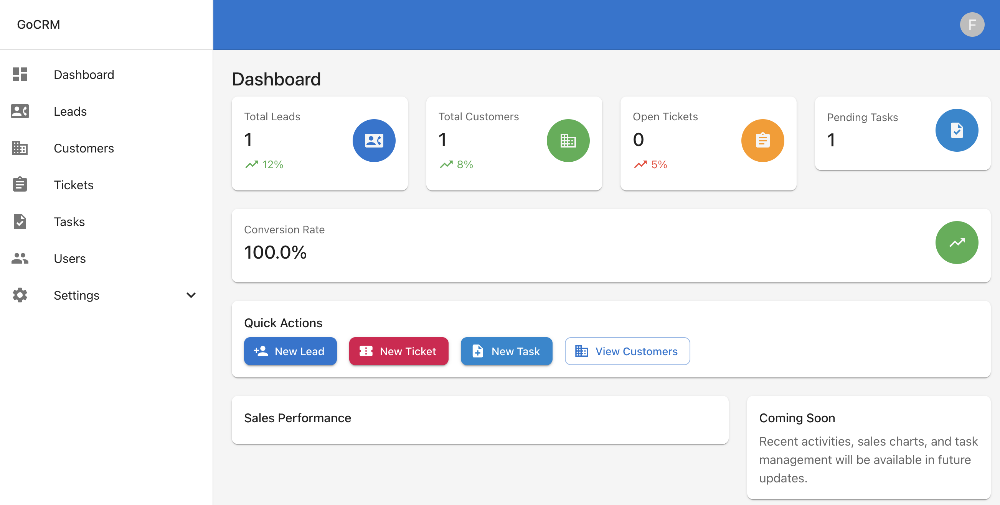
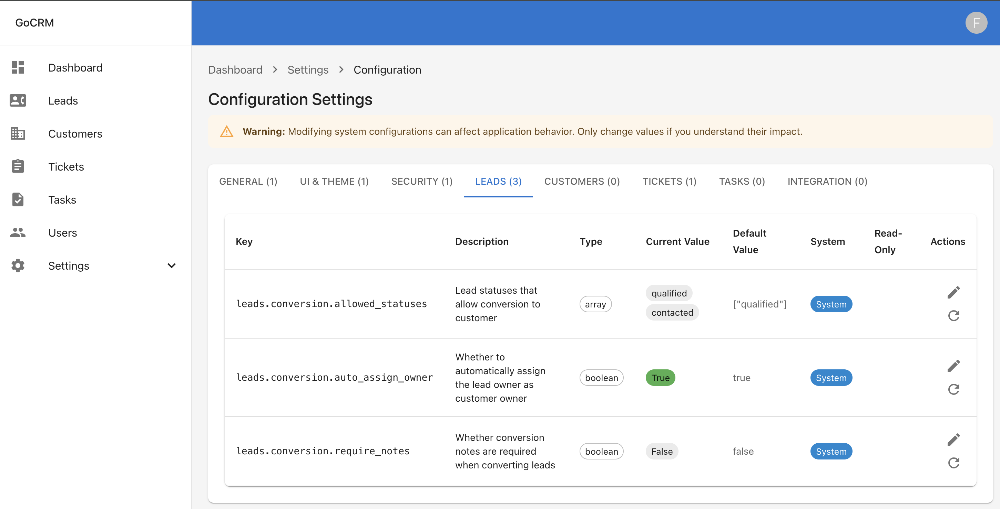
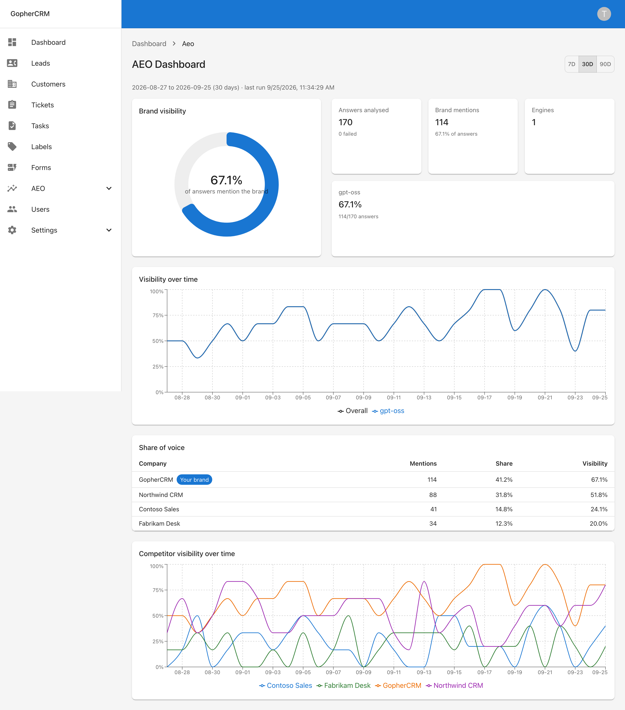
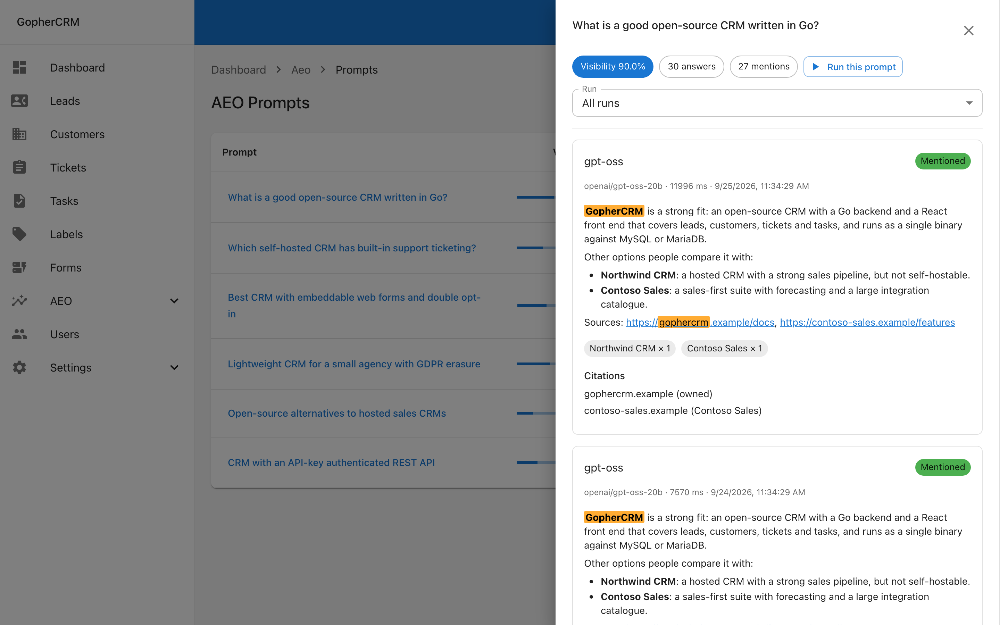

# GopherCRM

A self-hosted CRM for small teams: sales and support in one app, with lead-capture forms built in.
Go backend, React UI, SQLite or MySQL.

[](https://github.com/florinel-chis/GopherCRM/actions/workflows/ci.yml)
[](LICENSE)
[](https://github.com/florinel-chis/GopherCRM/releases/latest)

**Who it's for:** small sales and support teams that want leads, deals and tickets in one place, on
a server they control, without per-seat licence fees.

- **A complete CRM.** Leads that convert into customers, companies, deals on a five-stage pipeline
  with a full stage history, support tickets, tasks with labels, four fixed system roles (Admin,
  Sales, Support, Customer) plus custom roles managed in Settings → Roles.
- **Access control and sign-in.** Custom roles built from the permission catalogue, single sign-on
  through OpenID Connect (for example Microsoft Entra ID or Okta), SCIM 2.0 provisioning of staff
  accounts, signed outbound webhooks, and the sign-in and role audit logs.
- **Lead capture built in.** Build forms in the CRM and embed them on any website with one script
  tag. Submissions become leads, behind layered spam protection (time trap, origin allowlist,
  honeypot, rate limits, optional reCAPTCHA v3) and an optional double opt-in. A double opt-in
  form can instead open a support ticket for a known customer.
- **Easy to run.** A single Go API binary and a static React UI. SQLite needs no database server;
  MySQL 8 and MariaDB 10.11 are tested in CI. Docker Compose files ship for both.
- **AI-visibility reports (AEO).** See whether Anthropic, OpenAI, Gemini, Kimi, Perplexity or any
  OpenAI-compatible endpoint mentions your brand when buyers ask.



## Quick start (SQLite, no database server)

Needs Docker with Compose and free ports 3000 and 8080.

```bash
git clone https://github.com/florinel-chis/GopherCRM.git
cd GopherCRM
export JWT_SECRET="$(openssl rand -base64 32)"
docker compose -f docker-compose.sqlite.yml up -d --build
docker compose -f docker-compose.sqlite.yml exec backend create-admin -non-interactive \
  -email admin@example.com -name "Admin" -password 'ChangeMe!2345'
```

Open http://localhost:3000 and sign in as `admin@example.com` / `ChangeMe!2345`, then change the
password under **Settings > Profile**. Port 3000 taken? Put `UI_PORT=3001` in front of the `up`
command and open http://localhost:3001 instead.

Every guide is listed in the [Documentation](#documentation) table below.

If it's useful, a star helps others find it.

## Fork it

GopherCRM is meant to be forked and adapted. A fork starts with the modules listed under Features,
four fixed system roles (Admin, Sales, Support, Customer) plus custom roles built from the
permission catalogue in Settings → Roles or through the API, and the machinery that keeps them
working:
2155 top-level Go test functions, 35 Playwright specs, 46 MySQL migration pairs checked against
MySQL 8 and MariaDB 10.11, and
6 CI workflows (measured on `bbc5c81f`; commands in
[FORKING.md](docs/FORKING.md#9-why-fork-instead-of-rebuild)).

Start with [docs/FORKING.md](docs/FORKING.md) — first run, rebranding, configuration,
deployment, CI and staying in sync with upstream; the other guides are in the
[Documentation](#documentation) table.

Three things catch most first runs from source (`cp .env.example .env`, then `go run ./cmd` or
`make run`):

- **Replace the example `JWT_SECRET`.** The placeholder is refused at startup, so a copied
  `.env.example` does not start until the secret is replaced (`Load` (`internal/config/config.go`)).
- **Set `CORS_ALLOWED_ORIGINS`** for any cross-origin UI other than localhost on 5173, 3000 or 8080
  (`defaultAllowedOrigins` (`internal/middleware/cors.go`)). An unlisted origin looks like a failed login.
- **Public registration ships off** (the `security.allow_public_registration` entry of
  `DefaultConfigurations` (`internal/models/configuration.go`)). Create the first
  admin with `make build-tools && make create-admin`.

## Features

<details>
<summary>The full feature list</summary>

- 🔐 **Authentication**: JWT tokens and HMAC-SHA256 API Keys with role-based access control; API keys expire (at most one year)
- 🪪 **Single Sign-On**: OpenID Connect sign-in (for example Microsoft Entra ID or Okta); the provider's groups or app roles map to the GopherCRM role at each sign-in; the client authenticates with a client secret or a client certificate; signing out also ends the identity-provider session, and front-channel logout ends the GopherCRM session when the person signs out at the provider ([single sign-on guide](docs/user-guide/permissions-access/single-sign-on.md))
- 🔄 **SCIM Provisioning**: SCIM 2.0 create, update and deactivate of staff accounts and of the membership of the mapped groups; tokens under Settings → SCIM tokens ([SCIM provisioning guide](docs/user-guide/permissions-access/scim-provisioning.md))
- 📡 **Webhooks**: Signed outbound events with a delivery log, a test ping, secret rotation and redelivery ([webhooks guide](docs/user-guide/permissions-access/webhooks.md))
- 📜 **Audit Logs**: Settings → Sign-in audit and Settings → Role audit screens; sign-in audit rows are kept for `AUTH_AUDIT_RETENTION_DAYS`
- 🛡️ **Security**: Account lockout, password complexity, sort-column allowlists against SQL injection, rate limiting with trusted-proxy handling
- 🧹 **Right to Erasure**: Deleting a person overwrites their personal data before the row is soft-deleted (GDPR Art. 17)
- 👥 **Lead Management**: Lead tracking with conversion to customers
- 🏢 **Customer Management**: Complete customer lifecycle management
- 🏭 **Companies**: Organisation records that leads and customers link to, with domain de-duplication and per-company customer and lead views
- 💼 **Deals**: Sales opportunities with a five-stage pipeline, integer money per currency, per-stage probabilities and an append-only stage history
- 🧾 **Products & Quotes**: A product catalogue and quotes on deals and customers, with lines that copy the catalogue price, a per-line tax rate, server-computed net, tax and gross totals, a draft → sent → accepted/rejected/expired lifecycle with history, and a plaintext quote email; the UI has the products list and admin form, the quotes list and detail with draft-only line editing (including a per-line tax rate in the line dialog) and status actions, line tax and net, tax and gross totals on the quote detail and print pages, an email confirmation, a print page and a Quotes section on each deal
- ⏱️ **Follow-up Automation**: Admin-defined rules that start on lead, deal or ticket events, or on a daily UTC schedule, and run ordered steps — wait, condition, create task, assign owner, staff email, in-app notification — as persisted runs that survive a restart, with a dry run that writes, sends and notifies nothing; the UI has the admin rule list and form with a dry-run dialog, the run list and detail (admin and sales, with an admin cancel), Automation sections on lead and deal pages, and a notification bell and page for staff ([screenshots](docs/SCREENSHOTS.md#follow-up-automation))
- 🎫 **Ticket System**: Support ticket management with assignments
- ✅ **Task Management**: Task tracking and assignment
- ⚙️ **Configuration Management**: System-wide settings with admin interface
- 🔎 **Answer Engine Optimization (AEO)**: Track how often LLM answer engines mention your brand — daily runs across Anthropic, OpenAI, Gemini, Kimi, Perplexity and any OpenAI-compatible endpoint, with visibility, share-of-voice and citation reporting
- 📝 **Forms**: Build contact, quote-request and lead-capture forms in the CRM and embed them on any website with one script tag — submissions land in the CRM, create leads, and can require double opt-in email confirmation before delivering gated content; layered spam protection (honeypot, time trap, rate limits, optional invisible reCAPTCHA v3). A double opt-in form can instead open a support ticket for the customer whose email matches the confirmed address (fixed ticket text, no submitted value), deduplicated by an `idempotency_key` that API clients send with the submission (the embed script sends one key per rendered form on every submission of the render: the hosted view's per-render key, or one it generates)
- 🎨 **Modern UI**: React TypeScript frontend with Material-UI
- 📊 **Dashboard**: Analytics and activity overview
- 👤 **Role-Based Access**: four system roles (Admin, Sales, Support, Customer) plus custom roles built from the permission catalogue in Settings → Roles or through the API ([docs/AUTHORIZATION.md](docs/AUTHORIZATION.md)); administrator guide: [docs/user-guide/permissions-access/overview.md](docs/user-guide/permissions-access/overview.md)
- 🔌 **RESTful API**: Clean architecture with comprehensive endpoints

</details>

## Running with Docker (MySQL)

The whole stack (MySQL, API, UI) can run in containers, with database data
persisted in a named volume across restarts:

```bash
export JWT_SECRET="$(openssl rand -base64 32)"   # or put it in .env
docker compose up -d --build
docker compose exec backend create-admin          # first admin account
```

UI at http://localhost:3000, API at http://localhost:8080/api/v1. See
[docs/DOCKER.md](docs/DOCKER.md) for configuration and persistence details.

To run the same stack without a database server, use the SQLite flavor instead —
`docker compose -f docker-compose.sqlite.yml up -d --build` starts two containers
with the database in a file on a named volume ([docs/DOCKER.md](docs/DOCKER.md#sqlite-flavor-no-database-server)).

## Prerequisites

### Backend
- Go 1.25 or higher
- MySQL 8.0 or higher — or nothing at all, if you run on SQLite
  (`DB_DRIVER=sqlite`, see [Choosing a database](#choosing-a-database))
- Make (optional, for using Makefile commands)

### Frontend
- Node.js 22 or later and npm
- Modern web browser

## Setup Instructions

### 1. Clone the Repository
```bash
git clone https://github.com/florinel-chis/gophercrm.git
cd gophercrm
```

### 2. Backend Setup

#### Choosing a database

`DB_DRIVER` selects the backend. It defaults to `mysql`, which is the production
dialect and the one the SQL files in `migrations/` are written for.

```bash
DB_DRIVER=mysql          # default: DB_HOST/DB_PORT/DB_NAME/DB_USER/DB_PASSWORD apply
DB_DRIVER=sqlite         # single file, no server
DB_PATH=gophercrm.db     # only read when DB_DRIVER=sqlite; relative to the working directory
```

On SQLite the server-connection settings — `DB_HOST`, `DB_PORT`, `DB_NAME`,
`DB_USER`, `DB_PASSWORD` — are ignored.

SQLite needs no server and no `make create-db` — the file is created on first
start. It suits development, demos, CI and small single-instance deployments.
Things to know before relying on it:

- **Everything serializes on one connection.** SQLite takes a database-wide
  write lock, so the pool is deliberately capped at a single connection: within
  the backend process reads queue behind writes exactly as writes do, and there
  is no read concurrency to be had. What WAL mode buys here is that a *separate*
  reader — the `VACUUM INTO` snapshot below, or a `sqlite3` shell — is not
  blocked by the backend's writes. Run only one backend process against one
  file.
- **The file must live on a local filesystem.** WAL mode relies on shared-memory
  locking that NFS, SMB and similar network shares do not implement reliably;
  putting the database on one risks corruption.
- **The database is three files.** `gophercrm.db` plus the `-wal` and `-shm`
  siblings. A graceful shutdown checkpoints the WAL back into the main file; a
  process killed outright leaves it in place, which is normal and recovers on the
  next open.
- **Never copy a live database file.** To back it up, either stop the backend and
  copy all three files, or take an online snapshot with
  `sqlite3 gophercrm.db "VACUUM INTO 'backup.db'"`. A bare `cp` of `gophercrm.db`
  on a running system produces a stale or torn copy.
- **Back up before upgrading.** On SQLite the schema advances only through the
  auto-migration that runs at startup — the `migrations/` SQL is MySQL-only — and
  auto-migration is not reversible. Take the offline copy or the `VACUUM INTO`
  snapshot above first. What each release changes in the file, and the free disk
  its first start needs, is in
  [docs/DOCKER.md](docs/DOCKER.md#upgrading-the-sqlite-database).
- `DB_PATH` must not contain `?`; the connector appends its own pragma query
  string, so startup rejects a path that already carries one.

Docker users get this prewired in `docker-compose.sqlite.yml`; see
[docs/DOCKER.md](docs/DOCKER.md#sqlite-flavor-no-database-server).

#### Create the Database

MySQL only — skip this on SQLite, where the file is created on first start.

```bash
# Using Make (recommended)
make create-db

# Or manually with MySQL
mysql -u root < scripts/create_database.sql
```

#### Configure Environment
```bash
# Create environment file
cp .env.example .env

# Edit .env file with your database credentials
# JWT_SECRET is required; the placeholder must be replaced with the output of openssl rand -base64 32
```

#### Install Go Dependencies
```bash
go mod download
```

#### Run Backend Server
```bash
# Using Make (recommended)
make run

# Or directly with Go
go run ./cmd
```

The backend server will start on `http://localhost:8080`. Schema auto-migration runs at startup.

#### Create the First Admin

Self-service registration always creates a `customer` account, so the first administrator has to be
created out of band:

```bash
make build-tools
make create-admin
```

`create-admin` also accepts `--non-interactive --email ... --name ... --password ...` for scripted
provisioning; that is how the E2E suite seeds its admin (`gocrm-ui/e2e/global-setup.ts`).

### 3. Frontend Setup

#### Navigate to Frontend Directory
```bash
cd gocrm-ui
```

#### Install Dependencies
```bash
npm install
```

#### Configure the API Base URL (optional)
```bash
cp .env.example .env
# VITE_API_BASE_URL defaults to http://localhost:8080/api/v1
```

#### Start Development Server
```bash
npm run dev
```

The frontend will start on `http://localhost:5173`

## Usage

### Default Access

This section now lives in the user guide: [Getting started](docs/user-guide/getting-started.md).

1. **Open your browser** to `http://localhost:5173` (the dev server), or `http://localhost:3000` on
   the Docker stacks
2. **Sign in** with the admin account you created with `create-admin`

Public sign-up ships **disabled**: the login page offers no registration link until an admin (a
user whose role holds `settings.update`) turns on `security.allow_public_registration` under
**Settings > Configuration** (Security tab). When it is on, self-service registration always
creates a `customer` account.

Elevated roles (admin, sales, support) are never self-assigned. They are given by a user whose role
holds `users.assign_role` (the admin system role does), when creating a user with `POST /users` or
editing one; by the `create-admin` CLI; or by the single sign-on and SCIM role mapping an
administrator configured. The registration endpoint ignores any role supplied by the client.

Tokens are stored in `sessionStorage` and expire with the browser tab unless you tick **Remember
me** at login, which moves them to `localStorage`.

### Administration and settings

This section now lives in the user guide:
[Settings and configuration](docs/user-guide/settings-and-configuration.md).

Screens are shown by permission, not by role: a user sees a screen when their role holds the
permission it needs, and the system Admin role holds all of them. The administrator guide is
[docs/user-guide/permissions-access/overview.md](docs/user-guide/permissions-access/overview.md).

- **Users** (`users.view`): the user list and user pages; activating and deactivating an account
  needs `users.activate`.
- **Profile** (all users): your account details and the password change.
- **API Keys** (own keys, staff accounts only): create and revoke your own API keys; a key
  expires after at most one year; see
  [docs/user-guide/permissions-access/api-keys.md](docs/user-guide/permissions-access/api-keys.md).
- **Configuration** (`settings.view`; changes need `settings.update`): the system settings by
  category tab (see below).
- **Roles** (`roles.view`; creating, cloning, editing and deleting need `roles.manage`): system and
  custom roles and their permissions.
- **Webhooks** (`webhooks.manage`): outbound webhook endpoints and the delivery log; see
  [docs/user-guide/permissions-access/webhooks.md](docs/user-guide/permissions-access/webhooks.md).
- **Single sign-on** (`settings.sso_manage`): the OpenID Connect issuer, client and role mapping.
- **Sign-in audit** (`audit.sign_ins_view`): password, single sign-on, refresh and API-key sign-in
  outcomes; see
  [docs/user-guide/permissions-access/sign-in-audit.md](docs/user-guide/permissions-access/sign-in-audit.md).
- **Role audit** (`roles.audit_view`): role changes and account activation, deactivation, erasure
  and email changes.
- **SCIM tokens** (`settings.scim_manage`): the bearer tokens an identity provider's SCIM client
  uses.

### Configuration Management

This section now lives in the user guide:
[Settings and configuration](docs/user-guide/settings-and-configuration.md).

GopherCRM includes a powerful configuration management system that allows administrators to customize system behavior through a web interface.



#### Accessing Configuration Settings
1. Sign in as a user whose role holds `settings.view` (the admin system role does); changing or
   resetting a value needs `settings.update`
2. Navigate to **Settings > Configuration**
3. Browse settings by category tabs:
   - **General**: Company information and basic settings
   - **UI & Theme**: User interface customization
   - **Security**: Security-related settings
   - **Leads**: Lead management behavior
   - **Customers**: Customer management settings
   - **Tickets**: Support ticket configuration
   - **Tasks**: Task management settings
   - **Deals**: Deal settings (default currency)
   - **Integration**: Third-party integrations

#### Configuration Features
- **Type-Safe Editing**: Different input types based on configuration type (boolean, string, array, etc.)
- **Validation**: the server checks every value against the setting's type, and against its list
  of allowed values where the setting has one; a refused value is a 400 and nothing is saved
- **No deletion**: settings are seeded by the server; neither the screen nor the API can create or
  delete one
- **Read-only settings**: an entry marked read-only cannot be edited or reset; no setting the
  server seeds is read-only today
- **Default Values**: Easy reset to default values
- **No restart needed**: a saved value applies to the next request that reads it; other open
  browser sessions pick up UI settings when they reload

#### Lead Conversion Settings

This section now lives in the user guide:
[Lead conversion settings](docs/user-guide/settings-and-configuration.md#lead-conversion-settings).

The configuration system includes specific settings for lead conversion, enforced by the server on
every `POST /leads/:id/convert` before anything is written (a refusal is 400 `VALIDATION_ERROR`):
- `leads.conversion.allowed_statuses`: Which lead statuses allow conversion to customer
  (any of `new`, `contacted`, `qualified`, `unqualified`; seeded as `qualified` and `contacted`)
- `leads.conversion.require_notes`: Whether non-blank conversion notes are required
- `leads.conversion.auto_assign_owner`: Make the lead's owner the customer's assigned user

If the `leads.conversion.allowed_statuses` row is missing (seeding never ran), conversion falls back
to `qualified` only, the entry's default value, rather than the seeded `qualified, contacted`; the
next start re-seeds the row. A lead reaches `converted` only through the convert endpoint: lead
create/update and the bulk status endpoint refuse it. The lead's company link is carried over to
the customer as well. `GET /configurations/ui` exposes
the three settings read-only, and the web UI follows them: Convert to Customer is offered on the
allowed statuses, the conversion dialog requires notes when they are required and says when the
lead's owner becomes the customer's assigned user.

### Answer Engine Optimization (AEO)

This section now lives in the user guide: [Answer Engine Optimization](docs/user-guide/aeo.md).



AEO tracks how visible your brand is in the answers large language models give to buyer questions.
You describe the brand and its competitors once, track a list of prompts, and a daily run asks every
configured answer engine each prompt and records what came back: whether the brand was mentioned,
how early, which competitors appeared alongside it, and which sources were cited.

Available to **admin**, **sales** and **support** under **AEO** in the sidebar; `customer` cannot
reach it. Saving the profile, managing prompts and starting a run need admin or sales; deleting a
prompt needs admin.

1. **Settings** (`/aeo/settings`) — brand name, aliases, owned domains and competitors, the provider
   API keys (admin only; stored encrypted and never echoed back, so a chip per engine reports only
   whether a key is present) and which engine prompt generation runs on. Save the profile before
   anything else: a run has nothing to detect without it.
2. **Prompts** (`/aeo/prompts`) — the questions to track (up to 100 active). Add them by hand or ask
   the configured generation engine to suggest some. Each row shows the visibility percentage over
   the selected window; opening a row shows the recorded answers with every brand mention
   highlighted.
3. **Dashboard** (`/aeo`) — overall visibility, a per-engine timeline, share of voice against the
   competitors and their trend, over 7, 30 or 90 days.
4. **Citations** (`/aeo/citations`) — how often each company's domains are cited, and how often a
   citation coincides with a brand mention.
5. **Export** — the dashboard's **Export CSV** / **Export JSON** buttons download the selected 7,
   30 or 90-day window, and the answer drawer's **Export run as CSV** / **Export run as JSON**
   buttons download the run picked in its run filter (every prompt of that run). Both call
   `GET /api/v1/aeo/export` (`run_id` or `days`), which integrations can use directly: CSV (one
   row per citation, formula-guarded cells) or JSON (with the full answer text), for client
   reporting. Admin, sales and support; at most 10,000 answers per file.



Every recorded answer is kept verbatim — the drawer above shows one engine's answer with the brand
mentions highlighted and a selector to walk earlier runs. The full screen-by-screen tour lives in
[docs/SCREENSHOTS.md](docs/SCREENSHOTS.md#aeo).

Provider keys come from **Settings** (`/aeo/settings`) first and fall back to the environment
variables below when no key is stored, so a key entered in the UI takes effect from the next run
without restarting the process. An engine with no key from either source is simply skipped.
Admins can also override each hosted engine's **model and base URL** in **Models and endpoints**;
blank values restore environment/default behavior. These settings apply to both tracking runs and
prompt generation. The custom engine, schedule and egress policy remain environment-only, so a
stored base URL selects an endpoint but cannot make an untrusted one reachable.

**Where your data goes.** CRM records and stored prompt sets are kept on your server. Each tracking
run sends every active prompt to every configured engine. Queries stay on your network only when
all configured endpoints are local; in that setup, tracking measures those local models. Queries
to hosted endpoints leave your network. Prompt generation is separate: it sends your brand name,
description and competitor names to the selected generation provider. That request also leaves
your network if the provider's endpoint is hosted.

| Engine | Key | Model override |
|---|---|---|
| Anthropic | `ANTHROPIC_API_KEY` | `AEO_ANTHROPIC_MODEL` |
| OpenAI | `OPENAI_API_KEY` | `AEO_OPENAI_MODEL` |
| Gemini | `GEMINI_API_KEY` | `AEO_GEMINI_MODEL` |
| Kimi (Moonshot) | `MOONSHOT_API_KEY` | `AEO_KIMI_MODEL` |
| Perplexity | `PERPLEXITY_API_KEY` | `AEO_PERPLEXITY_MODEL` |
| Any OpenAI-compatible server (e.g. LM Studio) | `AEO_CUSTOM_BASE_URL` (+ optional `AEO_CUSTOM_API_KEY`) | `AEO_CUSTOM_MODEL`, `AEO_CUSTOM_NAME` |

Each hosted engine also accepts `AEO_<PROVIDER>_BASE_URL` (for example,
`AEO_GEMINI_BASE_URL=https://generativelanguage.googleapis.com/v1beta/openai/`). Use the
OpenAI-compatible base for Gemini/OpenAI/Kimi/Perplexity, and the Messages API root for Anthropic.
Do not include credentials, query parameters, or the final `/chat/completions` or `/v1/messages`
path. A provider's 503 may mean temporary overload.

**Egress policy.** Each engine may send its key only to its official HTTPS origin. Any other
endpoint must be trusted explicitly in the environment. This applies to a gateway or regional
host, a stored Settings override, and every custom engine. Use `AEO_EGRESS_ALLOWED_ORIGINS` for
public HTTPS origins and `AEO_EGRESS_LOCAL_ORIGINS` for narrowly scoped loopback/LAN servers, for
example `AEO_EGRESS_LOCAL_ORIGINS=custom=http://10.0.1.21:1234`. An untrusted endpoint fails with
`endpoint_not_permitted` before any request. Destinations are checked again at connection time;
redirects are never followed and `HTTP(S)_PROXY` is ignored. Failed answers record only a bounded
category and the numeric HTTP status, never the provider's response text. See
[docs/AEO_SECURITY.md](docs/AEO_SECURITY.md) for the syntax and the migration checklist.

`AEO_SCHEDULE_ENABLED` (default `true`) and `AEO_SCHEDULE_HOUR` (default `6`, server local time)
control the daily run. The scheduler is armed whenever it is enabled, with or without a key at
boot: engines are resolved when the hour arrives, so a key saved in Settings is used by the next
scheduled run without a restart. With no key set at all the module still boots; starting a run
then returns 503 instead of recording a run that could never produce an answer, and a scheduled
tick that finds no profile, key or active prompt is logged once and skipped until the next day.

**Shutdown.** On SIGINT/SIGTERM the process stops admitting runs (a run requested while draining
answers 503 `SHUTTING_DOWN`), cancels the scheduler and every run in flight, waits for them to
finalize, and only then closes the database. An interrupted run ends `failed`, or `partial` when
some answers were already recorded; queries cut short count as failed and are not stored as
answers. A failed finalizing write leaves its row for recovery even if the
work drains successfully. The AEO drain waits at most 15 seconds. If a provider call or database write still has not
released by then, the process exits without closing the database and the run row left in
`running` is failed once its heartbeat is older than 3 minutes, by the next boot or start on any
replica, exactly as after a crash (see *Known Limitations*).

Prompt generation (`POST /aeo/prompts/generate`) deliberately runs on one named engine rather than
whatever happens to be configured, so its output keeps a consistent shape. Anthropic is the default;
the `Settings` page selects any of Anthropic, OpenAI, Gemini, Kimi or Perplexity instead. If the
selected engine has no key, generation answers 503 naming that engine rather than silently falling
back to another one.

**Cost.** One run is *active prompts × configured engines* API calls — 25 prompts across 5 engines
is 125 calls a day. The 100-prompt cap exists for this reason. Only one run may be in flight at a
time; a second request is refused with 409.

`scripts/aeo_live_smoke.sh` walks the whole module against real providers for manual verification.
It spends real credit, so it is never part of CI. Test cases: `docs/testing/11-aeo.md`.

## Integrations: webhooks

Integrations no longer need to poll for new records: GopherCRM sends a small signed HTTPS request
to a registered endpoint when a lead, customer, ticket, deal, task, company or quote is created,
updated or deleted (twenty-one event types). Endpoints, the test ping, secret rotation and the
delivery log with redelivery are managed in **Settings > Webhooks** by users holding
`webhooks.manage`, or through the API. The event table, delivery, retries and pausing, and how a
receiving system verifies the signature are described in
[docs/user-guide/permissions-access/webhooks.md](docs/user-guide/permissions-access/webhooks.md).

## Privacy: deleting a person erases their data

This section now lives in the user guide: [Privacy and erasure](docs/user-guide/privacy-and-erasure.md).

Deleting a **user, customer or lead** is an erasure under GDPR Art. 17, not a recoverable soft
delete. Every personal field on the row is overwritten in place — the email address is replaced
with a random, non-routable placeholder in the reserved `.invalid` domain — and the row is only then
soft-deleted, all in a single transaction. API keys, refresh tokens and password-reset tokens
belonging to the account are purged with it. The row itself is deliberately kept so foreign keys
from tickets and tasks still resolve: business records survive, the person does not.

Erasure follows the person, not the table: a lead, the customer it was converted into and that
customer's own customer-role login are erased together whichever of them you delete. Staff
accounts are never erased that way, and only an admin may delete a converted lead. Erasures made
before this rule existed are not repaired automatically: `docs/DEV_ERASURE.md` lists the queries
that find the ones with a live row left, and the supervised way to finish them; graphs whose rows
are all soft-deleted have no supported path yet.

Deals and quotes of the erased customers and leads are kept with their links, stages, amounts,
statuses, totals and history, but the text staff typed into them can name the client, so the same
transaction overwrites it: deal titles become `[redacted]` and their notes and lost reasons are
emptied, quote titles become `[redacted]` and their notes are emptied whatever the quote status,
quote line descriptions are reset to the product names, and notifications about those deals are
deleted (#245). A client response link mailed for a quote of an erased customer stops working
(#395). Ticket and task text is kept; see `docs/DEV_ERASURE.md` for the ticket redaction
procedure.

Two consequences:

- **Erasure cannot be undone.** The only way to get the data back is to restore a database backup.
  To suspend access reversibly, deactivate the account instead (`is_active = false`); deactivation
  never touches personal data.
- **The email address becomes reusable**, because the original no longer exists in the table.

Tickets and tasks are unaffected — deleting one is still an ordinary soft delete.

Rows soft-deleted *before* this behaviour existed still hold personal data;
`scripts/anonymize_legacy_deleted_pii.sql` remediates them. It is manual, irreversible, and
deliberately not wired into auto-migration.

Full rationale, the cascade rules for converted leads, and the operational caveats are in
[docs/DEV_ERASURE.md](docs/DEV_ERASURE.md#deleting-personal-data).

## Development

### Backend Development

#### Building
```bash
make build
```

#### Running Tests
```bash
# Run all tests
make test

# Run specific tests
go test -run TestName ./path/to/package

# Run integration tests (in-memory SQLite, no MySQL needed)
go test ./test/integration/ ./tests/

# Race detector
go test -race ./internal/... ./test/... ./tests/...
```

#### Database Operations
```bash
# Create database
make create-db
```

### Frontend Development

#### Available Scripts
```bash
# Start development server
npm run dev

# Build for production (runs tsc -b first)
npm run build

# Preview production build
npm run preview

# Run unit tests (watch mode)
npm run test

# Run unit tests once, on three workers (what make verify-frontend runs)
npm test -- --run --maxWorkers=3

# Run end-to-end tests (requires the backend and frontend running)
npm run test:e2e

# Run linting
npm run lint
```

#### Development Tools
- **Hot Reload**: Automatic browser refresh on code changes
- **TypeScript**: Full type checking and IntelliSense
- **ESLint**: Code linting
- **Prettier**: Code formatting

## API Documentation

All application routes are mounted under `/api/v1` (configurable via `API_PREFIX`). Every endpoint
under the prefix answers with the unified envelope `{ success, data, error, meta }`: `data` holds
the result, `error` the code and message of a refusal, and `meta` the pagination of a list.

The complete reference, with every operation's roles, parameters, side effects, error codes and
schemas, is generated into `api/`:

- `api/index.html`: a static page that works offline, straight from the checkout;
- `api/swagger.yaml` and `api/swagger.json`: the OpenAPI (Swagger 2.0) spec, for client
  generators.

`make swagger` regenerates all three from the handler annotations. How the spec is built is
described in [docs/DEVELOPMENT.md](docs/DEVELOPMENT.md#api-reference); `make verify-api-docs`
checks it (see [docs/DEV_TESTING_CI.md](docs/DEV_TESTING_CI.md#api-docs-gate)).

The SCIM 2.0 server at `/scim/v2` is not part of the spec; see
[docs/user-guide/permissions-access/scim-provisioning.md](docs/user-guide/permissions-access/scim-provisioning.md).

`GET /health` is served outside the API prefix, needs no authentication and is not in the spec.
Its `webhooks` field is `{"state": "running"}`, or `{"state": "paused", "reason": "secret_unavailable"}`
while the webhook sender holds the deliveries of an endpoint whose signing secret cannot be
opened; the top-level `status` stays `healthy` and the answer stays 200 either way.

## Project Structure

```
gophercrm/
├── cmd/
│   ├── main.go                  # Application entry point and DI wiring
│   ├── create-admin/            # CLI that provisions an admin account
│   └── migrate/                 # Migration runner
├── internal/
│   ├── aeo/                     # Answer engine providers, run engine and scheduler
│   ├── config/                  # Environment configuration
│   ├── database/                # The one place a database connection is opened
│   ├── egress/                  # Outbound-request guard for AEO providers and webhooks
│   ├── forms/                   # Form time-trap challenge and captcha verifier
│   ├── idkit/                   # OpenID Connect sign-in, claim-to-role mapping and SCIM
│   ├── integration/             # Permission and visibility integration tests
│   ├── lifecycle/               # Start/stop types shared by the background runtimes
│   ├── mailer/                  # Transactional mail (SMTP or log-only)
│   ├── permissions/             # Permission catalogue and system-role matrices
│   ├── testsupport/             # Test database helpers (SQLite, TEST_MYSQL_DSN)
│   ├── webhook/                 # Webhook event catalogue and outbox emitter
│   ├── models/                  # Domain models and database schemas
│   ├── repository/              # Data access layer (incl. erasure.go, erasure_cascade.go)
│   ├── service/                 # Business logic layer
│   ├── handler/                 # HTTP handlers and routing
│   ├── middleware/              # Auth, logging, CORS, rate limiting, recovery
│   ├── errors/                  # Sentinel error types
│   ├── mocks/                   # Generated test doubles
│   └── utils/                   # Utility functions and helpers
├── test/integration/            # Integration tests (SQLite in-memory)
├── tests/                       # Further integration tests
├── scripts/                     # create_database.sql, anonymize_legacy_deleted_pii.sql
├── migrations/                  # SQL migrations
├── api/                         # Generated Swagger 2.0 spec + static HTML reference — make swagger
├── docs/                        # Project documentation (developer guide, setup, features, roadmap)
├── gocrm-ui/                    # React TypeScript frontend
│   ├── src/
│   │   ├── components/          # Reusable UI components
│   │   ├── pages/               # Application pages
│   │   ├── api/                 # API client and endpoints
│   │   ├── hooks/               # Custom React hooks
│   │   ├── contexts/            # React contexts (auth, config, snackbar)
│   │   ├── layouts/             # Shell layouts
│   │   ├── routes/              # Route table
│   │   ├── types/               # TypeScript type definitions
│   │   ├── test/                # Vitest setup and helpers
│   │   └── theme/               # Material-UI theme configuration
│   ├── e2e/                     # Playwright suites, page objects and global setup
│   └── public/                  # Static assets
├── Makefile                     # Build and development commands
├── go.mod                       # Go module definition
├── go.sum                       # Go module checksums
└── README.md                    # This file
```

## Tech Stack

### Backend
- **Go 1.25+** - Main backend language
- **Gin 1.10** - HTTP web framework
- **GORM 1.30** - ORM for database operations
- **MySQL 8.0+** - Default database; **SQLite** is a supported alternative via
  `DB_DRIVER` (pure-Go driver, no cgo) and is what the test suite runs on
- **JWT** (`golang-jwt/jwt/v5`) - Authentication tokens
- **Logrus** - Structured logging
- **Testify** - Unit and integration test suites

### Frontend
- **React 19** - UI framework
- **TypeScript 5.8** - Type safety
- **Material-UI (MUI) v7** - Component library
- **React Router 7** - Client-side routing
- **TanStack Query 5** - Data fetching and caching
- **React Hook Form + Zod** - Forms and validation
- **Axios** - HTTP client
- **Recharts** - Dashboard charts
- **Vite 6** - Build tool and dev server
- **Vitest 3 + Playwright** - Unit and end-to-end tests

## Documentation

| Document | Contents |
|---|---|
| [docs/FORKING.md](docs/FORKING.md) | Running your own copy: first run, rebranding, configuration, deployment, CI and staying in sync with upstream |
| [docs/SETUP.md](docs/SETUP.md) | Backend and frontend setup walkthrough |
| [docs/DOCKER.md](docs/DOCKER.md) | Running with Docker Compose (MySQL or SQLite), backups and SQLite upgrade notes, the production override example and the image's quote PDF browser |
| [docs/SERVER_PROVISIONING.md](docs/SERVER_PROVISIONING.md) | Preparing a fresh systemd server (MySQL or MariaDB) for the release-tarball deploy path, quote PDF setup, and the [Reverse proxy and TLS](docs/SERVER_PROVISIONING.md#reverse-proxy-and-tls) sites for nginx or Apache 2.4 |
| [docs/USE_CASES.md](docs/USE_CASES.md) | Worked recipes for concrete deployments, with their gaps |
| [docs/DEVELOPMENT.md](docs/DEVELOPMENT.md) | Developer guide index: commands, architecture layers, package map, conventions, gotchas, configuration, API reference |
| [docs/DEV_TRANSACTIONS.md](docs/DEV_TRANSACTIONS.md) | Transaction manager contract, service transaction units, request context |
| [docs/DEV_AUTH.md](docs/DEV_AUTH.md) | Sign-in, sessions and refresh tokens, API keys, credential revocation, single sign-on, SCIM |
| [docs/DEV_RBAC.md](docs/DEV_RBAC.md) | Role assignment, custom roles, admin-only permissions, role API, last-admin guard |
| [docs/DEV_ENTITIES.md](docs/DEV_ENTITIES.md) | Entity rules: quotes, mail delivery, ordered reads, tasks and tickets, list filters, leads and companies, bulk endpoints |
| [docs/DEV_ERASURE.md](docs/DEV_ERASURE.md) | Deletion semantics: the personal-data erasure, what is scrubbed and kept, operator procedures |
| [docs/DEV_RUNTIMES.md](docs/DEV_RUNTIMES.md) | Background runtimes: AEO, automation, outbound webhooks, form retention, form mail and ticket intake |
| [docs/DEV_TESTING_CI.md](docs/DEV_TESTING_CI.md) | Test layout, CI jobs and gates, documentation checks, API docs gate |
| [docs/EXTENDING.md](docs/EXTENDING.md) | Adding or removing entities, routes, migrations and modules |
| [docs/CONCURRENCY.md](docs/CONCURRENCY.md) | Lock order and retry rule for multi-table writes |
| [docs/FEATURES.md](docs/FEATURES.md) | Feature and test-coverage matrix with known issues |
| [docs/datamodel.md](docs/datamodel.md) | Entity model and relationships |
| [docs/AUTHORIZATION.md](docs/AUTHORIZATION.md) | Permission catalogue, system-role matrix, custom roles, role-change rules and the phase 2 sign-in design note |
| [docs/user-guide/README.md](docs/user-guide/README.md) | User guide index: getting started, settings, AEO, privacy and erasure, and the administrator guide |
| [docs/user-guide/permissions-access/overview.md](docs/user-guide/permissions-access/overview.md) | Administrator guide: roles and permissions, single sign-on, a Microsoft Entra ID walk-through, API keys, the sign-in audit, webhooks and an FAQ |
| [docs/AEO_SECURITY.md](docs/AEO_SECURITY.md) | AEO provider egress policy, operator migration steps and failure diagnostics |
| [api/index.html](api/index.html) | Offline API reference, generated from the OpenAPI spec [api/swagger.yaml](api/swagger.yaml) |
| [docs/SCREENSHOTS.md](docs/SCREENSHOTS.md) | Screenshot catalog of every user-facing screen |
| [docs/testing/README.md](docs/testing/README.md) | Test-case catalog: end-to-end cases per feature, automated, planned and blocked |
| [gocrm-ui/e2e/README.md](gocrm-ui/e2e/README.md) | End-to-end suite: make e2e, running by hand, the seeded admin account, spec coverage and conventions |
| [docs/VALIDATION_RELEASE.md](docs/VALIDATION_RELEASE.md) | Contextual validation profiles, the release workflow and deploys |
| [docs/DOCUMENTATION_WORKFLOW.md](docs/DOCUMENTATION_WORKFLOW.md) | How documentation is assessed and updated with each pull request |
| [docs/ROADMAP.md](docs/ROADMAP.md) | Ideas that are not implemented yet |
| [CHANGELOG.md](CHANGELOG.md) | Notable changes |
| [Releases](https://github.com/florinel-chis/GopherCRM/releases) | Published releases and their artifacts |

## Known Limitations

- **Access tokens end early only on logout, password change, password reset, deactivation and a
  SCIM group change that lowers the role.**
  These increment the account's `users.token_version`, which every JWT carries, so every access
  token issued before them is refused at once (erasure rejects it too). Password change, password
  reset and deactivation (by an administrator or through SCIM) also revoke every API key of the
  account for good, and reactivating an account brings none of its earlier credentials back;
  logout leaves API keys alone. A SCIM group change that leaves an account in no mapped group
  deactivates it the same way; one that gives it a role lacking a permission the old one had ends
  its access and refresh tokens, not its API keys. Refresh rotation
  does not: the access token it replaces stays valid until `JWT_EXPIRY_HOURS` elapses, and so does
  every token of an account whose role changes any other way. There is no per-token denylist.
- **Session handling has known gaps.** Browser tabs sharing a remembered session coordinate their
  refreshes through the Web Locks API (#184), which browsers offer only in secure contexts: served
  over plain HTTP (the bundled nginx without TLS) each tab locks on its own, and two tabs
  refreshing at the same moment can still sign each other out when the losing tab's rejection
  arrives before the winner stored the successor. Other open tabs learn about a sign-in or
  sign-out only on their next request. A login that verified the old password a moment before a
  password change commits can still be issued a session afterwards, and login is not yet
  serialised against erasure under the owner lock (#183).
- **Outbound email needs SMTP configuration.** Without `SMTP_HOST` set, every mail — the
  password-reset link (redacted), the forms mail, the quote email and the `send_email` step of an
  automation rule — goes to the application log instead of a mailbox, and the sending code cannot
  tell: `POST /api/v1/quotes/:id/email` still answers `200` and stamps `last_emailed_at`, and an
  automation email step is logged as `succeeded`, although nothing was delivered. Form mail and
  ticket comment mail (`email_customer`) are the exception: each delivery is recorded `log_only`,
  not `sent`. Fine for development, useless in production.
- **Quote PDF output needs a browser on the server.** Without a headless browser named by
  `QUOTE_PDF_CHROME_PATH`, and in the two development Compose stacks, PDF output is off and quote
  emails are text only; setup is in
  [docs/SERVER_PROVISIONING.md](docs/SERVER_PROVISIONING.md#quote-pdf-output).
- **Form mail is retried by hand only.** Every form mail (confirmation, follow-up, one notification
  per address) is recorded and shown on the submission and in `GET /api/v1/forms/deliveries`;
  admin and sales retry a failed, log-only or stuck one with
  `POST /api/v1/forms/deliveries/{id}/retry`. Nothing retries automatically, and `sent` means the
  relay accepted the message: bounces are not tracked.
- **The automation worker is replica-safe on MySQL/MariaDB, with conditions.** Every replica with
  `AUTOMATION_ENABLED=true` (see `.env.example`) may run the worker against one shared database
  (#237): each run claim carries the replica's instance id and a heartbeat lease, every later
  write is fenced on that owner, and a run whose lease is older than 3 minutes (a crashed or
  paused worker) is recovered by the next tick of any worker, without a restart. A replica with
  the worker off serves the API and records events but neither executes nor recovers runs.
  Replica clocks must agree to well under 90 seconds, and an upgrade stops every replica before
  starting the new version (an older binary resets live runs at boot). Several processes on one
  SQLite file are still not supported. An email whose worker paused between its final owner check
  and the relay call can still go out once after another worker recorded it `email_unconfirmed`;
  it is never resent. Processed events and finished runs are kept; there is no retention pruning
  yet.
- **AEO is replica-safe on MySQL/MariaDB, with conditions.** One AEO run is admitted across every
  replica sharing the database and the daily scheduled run starts once per slot (#229). A run of a
  crashed or killed process is recovered up to 3 minutes after the crash, at the next boot or start
  attempt; until then a manual run answers 409. Every replica must use the same `TZ` and
  `AEO_SCHEDULE_HOUR`, replica clocks must be synchronised to well under 90 seconds, and an
  upgrade stops every replica before starting the new version (mixed versions are not supported).
  Several processes on one SQLite file are not supported.
- Authentication is header-only (Bearer or ApiKey); no cookie credential is accepted, so CSRF does
  not apply. Any future cookie session must ship with session-bound CSRF protection (see #261).
- **Rate limiting does not distinguish reads from writes on authenticated routes.**
  `RateLimitModerate` (120/min, burst 30) is applied once to the whole protected group in
  `setupDependencies` (`cmd/main.go`) and covers reads and writes alike. It is charged before
  authentication (#466), so requests with refused or missing credentials on protected routes
  are charged too.
  `RateLimitStrict` (10/min, burst 5) guards the `/auth`
  group, the public form submit and confirm routes (`SetupFormPublicRoutes`) and the public quote
  response routes `/quotes/public/response` (`SetupQuotePublicRoutes`);
  `RateLimitGenerous` (240/min, burst 40) is applied only to the public form *reads*
  (`embed.js`, the definition and the hosted view) and to `/quotes/public/render`.
  `DISABLE_RATE_LIMIT=true` lifts the strict tier and the two SCIM limits on `/scim/v2` (the SCIM
  token limit and the SCIM refusal limit); the checks live inside `RateLimitStrict` and
  `NewSCIMRateLimits`. The moderate and generous tiers still apply to test traffic.
- **Rate limits are per process and per middleware instance.** Clients are counted per IPv4
  address and per IPv6 /64 network. Each instance tracks at most 10,000 clients; when it is full, a
  new client is still admitted and the least recently active record is dropped (that client
  starts again with a fresh burst). Idle records are also reclaimed after five idle minutes once
  the bucket has refilled. Limits are not shared between replicas, and behind a proxy they depend
  on `TRUSTED_PROXIES`. `DISABLE_RATE_LIMIT=true` stops startup when `SERVER_MODE=production`. See
  [DEVELOPMENT.md](docs/DEVELOPMENT.md) for details.
- **Bulk operations are status-only.** Only `POST /leads|tickets|tasks/bulk/status` exist (see the
  [API reference](api/index.html)); there is no bulk create, update or delete.
- **Spam and unconfirmed form submissions are kept until you set a retention.** With
  `FORM_RETENTION_DAYS` set (3 days at least, off by default), those with no linked lead are removed
  permanently at that age, at boot and then every 24 hours, so the first boot removes the existing
  backlog. Until a separate frontend task merges, the form-delete dialogs still say "Collected
  submissions are retained", which is wrong for those rows.
- **Sign-in audit rows are kept for `AUTH_AUDIT_RETENTION_DAYS`.** Every successful password
  sign-in, single sign-on callback and successful refresh writes one `auth_audit_log` row, so does every password change
  (`password_change`), password reset request (`reset_request`), reset completion
  (`reset_confirm`) and logout (`logout`, #550), so does every API key creation
  (`api_key_create`), revocation (`api_key_revoke`) and refused re-enable of a revoked key
  (`api_key_enable`, #551, with the key's id), and refused API keys (#466), refused password
  sign-ins, refused refreshes and refused SCIM authentications (#553) are counted in one row per
  method, reason, account, client network and minute (`attempts`); rows are kept 90
  days by default (#454). The rows hold no email, name, subject or full IP address, and erasure leaves them
  to age out.
- **Erasure does not reach logs or issued tokens.** Service logs omit email, name, title and
  search fields; shared helpers omit argument/result/response payloads, and HTTP logs omit query
  strings. Quoted values in logged errors are redacted, and SMTP errors retain only the protocol
  code. Other raw diagnostics, request IDs, client IPs, Origin/User-Agent headers and mailer
  recipient metadata can still carry personal data. Older logs and issued JWTs that embed email
  also remain outside database erasure, so log and token retention need their own policy.

## Contributing

Read [docs/DEVELOPMENT.md](docs/DEVELOPMENT.md) first — it documents the layering and the patterns
the codebase enforces (unified response envelope, sentinel errors, sort allowlists, role assignment
rules, erasure-on-delete). Then:

1. Fork the repository
2. Create a feature branch (`git checkout -b feature/amazing-feature`)
3. Commit your changes (`git commit -m 'Add some amazing feature'`)
4. Push to the branch (`git push origin feature/amazing-feature`)
5. Open a Pull Request

## License

GopherCRM is released under the MIT License. See [LICENSE](LICENSE).

## Support

For support and questions:
- Create an issue in the GitHub repository
- Check the documentation in the `docs/` directory
- Review the configuration settings for system behavior customization
