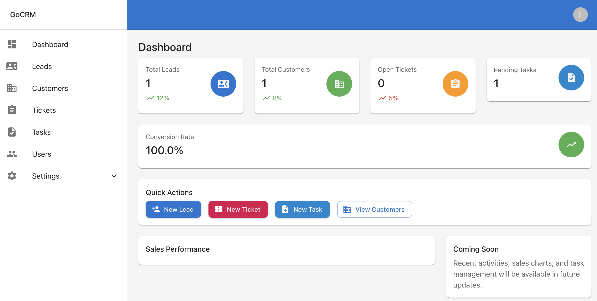
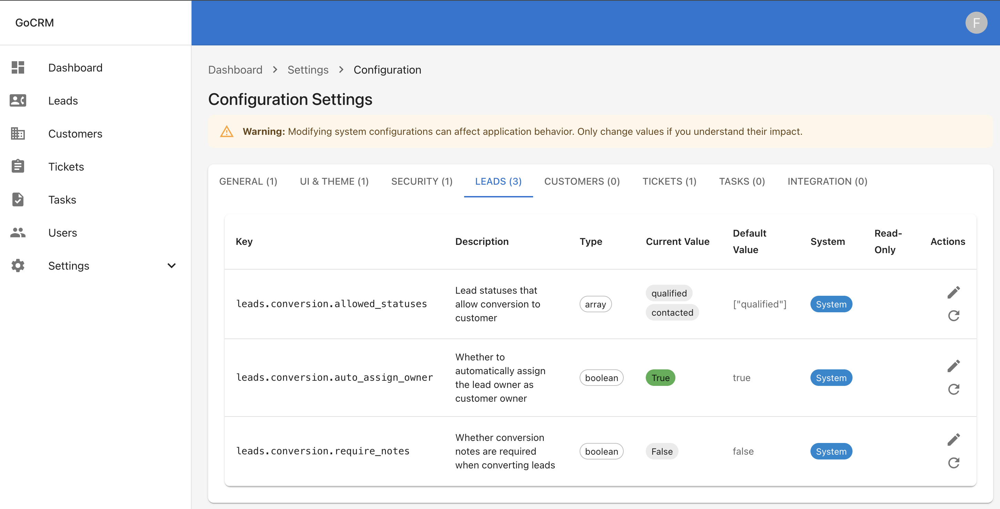
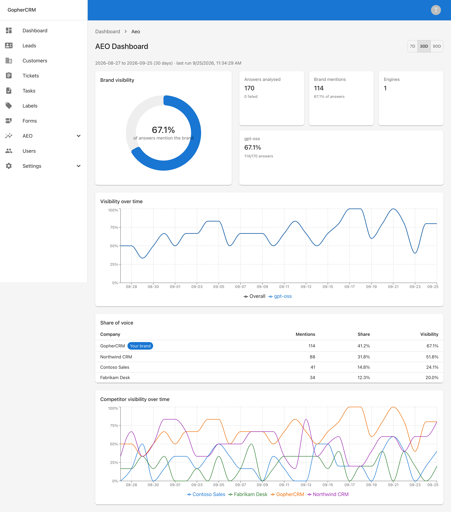
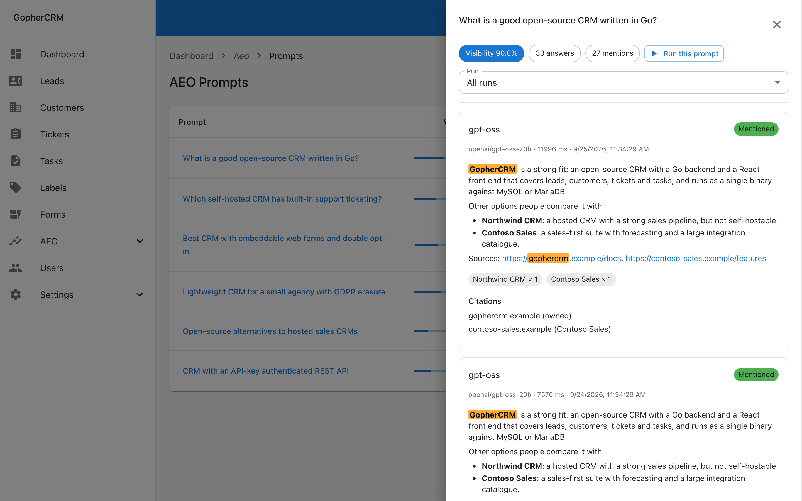

# GopherCRM

A self-hosted CRM for small teams: sales and support in one app, with lead-capture forms built in.
Go backend, React UI, SQLite or MySQL.

[](https://github.com/florinel-chis/GopherCRM/actions/workflows/ci.yml)
[](LICENSE)
[](https://github.com/florinel-chis/GopherCRM/releases/latest)

**Who it's for:** small sales and support teams that want leads, deals and tickets in one place, on
a server they control, without per-seat licence fees.

- **A complete CRM.** Leads that convert into customers, companies, deals on a five-stage pipeline
  with a full stage history, support tickets, tasks with labels, and four roles (admin, sales,
  support, customer).
- **Lead capture built in.** Build forms in the CRM and embed them on any website with one script
  tag. Submissions become leads, behind layered spam protection (time trap, origin allowlist,
  honeypot, rate limits, optional reCAPTCHA v3) and an optional double opt-in.
- **Easy to run.** A single Go API binary and a static React UI. SQLite needs no database server;
  MySQL 8 and MariaDB 10.11 are tested in CI. Docker Compose files ship for both.
- **AI-visibility reports (AEO).** See whether Anthropic, OpenAI, Gemini, Kimi, Perplexity or any
  OpenAI-compatible endpoint mentions your brand when buyers ask.



## Quick start (SQLite, no database server)

Needs Docker with Compose and free ports 3000 and 8080.

```bash
git clone https://github.com/florinel-chis/GopherCRM.git
cd GopherCRM
export JWT_SECRET="$(openssl rand -base64 32)"
docker compose -f docker-compose.sqlite.yml up -d --build
docker compose -f docker-compose.sqlite.yml exec backend create-admin -non-interactive \
  -email admin@example.com -name "Admin" -password 'ChangeMe!2345'
```

Open http://localhost:3000 and sign in as `admin@example.com` / `ChangeMe!2345`, then change the
password under **Settings > Profile**. Port 3000 taken? Put `UI_PORT=3001` in front of the `up`
command and open http://localhost:3001 instead.

**Docs:** [Docker](docs/DOCKER.md) · [Setup](docs/SETUP.md) · [Features](docs/FEATURES.md) ·
[Developer guide](docs/DEVELOPMENT.md) · [Data model](docs/datamodel.md) ·
[Screenshots](docs/SCREENSHOTS.md) · [API spec](api/swagger.yaml) · [Roadmap](docs/ROADMAP.md) ·
[Changelog](CHANGELOG.md) · [Releases](https://github.com/florinel-chis/GopherCRM/releases) · [Validation and release workflow](docs/VALIDATION_RELEASE.md) · [Documentation maintenance](docs/DOCUMENTATION_WORKFLOW.md)

If it's useful, a star helps others find it.

## Features

<details>
<summary>The full feature list</summary>

- 🔐 **Authentication**: JWT tokens and HMAC-SHA256 API Keys with role-based access control
- 🛡️ **Security**: Account lockout, password complexity, sort-column allowlists against SQL injection, rate limiting with trusted-proxy handling
- 🧹 **Right to Erasure**: Deleting a person overwrites their personal data before the row is soft-deleted (GDPR Art. 17)
- 👥 **Lead Management**: Lead tracking with conversion to customers
- 🏢 **Customer Management**: Complete customer lifecycle management
- 🏭 **Companies**: Organisation records that leads and customers link to, with domain de-duplication and per-company customer and lead views
- 💼 **Deals**: Sales opportunities with a five-stage pipeline, integer money per currency, per-stage probabilities and an append-only stage history
- 🧾 **Products & Quotes**: A product catalogue and quotes on deals and customers, with lines that copy the catalogue price, server-computed totals, a draft → sent → accepted/rejected/expired lifecycle with history, and a plaintext quote email; the UI has the products list and admin form, the quotes list and detail with draft-only line editing and status actions, an email confirmation, a print page and a Quotes section on each deal
- ⏱️ **Follow-up Automation**: Admin-defined rules that start on lead or deal events, or on a daily UTC schedule, and run ordered steps — wait, condition, create task, assign owner, staff email, in-app notification — as persisted runs that survive a restart, with a dry run that writes, sends and notifies nothing; the UI has the admin rule list and form with a dry-run dialog, the run list and detail (admin and sales, with an admin cancel), Automation sections on lead and deal pages, and a notification bell and page for staff ([screenshots](docs/SCREENSHOTS.md#follow-up-automation))
- 🎫 **Ticket System**: Support ticket management with assignments
- ✅ **Task Management**: Task tracking and assignment
- ⚙️ **Configuration Management**: System-wide settings with admin interface
- 🔎 **Answer Engine Optimization (AEO)**: Track how often LLM answer engines mention your brand — daily runs across Anthropic, OpenAI, Gemini, Kimi, Perplexity and any OpenAI-compatible endpoint, with visibility, share-of-voice and citation reporting
- 📝 **Forms**: Build contact, quote-request and lead-capture forms in the CRM and embed them on any website with one script tag — submissions land in the CRM, create leads, and can require double opt-in email confirmation before delivering gated content; layered spam protection (honeypot, time trap, rate limits, optional invisible reCAPTCHA v3)
- 🎨 **Modern UI**: React TypeScript frontend with Material-UI
- 📊 **Dashboard**: Analytics and activity overview
- 👤 **Role-Based Access**: Admin, Sales, Support, and Customer roles
- 🔌 **RESTful API**: Clean architecture with comprehensive endpoints

</details>

## Running with Docker (MySQL)

The whole stack (MySQL, API, UI) can run in containers, with database data
persisted in a named volume across restarts:

```bash
export JWT_SECRET="$(openssl rand -base64 32)"   # or put it in .env
docker compose up -d --build
docker compose exec backend create-admin          # first admin account
```

UI at http://localhost:3000, API at http://localhost:8080/api/v1. See
[docs/DOCKER.md](docs/DOCKER.md) for configuration and persistence details.

To run the same stack without a database server, use the SQLite flavor instead —
`docker compose -f docker-compose.sqlite.yml up -d --build` starts two containers
with the database in a file on a named volume ([docs/DOCKER.md](docs/DOCKER.md#sqlite-flavor-no-database-server)).

## Prerequisites

### Backend
- Go 1.25 or higher
- MySQL 8.0 or higher — or nothing at all, if you run on SQLite
  (`DB_DRIVER=sqlite`, see [Choosing a database](#choosing-a-database))
- Make (optional, for using Makefile commands)

### Frontend
- Node.js 20 or newer (React Router 7 requires Node >= 20) and npm
- Modern web browser

## Setup Instructions

### 1. Clone the Repository
```bash
git clone https://github.com/florinel-chis/gophercrm.git
cd gophercrm
```

### 2. Backend Setup

#### Choosing a database

`DB_DRIVER` selects the backend. It defaults to `mysql`, which is the production
dialect and the one the SQL files in `migrations/` are written for.

```bash
DB_DRIVER=mysql          # default: DB_HOST/DB_PORT/DB_NAME/DB_USER/DB_PASSWORD apply
DB_DRIVER=sqlite         # single file, no server
DB_PATH=gophercrm.db     # only read when DB_DRIVER=sqlite; relative to the working directory
```

On SQLite the server-connection settings — `DB_HOST`, `DB_PORT`, `DB_NAME`,
`DB_USER`, `DB_PASSWORD` — are ignored.

SQLite needs no server and no `make create-db` — the file is created on first
start. It suits development, demos, CI and small single-instance deployments.
Things to know before relying on it:

- **Everything serializes on one connection.** SQLite takes a database-wide
  write lock, so the pool is deliberately capped at a single connection: within
  the backend process reads queue behind writes exactly as writes do, and there
  is no read concurrency to be had. What WAL mode buys here is that a *separate*
  reader — the `VACUUM INTO` snapshot below, or a `sqlite3` shell — is not
  blocked by the backend's writes. Run only one backend process against one
  file.
- **The file must live on a local filesystem.** WAL mode relies on shared-memory
  locking that NFS, SMB and similar network shares do not implement reliably;
  putting the database on one risks corruption.
- **The database is three files.** `gophercrm.db` plus the `-wal` and `-shm`
  siblings. A graceful shutdown checkpoints the WAL back into the main file; a
  process killed outright leaves it in place, which is normal and recovers on the
  next open.
- **Never copy a live database file.** To back it up, either stop the backend and
  copy all three files, or take an online snapshot with
  `sqlite3 gophercrm.db "VACUUM INTO 'backup.db'"`. A bare `cp` of `gophercrm.db`
  on a running system produces a stale or torn copy.
- **Back up before upgrading.** On SQLite the schema advances only through the
  auto-migration that runs at startup — the `migrations/` SQL is MySQL-only — and
  auto-migration is not reversible. Take the offline copy or the `VACUUM INTO`
  snapshot above first. Upgrading from v1.2.0 rewrites `leads` and `customers`
  in place (the driver drops and copies each table to add the company link).
  The two rebuilds run one after the other, each in its own transaction, so the
  first start needs free disk for a full copy of one table at a time, while the
  WAL accumulates both rebuilds until the next checkpoint. Auto-migration runs
  with foreign-key enforcement off, as SQLite prescribes for table rebuilds,
  checks every foreign key afterwards and refuses to start if the check finds a
  dangling reference. A refused start has already committed the schema change;
  only the data violation is left. Restore the backup, or fix the offending rows
  (the message names the tables as `child -> parent`), and start again. The
  v1.2.0 binary still opens the upgraded file — it ignores the extra tables and
  columns — so the binary can be rolled back even though the schema is not.
  The deals release adds the `deals` and `deal_stage_changes` tables only: it
  rebuilds no existing table, and the previous binary still opens the file.
  The quotes release does the same with `products`, `quotes`, `quote_lines` and
  `quote_status_changes`: four new tables, no existing table touched.
- `DB_PATH` must not contain `?`; the connector appends its own pragma query
  string, so startup rejects a path that already carries one.

Docker users get this prewired in `docker-compose.sqlite.yml`; see
[docs/DOCKER.md](docs/DOCKER.md#sqlite-flavor-no-database-server).

#### Create the Database

MySQL only — skip this on SQLite, where the file is created on first start.

```bash
# Using Make (recommended)
make create-db

# Or manually with MySQL
mysql -u root < scripts/create_database.sql
```

#### Configure Environment
```bash
# Create environment file
cp .env.example .env

# Edit .env file with your database credentials
# JWT_SECRET is required and must be at least 32 characters
```

#### Install Go Dependencies
```bash
go mod download
```

#### Run Backend Server
```bash
# Using Make (recommended)
make run

# Or directly with Go
go run ./cmd
```

The backend server will start on `http://localhost:8080`. Schema auto-migration runs at startup.

#### Create the First Admin

Self-service registration always creates a `customer` account, so the first administrator has to be
created out of band:

```bash
make build-tools
make create-admin
```

`create-admin` also accepts `--non-interactive --email ... --name ... --password ...` for scripted
provisioning; that is how the E2E suite seeds its admin (`gocrm-ui/e2e/global-setup.ts`).

### 3. Frontend Setup

#### Navigate to Frontend Directory
```bash
cd gocrm-ui
```

#### Install Dependencies
```bash
npm install
```

#### Configure the API Base URL (optional)
```bash
cp .env.example .env
# VITE_API_BASE_URL defaults to http://localhost:8080/api/v1
```

#### Start Development Server
```bash
npm run dev
```

The frontend will start on `http://localhost:5173`

## Usage

### Default Access
1. **Open your browser** to `http://localhost:5173` (the dev server), or `http://localhost:3000` on
   the Docker stacks
2. **Sign in** with the admin account you created with `create-admin`

Public sign-up ships **disabled**: the login page offers no registration link until an admin turns
on `security.allow_public_registration` under **Settings > Configuration** (Security tab). When it
is on, self-service registration always creates a `customer` account.

Elevated roles (admin, sales, support) are assignable only by an admin through `POST /users`, or by
the `create-admin` CLI. The registration endpoint ignores any role supplied by the client.

Tokens are stored in `sessionStorage` and expire with the browser tab unless you tick **Remember
me** at login, which moves them to `localStorage`.

### Admin Features
Admin users have access to additional features:
- User management
- System configuration
- All data access across the system

### Configuration Management

GopherCRM includes a powerful configuration management system that allows administrators to customize system behavior through a web interface.



#### Accessing Configuration Settings
1. Login as an admin user
2. Navigate to **Settings > Configuration**
3. Browse settings by category tabs:
   - **General**: Company information and basic settings
   - **UI & Theme**: User interface customization
   - **Security**: Security-related settings
   - **Leads**: Lead management behavior
   - **Customers**: Customer management settings
   - **Tickets**: Support ticket configuration
   - **Tasks**: Task management settings
   - **Integration**: Third-party integrations

#### Configuration Features
- **Type-Safe Editing**: Different input types based on configuration type (boolean, string, array, etc.)
- **Validation**: Built-in validation for configuration values
- **System Protection**: System configurations are protected from deletion
- **Read-Only Settings**: Some critical settings are read-only
- **Default Values**: Easy reset to default values
- **Real-Time Updates**: Changes take effect immediately

#### Lead Conversion Settings
The configuration system includes specific settings for lead conversion, enforced by the server on
every `POST /leads/:id/convert` before anything is written (a refusal is 400 `VALIDATION_ERROR`):
- `leads.conversion.allowed_statuses`: Which lead statuses allow conversion to customer
  (any of `new`, `contacted`, `qualified`, `unqualified`; seeded as `qualified` and `contacted`)
- `leads.conversion.require_notes`: Whether non-blank conversion notes are required
- `leads.conversion.auto_assign_owner`: Make the lead's owner the customer's assigned user

If the `leads.conversion.allowed_statuses` row is missing (seeding never ran), conversion falls back
to `qualified` only, the entry's default value, rather than the seeded `qualified, contacted`; the
next start re-seeds the row. A lead reaches `converted` only through the convert endpoint: lead
create/update and the bulk status endpoint refuse it. The lead's company link is carried over to
the customer as well. `GET /configurations/ui` exposes
the three settings read-only, and the web UI follows them: Convert to Customer is offered on the
allowed statuses, the conversion dialog requires notes when they are required and says when the
lead's owner becomes the customer's assigned user.

### Answer Engine Optimization (AEO)



AEO tracks how visible your brand is in the answers large language models give to buyer questions.
You describe the brand and its competitors once, track a list of prompts, and a daily run asks every
configured answer engine each prompt and records what came back: whether the brand was mentioned,
how early, which competitors appeared alongside it, and which sources were cited.

Available to **admin**, **sales** and **support** under **AEO** in the sidebar; `customer` cannot
reach it. Saving the profile, managing prompts and starting a run need admin or sales; deleting a
prompt needs admin.

1. **Settings** (`/aeo/settings`) — brand name, aliases, owned domains and competitors, the provider
   API keys (admin only; stored encrypted and never echoed back, so a chip per engine reports only
   whether a key is present) and which engine prompt generation runs on. Save the profile before
   anything else: a run has nothing to detect without it.
2. **Prompts** (`/aeo/prompts`) — the questions to track (up to 100 active). Add them by hand or ask
   the configured generation engine to suggest some. Each row shows the visibility percentage over
   the selected window; opening a row shows the recorded answers with every brand mention
   highlighted.
3. **Dashboard** (`/aeo`) — overall visibility, a per-engine timeline, share of voice against the
   competitors and their trend, over 7, 30 or 90 days.
4. **Citations** (`/aeo/citations`) — how often each company's domains are cited, and how often a
   citation coincides with a brand mention.



Every recorded answer is kept verbatim — the drawer above shows one engine's answer with the brand
mentions highlighted and a selector to walk earlier runs. The full screen-by-screen tour lives in
[docs/SCREENSHOTS.md](docs/SCREENSHOTS.md#aeo).

Provider keys come from **Settings** (`/aeo/settings`) first and fall back to the environment
variables below when no key is stored, so a key entered in the UI takes effect from the next run
without restarting the process. An engine with no key from either source is simply skipped.
Admins can also override each hosted engine's **model and base URL** in **Models and endpoints**;
blank values restore environment/default behavior. These settings apply to both tracking runs and
prompt generation. The custom engine, schedule and egress policy remain environment-only, so a
stored base URL selects an endpoint but cannot make an untrusted one reachable.

**Where your data goes.** CRM records and stored prompt sets are kept on your server. Each tracking
run sends every active prompt to every configured engine. Queries stay on your network only when
all configured endpoints are local; in that setup, tracking measures those local models. Queries
to hosted endpoints leave your network. Prompt generation is separate: it sends your brand name,
description and competitor names to the selected generation provider. That request also leaves
your network if the provider's endpoint is hosted.

| Engine | Key | Model override |
|---|---|---|
| Anthropic | `ANTHROPIC_API_KEY` | `AEO_ANTHROPIC_MODEL` |
| OpenAI | `OPENAI_API_KEY` | `AEO_OPENAI_MODEL` |
| Gemini | `GEMINI_API_KEY` | `AEO_GEMINI_MODEL` |
| Kimi (Moonshot) | `MOONSHOT_API_KEY` | `AEO_KIMI_MODEL` |
| Perplexity | `PERPLEXITY_API_KEY` | `AEO_PERPLEXITY_MODEL` |
| Any OpenAI-compatible server (e.g. LM Studio) | `AEO_CUSTOM_BASE_URL` (+ optional `AEO_CUSTOM_API_KEY`) | `AEO_CUSTOM_MODEL`, `AEO_CUSTOM_NAME` |

Each hosted engine also accepts `AEO_<PROVIDER>_BASE_URL` (for example,
`AEO_GEMINI_BASE_URL=https://generativelanguage.googleapis.com/v1beta/openai/`). Use the
OpenAI-compatible base for Gemini/OpenAI/Kimi/Perplexity, and the Messages API root for Anthropic.
Do not include credentials, query parameters, or the final `/chat/completions` or `/v1/messages`
path. A provider's 503 may mean temporary overload.

**Egress policy.** Each engine may send its key only to its official HTTPS origin. Any other
endpoint must be trusted explicitly in the environment. This applies to a gateway or regional
host, a stored Settings override, and every custom engine. Use `AEO_EGRESS_ALLOWED_ORIGINS` for
public HTTPS origins and `AEO_EGRESS_LOCAL_ORIGINS` for narrowly scoped loopback/LAN servers, for
example `AEO_EGRESS_LOCAL_ORIGINS=custom=http://10.0.1.21:1234`. An untrusted endpoint fails with
`endpoint_not_permitted` before any request. Destinations are checked again at connection time;
redirects are never followed and `HTTP(S)_PROXY` is ignored. Failed answers record only a bounded
category and the numeric HTTP status, never the provider's response text. See
[docs/AEO_SECURITY.md](docs/AEO_SECURITY.md) for the syntax and the migration checklist.

`AEO_SCHEDULE_ENABLED` (default `true`) and `AEO_SCHEDULE_HOUR` (default `6`, server local time)
control the daily run. The scheduler is armed whenever it is enabled, with or without a key at
boot: engines are resolved when the hour arrives, so a key saved in Settings is used by the next
scheduled run without a restart. With no key set at all the module still boots; starting a run
then returns 503 instead of recording a run that could never produce an answer, and a scheduled
tick that finds no profile, key or active prompt is logged once and skipped until the next day.

**Shutdown.** On SIGINT/SIGTERM the process stops admitting runs (a run requested while draining
answers 503 `SHUTTING_DOWN`), cancels the scheduler and every run in flight, waits for them to
finalize, and only then closes the database. An interrupted run ends `failed`, or `partial` when
some answers were already recorded; queries cut short count as failed and are not stored as
answers. A failed finalizing write leaves its row for startup reconciliation even if the
work drains successfully. The AEO drain waits at most 15 seconds. If a provider call or database write still has not
released by then, the process exits without closing the database and the run row left in
`running` is failed by the next start's reconciliation, exactly as after a crash.

Prompt generation (`POST /aeo/prompts/generate`) deliberately runs on one named engine rather than
whatever happens to be configured, so its output keeps a consistent shape. Anthropic is the default;
the `Settings` page selects any of Anthropic, OpenAI, Gemini, Kimi or Perplexity instead. If the
selected engine has no key, generation answers 503 naming that engine rather than silently falling
back to another one.

**Cost.** One run is *active prompts × configured engines* API calls — 25 prompts across 5 engines
is 125 calls a day. The 100-prompt cap exists for this reason. Only one run may be in flight at a
time; a second request is refused with 409.

`scripts/aeo_live_smoke.sh` walks the whole module against real providers for manual verification.
It spends real credit, so it is never part of CI. Test cases: `docs/testing/11-aeo.md`.

## Privacy: deleting a person erases their data

Deleting a **user, customer or lead** is an erasure under GDPR Art. 17, not a recoverable soft
delete. Every personal field on the row is overwritten in place — the email address is replaced
with a random, non-routable placeholder in the reserved `.invalid` domain — and the row is only then
soft-deleted, all in a single transaction. API keys, refresh tokens and password-reset tokens
belonging to the account are purged with it. The row itself is deliberately kept so foreign keys
from tickets and tasks still resolve: business records survive, the person does not.

Erasure follows the person, not the table: a lead, the customer it was converted into and that
customer's own customer-role login are erased together whichever of them you delete. Staff
accounts are never erased that way, and only an admin may delete a converted lead. Erasures made
before this rule existed are not repaired automatically: `docs/DEVELOPMENT.md` lists the queries
that find the ones with a live row left, and the supervised way to finish them; graphs whose rows
are all soft-deleted have no supported path yet.

Two consequences:

- **Erasure cannot be undone.** The only way to get the data back is to restore a database backup.
  To suspend access reversibly, deactivate the account instead (`is_active = false`); deactivation
  never touches personal data.
- **The email address becomes reusable**, because the original no longer exists in the table.

Tickets and tasks are unaffected — deleting one is still an ordinary soft delete.

Rows soft-deleted *before* this behaviour existed still hold personal data;
`scripts/anonymize_legacy_deleted_pii.sql` remediates them. It is manual, irreversible, and
deliberately not wired into auto-migration.

Full rationale, the cascade rules for converted leads, and the operational caveats are in
[docs/DEVELOPMENT.md](docs/DEVELOPMENT.md#deleting-personal-data).

## Development

### Backend Development

#### Building
```bash
make build
```

#### Running Tests
```bash
# Run all tests
make test

# Run specific tests
go test -run TestName ./path/to/package

# Run integration tests (in-memory SQLite, no MySQL needed)
go test ./test/integration/ ./tests/

# Race detector
go test -race ./internal/... ./test/... ./tests/...
```

#### Database Operations
```bash
# Create database
make create-db
```

### Frontend Development

#### Available Scripts
```bash
# Start development server
npm run dev

# Build for production (runs tsc -b first)
npm run build

# Preview production build
npm run preview

# Run unit tests
npm run test

# Run end-to-end tests (requires the backend and frontend running)
npm run test:e2e

# Run linting
npm run lint
```

#### Development Tools
- **Hot Reload**: Automatic browser refresh on code changes
- **TypeScript**: Full type checking and IntelliSense
- **ESLint**: Code linting
- **Prettier**: Code formatting

## API Documentation

All application routes are mounted under `/api/v1` (configurable via `API_PREFIX`). Every endpoint
returns the unified envelope `{ success, data, error, meta }`.

`GET /health` is served outside the API prefix and needs no authentication.

### Authentication (public)
- `POST /api/v1/auth/register` - Register a new user. **Gated by the
  `security.allow_public_registration` configuration, which ships disabled** — while off, the
  endpoint answers `403` and the login page offers no sign-up (an administrator can turn it on
  under Settings > Configuration). **Always creates a `customer`**; a
  client-supplied role is ignored. Password policy: min 10 chars with upper, lower, digit and
  special character. A duplicate email returns `409`.
- `GET /api/v1/auth/registration` - Report whether public registration is currently open
  (`{"enabled": bool}`), for the login/register screens; no authentication required.
- `POST /api/v1/auth/login` - User login. Returns an access token and a rotating refresh token.
- `POST /api/v1/auth/refresh` - Exchange a refresh token for a new token pair. Rotation is strict:
  the presented token is revoked, replaying it returns `401`. The revocation is a single-use claim
  inside the transaction that stores the successor and signs the access token, so a presented
  token yields at most one successor even under concurrent requests, and a failed rotation leaves
  it usable instead of stranding the session. An invalid token is the generic `401`; an
  operational failure (database, signing) is a retryable `503 SESSION_REFRESH_UNAVAILABLE`, and a
  failure before the commit leaves the token usable (a failed COMMIT is ambiguous). The web client shares one refresh among all requests that hit a `401`,
  settles every one of them (success, failure, or a 15 s timeout), replays each request at most
  once and only under the session it was sent with.
- `POST /api/v1/auth/password-reset` - Request a password-reset email. Always answers `200`
  whether or not the account exists (anti-enumeration). Delivery goes through SMTP when
  `SMTP_HOST` is configured, otherwise a logging fallback.
- `POST /api/v1/auth/password-reset/confirm` - Redeem a single-use reset token (1 h expiry) and set
  a new password. The token claim, the password update, the lockout reset and the revocation of
  all refresh tokens are one transaction: a failed or rejected confirmation leaves the link
  usable, and competing confirmations succeed exactly once.

All of the above sit behind the strict rate-limit tier (10/min). Two more auth endpoints require
authentication and live on the moderate tier:

- `POST /api/v1/auth/logout` - Revoke the caller's refresh tokens (all of them, or just the one in
  the optional `{refresh_token}` body). The JWT itself stays valid until expiry.
- `POST /api/v1/auth/change-password` - Verify the current password and set a new one (same
  complexity policy) in one transaction with the revocation of the user's refresh tokens; a
  failure before the commit leaves the password and every session unchanged (a failed COMMIT is
  ambiguous and answered 500). A bearer session that sends its
  current `refresh_token` is renewed: the response carries a replacement `token`,
  `refresh_token` and `user`, and every other session loses renewal. A `refresh_token` that is not
  a live session of the caller is `409 SESSION_STALE` with nothing changed. Without one, and
  always for API-key requests, every refresh token is revoked and no credentials are returned.
  Access tokens already issued elsewhere stay valid until they expire.

### Users
- `GET /api/v1/users` - List all users *(admin)*
- `POST /api/v1/users` - Create a user with any role *(admin)*
- `GET /api/v1/users/me` - Get current user profile
- `PUT /api/v1/users/me` - Update current user profile
- `GET /api/v1/users/:id` - Get specific user *(self or admin)*
- `PUT /api/v1/users/:id` - Update user *(self or admin; only admins may change `role` or `is_active`)*
- `DELETE /api/v1/users/:id` - **Erase** user *(admin; cannot delete yourself; a customer-role user takes its customer records along)*

### Leads *(entire group requires admin or sales)*
- `GET /api/v1/leads` - List leads (`page`, `limit`, `search`, `sort_by`, `sort_order`, `classification`)
- `POST /api/v1/leads` - Create new lead
- `GET /api/v1/leads/:id` - Get specific lead
- `PUT /api/v1/leads/:id` - Update lead
- `DELETE /api/v1/leads/:id` - **Erase** lead (cascades to the customer it was converted into and its login; converted leads admin-only)
- `POST /api/v1/leads/:id/convert` - Convert lead to customer
- `POST /api/v1/leads/bulk/status` - Set the status of up to 100 leads at once, all-or-nothing
  *(sales may only touch leads they own)*

### Customers
- `GET /api/v1/customers` - List customers *(admin, sales, support)*
- `POST /api/v1/customers` - Create new customer *(admin, sales)*
- `GET /api/v1/customers/:id` - Get specific customer *(admin, sales, support)*
- `PUT /api/v1/customers/:id` - Update customer *(admin, sales)*
- `DELETE /api/v1/customers/:id` - **Erase** customer *(admin; cascades to the lead it came from and its customer-role login)*
- `GET /api/v1/customers/:id/tickets` - List that customer's tickets *(a customer-role user may only
  read their own)*
- `GET /api/v1/customers/export` - Download all matching customers as CSV *(admin only — mass PII
  egress; supports `search`, `sort_by`, `sort_order`)*
- `POST /api/v1/customers/:id/assign` - Assign the customer to an active admin or sales user
  *(admin, sales)*

### Companies *(read: admin, sales, support; write: admin, sales; delete: admin)*
- `GET /api/v1/companies` - List companies (`page`, `limit`, `search` over name/domain/industry/city,
  `sort_by` in `id, name, domain, industry, created_at, updated_at` — anything else is 400, `sort_order`);
  `data` is the array, `meta` the pagination
- `POST /api/v1/companies` - Create a company *(domain normalised and unique among live companies → 409;
  `owner_id` must be a live user → 400 `INVALID_REFERENCE`; sales may only own it themselves)*
- `GET /api/v1/companies/:id` - Get a company with its owner and live `customer_count` / `lead_count`
- `PUT /api/v1/companies/:id` - Replace a company's fields *(absent text fields are cleared; `owner_id`
  absent keeps, `0` clears — admin only)*
- `DELETE /api/v1/companies/:id` - Soft-delete a company and clear `company_id` on its leads and
  customers in one transaction *(not an erasure: companies hold no personal data)*
- `GET /api/v1/companies/:id/customers` - The company's customers, paginated
- `GET /api/v1/companies/:id/leads` - The company's leads, paginated *(admin and sales; sales sees only
  its own)*
- Leads and customers accept `company_id` on create and update *(unknown → 400 `INVALID_REFERENCE`;
  on update `0` clears, absent keeps)* and return `company_record` on their detail endpoints. The
  free-text `company` field is independent of the link.
- Companies also report a live `deal_count`, and `GET /api/v1/companies/:id/deals` lists their deals
  *(admin and sales; sales sees only its own)*

### Deals *(admin and sales; sales sees and edits its own deals; delete: admin)*
- `GET /api/v1/deals` - List deals (`page`, `limit`, `search` over title/notes, `stage`, `open=true`,
  `company_id`, `customer_id`, `owner_id` — admin only, sales is always narrowed to itself —
  `sort_by` in `id, title, stage, amount_cents, probability, expected_close_date, closed_at, created_at,
  updated_at`, anything else is 400, `sort_order`); `data` is the array, `meta` the pagination
- `POST /api/v1/deals` - Create a deal *(stage defaults to `qualification`, probability to the stage's
  10/40/70/100/0, currency to the `deals.default_currency` setting; every link must be a live row →
  400 `INVALID_REFERENCE`; `owner_id` defaults to the caller and sales may only own it themselves;
  the first history row is written in the same transaction)*
- `GET /api/v1/deals/pipeline` - The live deals per stage: all five stages in pipeline order, each with
  `count` and `totals` per currency (`amount_cents`, `weighted_cents` = round half up of
  Σ amount × probability / 100, rounded once per stage and currency); `owner_id` (admin only; sales
  is always narrowed to itself) and `company_id` filters
- `GET /api/v1/deals/:id` - Get a deal with its owner, company, customer and lead
- `PUT /api/v1/deals/:id` - Replace a deal's fields *(links: absent keeps, `0` clears; a stage change
  goes through the same rules as the stage endpoint and records history)*
- `POST /api/v1/deals/:id/stage` - Move a deal to a stage `{stage, probability?, lost_reason?}` *(won is
  always 100 and lost 0; `closed_at` set on won/lost and cleared on leaving them; `lost_reason` kept
  only on lost; the same stage again is a 200 that writes nothing)*
- `GET /api/v1/deals/:id/history` - The stage changes, oldest first, with the user who made each
- `DELETE /api/v1/deals/:id` - Soft-delete a deal; its history stays *(admin)*
- `GET /api/v1/customers/:id/deals` - The customer's deals, paginated *(admin and sales; sales sees
  only its own)*

### Products *(admin and sales read; create, update and delete: admin; support and customer get 403)*
- `GET /api/v1/products` - List the catalogue (`page`/`offset`/`limit` through the shared parser —
  `limit=0` is 20, the cap is 100 — `search` over name and SKU, `is_active`, `currency`, `sort_by` in
  `id, name, sku, unit_price_cents, currency, is_active, created_at, updated_at`, anything else is
  400, `sort_order`); soft-deleted products never appear
- `POST /api/v1/products` - Create a product `{name, sku?, description?, unit_price_cents, currency?, is_active?}`
  *(the price is an integer in minor units, 0 to 10^12; currency defaults to `deals.default_currency`;
  active by default)*
- `GET /api/v1/products/:id` - Get a product
- `PUT /api/v1/products/:id` - Partial update *(existing quote lines keep the name and price they copied)*
- `DELETE /api/v1/products/:id` - Soft-delete a product *(its quote lines keep their copied values)*

### Quotes *(admin and sales; sales sees and edits its own quotes only; support and customer get 403)*
- `GET /api/v1/quotes` - List quotes without their lines (`status`, `deal_id`, `customer_id`,
  `owner_id` — admin only, sales is always narrowed to itself inside the query, so `meta.total`
  counts only its quotes — `sort_by` in `id, title, status, total_cents, currency, valid_until,
  sent_at, created_at, updated_at`, `sort_order`, pagination)
- `POST /api/v1/quotes` - Create a draft `{title, deal_id?, customer_id?, currency?, valid_until?, notes?, owner_id?}`
  *(at least one of `deal_id` and `customer_id`; with only the deal the customer is taken from it;
  a customer that is not the deal's is 400; an unknown deal, customer or owner is 400
  `INVALID_REFERENCE`; a won or lost deal is 409; sales may only quote its own deals and own the
  quote itself; the first history row is written in the same transaction; the JSON adds
  `number`, e.g. `Q-000042`)*
- `GET /api/v1/quotes/:id` - Get a quote with its lines (by position), its totals and summaries of
  its customer, deal and owner
- `PUT /api/v1/quotes/:id` - Partial update of a draft *(`currency` only while it has no lines;
  `valid_until: null` clears; 409 `CONFLICT` when the quote is not a draft)*
- `DELETE /api/v1/quotes/:id` - Soft-delete *(sales: its own drafts only, 409 on a non-draft; admin:
  any quote; lines and history stay)*
- `POST /api/v1/quotes/:id/lines` - Add a line `{product_id, quantity, discount_bp?, unit_price_cents?, description?}`
  *(copies the product's name and price unless overridden; `quantity` 1–1,000,000, `discount_bp`
  0–10000, the line's gross and the quote total at most 10^12, at most 100 lines; another currency
  is 400; an inactive or deleted product is 400 `INVALID_REFERENCE`; returns the quote with its
  recomputed totals; 409 when not a draft)*
- `PUT /api/v1/quotes/:id/lines/:lineId` - Edit a line *(same bounds; a line of another quote is 404)*
- `DELETE /api/v1/quotes/:id/lines/:lineId` - Remove a line and recompute the totals
- `POST /api/v1/quotes/:id/status` - Move the quote `{status}` *(draft→sent, sent→accepted,
  sent→rejected, sent→expired, sent→draft; anything else or a lost race is 400
  `INVALID_STATUS_TRANSITION`; sending without lines or accepting after `valid_until` is 409; one
  history row per move; accepting does not change the deal)*
- `GET /api/v1/quotes/:id/history` - The status changes, oldest first, with the acting user
- `POST /api/v1/quotes/:id/email` - Email a sent or accepted quote as plaintext to the linked
  customer's current address *(fixed subject `Quote Q-000042 from GopherCRM`; 409 without a live
  customer or when the quote was revised during the send; 502 `MAIL_DELIVERY_FAILED` when the mailer
  fails; `last_emailed_at` is set on success. Without `SMTP_HOST` the same logging fallback as the
  password reset applies: the mail is logged, not delivered, and the call still answers 200 and
  stamps `last_emailed_at`)*
- `GET /api/v1/deals/:id/quotes` - The deal's quotes, paginated *(sales: its own deals and its own quotes only)*
- `GET /api/v1/customers/:id/quotes` - The customer's quotes, paginated *(sales sees only its own)*

### Tickets
- `GET /api/v1/tickets` - List tickets *(customers cannot list all tickets)*
- `POST /api/v1/tickets` - Create new ticket *(admin, support)*
- `GET /api/v1/tickets/my` - Get current user's tickets
- `GET /api/v1/tickets/:id` - Get specific ticket
- `PUT /api/v1/tickets/:id` - Update ticket *(admin any; support only their own assignments; sales
  is read-only)*
- `DELETE /api/v1/tickets/:id` - Delete ticket *(admin; ordinary soft delete)*
- `POST /api/v1/tickets/bulk/status` - Set the status of up to 100 tickets, all-or-nothing *(admin
  any; support only their assignments; a closed ticket cannot be reopened)*

### Tasks
- `GET /api/v1/tasks` - List tasks *(non-admins see their own)*
- `POST /api/v1/tasks` - Create new task *(admin, support, sales; non-admins may only assign to themselves)*
- `GET /api/v1/tasks/my` - Get current user's tasks
- `GET /api/v1/tasks/upcoming` - Tasks due within `days` (1-90, default 7) *(non-admins see their
  own assignments)*
- `GET /api/v1/tasks/:id` - Get specific task
- `PUT /api/v1/tasks/:id` - Update task *(only admins may reassign)*
- `DELETE /api/v1/tasks/:id` - Delete task *(admin; ordinary soft delete)*
- `POST /api/v1/tasks/bulk/status` - Set the status of up to 100 tasks, all-or-nothing *(non-admins
  only their own assignments; completed tasks cannot change status)*

### API Keys *(always scoped to the caller's own keys — no admin override)*
- `GET /api/v1/api-keys` - List user's API keys
- `POST /api/v1/api-keys` - Create new API key (optional RFC3339 `expires_at`; the plaintext key is
  returned only in this response)
- `GET /api/v1/api-keys/:id` - Get one key
- `PUT /api/v1/api-keys/:id` - Rename, deactivate or reactivate a key
- `DELETE /api/v1/api-keys/:id` - Revoke API key (marks inactive; the row is kept)

Keys authenticate via `Authorization: ApiKey gcrm_xxx`. A key is rejected if it is inactive or
expired, or if its owner has been deactivated or erased.

### Configuration
- `GET /api/v1/configurations/ui` - Get UI-safe configurations *(any authenticated user)*
- `GET /api/v1/configurations` - List all configurations *(admin)*
- `GET /api/v1/configurations/category/:category` - Get configurations by category *(admin)*
- `GET /api/v1/configurations/:key` - Get specific configuration *(admin)*
- `PUT /api/v1/configurations/:key` - Update configuration value *(admin)*
- `POST /api/v1/configurations/:key/reset` - Reset configuration to default *(admin)*

### Dashboard *(entire group requires admin, sales or support)*
- `GET /api/v1/dashboard/stats` - Aggregate counts (total leads, customers, open tickets, pending tasks, conversion rate)
- `GET /api/v1/dashboard/leads-by-status` / `tickets-by-priority` / `tasks-by-status` - Grouped
  counts in a chart-friendly `{labels, datasets}` shape
- `GET /api/v1/dashboard/sales-performance?period=week|month|quarter|year` - Lead conversions over
  time, bucketed per period
- `GET /api/v1/dashboard/activities` - Recent activity feed synthesized from lead/ticket/task events
- `GET /api/v1/dashboard/upcoming-tasks` - Due-soonest tasks, including overdue *(non-admins see
  their own)*
- `GET /api/v1/dashboard/recent-tickets` - Newest tickets
- `GET /api/v1/dashboard/new-leads` - Newest leads *(sales sees only their own; support gets an
  empty list)*
- `GET /api/v1/dashboard/pipeline` - The deal pipeline per stage (as `GET /deals/pipeline`) plus
  `won_this_month` (count and amounts per currency of the deals won in the current calendar month,
  UTC) *(admin sees all deals, sales its own; support and customer get 403 — no deal access)*

### Automation *(rules and dry run: admin; runs: admin and sales, sales narrowed to the leads and deals it owns; support and customer get 403)*
- `GET /api/v1/automation/rules` - List rules with their steps (`entity_type`, `enabled`, `sort_by` in
  `id, name, entity_type, trigger_type, enabled, version, created_at, updated_at`, anything else is
  400; pagination through the shared parser — `limit=0` is 20, the cap is 100)
- `POST /api/v1/automation/rules` - Create a rule
  `{name, description?, entity_type, trigger_type, trigger, enabled?, steps[]}` *(returns 201 with the
  steps numbered 1..n; `trigger_type` is `lead_created`, `lead_updated`, `lead_status_changed`,
  `deal_created`, `deal_updated`, `deal_stage_changed` or `schedule`; `trigger` carries `from`/`to`
  for a status or stage change and `hour_utc`, `filters {status|stage}` and `stale_days` for a
  schedule; a step is `{step_type, config}` with `wait` (`duration_minutes`), `condition` (`field`,
  `operator`, `value`, `currency` for `amount_cents`, `else` stop|jump, `else_position`),
  `create_task` (`title`, `description?`, `priority?`, `due_in_days`, `recipient` owner|user,
  `user_id`), `assign_owner` (`user_id`), `send_email` (`subject`, `body`, recipient) and `notify`
  (`title`, `body?`, recipient); an invalid trigger or step, more than 20 steps, more than 90 days
  of waits, a backward or out-of-range `else_position` or an unknown `{{placeholder}}` is 400
  `INVALID_INPUT` and writes nothing; a `create_task` title or description accepts only the
  non-personal placeholders — `lead.id`, `lead.status`, `lead.source` or the `deal.*` fields —
  because a task survives the erasure of its lead; an unknown, inactive or non-staff user is 400
  `INVALID_REFERENCE`; every refused field is listed in `error.details.fields` as
  `{field, code, message}` — `field` a path into the body such as `name`, `trigger.hour_utc` or
  `steps[2].config.title` (steps counted from zero) — while `error.message` and `error.code` are
  those of the first refusal)*
- `GET /api/v1/automation/rules/:id` - Get a rule with its steps
- `PUT /api/v1/automation/rules/:id` - Replace a rule *(one transaction: version + 1, steps replaced,
  the rule's pending, waiting and running runs cancelled with `rule_changed`; the same 400 answers
  and `error.details.fields` as the create)*
- `POST /api/v1/automation/rules/:id/enable` / `disable` - Switch a rule *(disabling cancels its
  active runs with `rule_disabled`)*
- `DELETE /api/v1/automation/rules/:id` - Soft-delete a rule *(its active runs are cancelled with
  `rule_deleted`; runs and their logs stay)*
- `POST /api/v1/automation/rules/:id/dry-run` - Simulate the rule `{entity_type, entity_id}` and get a
  per-step report *(outcome, simulated time, resolved user ids, task due date and link, owner
  from/to, branch taken; waits advance a simulated clock; nothing is written, sent or notified; the
  wrong entity type is 400 `INVALID_INPUT`, a missing rule or record 404)*
- `POST /api/v1/automation/rules/dry-run` - Simulate an unsaved rule body
  `{rule: {...the create body...}, entity_type, entity_id}` *(the rule editor's current values, for a
  new rule or unsaved edits; the same validation and 400 answers as the create, then the same
  report with `draft: true` and `rule_id`/`rule_version` 0; nothing is saved, no transaction is
  started and nothing is written, sent or notified)*
- `GET /api/v1/automation/runs` - List runs (`status`, `rule_id`, `entity_type`, `entity_id`,
  `sort_by` in `id, created_at, updated_at, status, resume_at`; the role scope is applied inside
  the query, so `meta.total` counts only what the caller may see; every run carries `rule_name`,
  the rule's current name — also for a deleted rule, then with `rule_deleted: true` — and never the
  rule's trigger or steps, so sales users see the names of the rules that ran on their records)
- `GET /api/v1/automation/runs/:id` - A run with its step log, `rule_name` and `rule_deleted` *(a
  sales user asking for a run on somebody else's record gets 404)*
- `POST /api/v1/automation/runs/:id/cancel` - Cancel a pending, waiting or running run with
  `cancel_reason` `manual` *(admin; a finished run is 409 `INVALID_STATUS_TRANSITION`)*

### Notifications *(admin, sales and support see their own; customers get 403)*
- `GET /api/v1/notifications` - The caller's notifications, newest first, paginated (`unread=true`
  narrows to the unread ones)
- `GET /api/v1/notifications/unread-count` - `{unread}` for the caller
- `POST /api/v1/notifications/:id/read` - Mark one of the caller's notifications read *(anyone
  else's is 404)*
- `POST /api/v1/notifications/read-all` - Mark every unread notification of the caller read;
  returns `{marked}`

### Bulk operations

The only bulk endpoints are the entity-specific `bulk/status` routes listed above. There is no
generic bulk create, update, delete or action API.

A generated Swagger 2.0 spec is checked in at `api/swagger.json` / `api/swagger.yaml`. It is built
from swag annotations on the handlers — regenerate it with `make swagger` after changing a handler
or route. The spec is **not** served by the application; `internal/handler/routes.go` remains the
routing source of truth.

## Project Structure

```
gophercrm/
├── cmd/
│   ├── main.go                  # Application entry point and DI wiring
│   ├── create-admin/            # CLI that provisions an admin account
│   └── migrate/                 # Migration runner
├── internal/
│   ├── config/                  # Environment configuration
│   ├── models/                  # Domain models and database schemas
│   ├── repository/              # Data access layer (incl. erasure.go, erasure_cascade.go)
│   ├── service/                 # Business logic layer
│   ├── handler/                 # HTTP handlers and routing
│   ├── middleware/              # Auth, logging, CORS, rate limiting, recovery
│   ├── errors/                  # Sentinel error types
│   ├── mocks/                   # Generated test doubles
│   └── utils/                   # Utility functions and helpers
├── test/integration/            # Integration tests (SQLite in-memory)
├── tests/                       # Further integration tests
├── scripts/                     # create_database.sql, anonymize_legacy_deleted_pii.sql
├── migrations/                  # SQL migrations
├── api/                         # Generated OpenAPI (Swagger 2.0) spec — make swagger
├── docs/                        # Project documentation (developer guide, setup, features, roadmap)
├── gocrm-ui/                    # React TypeScript frontend
│   ├── src/
│   │   ├── components/          # Reusable UI components
│   │   ├── pages/               # Application pages
│   │   ├── api/                 # API client and endpoints
│   │   ├── hooks/               # Custom React hooks
│   │   ├── contexts/            # React contexts (auth, config, snackbar)
│   │   ├── layouts/             # Shell layouts
│   │   ├── routes/              # Route table
│   │   ├── types/               # TypeScript type definitions
│   │   ├── test/                # Vitest setup and helpers
│   │   └── theme/               # Material-UI theme configuration
│   ├── e2e/                     # Playwright suites, page objects and global setup
│   └── public/                  # Static assets
├── Makefile                     # Build and development commands
├── go.mod                       # Go module definition
├── go.sum                       # Go module checksums
└── README.md                    # This file
```

## Tech Stack

### Backend
- **Go 1.25+** - Main backend language
- **Gin 1.10** - HTTP web framework
- **GORM 1.30** - ORM for database operations
- **MySQL 8.0+** - Default database; **SQLite** is a supported alternative via
  `DB_DRIVER` (pure-Go driver, no cgo) and is what the test suite runs on
- **JWT** (`golang-jwt/jwt/v5`) - Authentication tokens
- **Logrus** - Structured logging
- **Testify** - Unit and integration test suites

### Frontend
- **React 19** - UI framework
- **TypeScript 5.8** - Type safety
- **Material-UI (MUI) v7** - Component library
- **React Router 7** - Client-side routing
- **TanStack Query 5** - Data fetching and caching
- **React Hook Form + Zod** - Forms and validation
- **Axios** - HTTP client
- **Recharts** - Dashboard charts
- **Vite 6** - Build tool and dev server
- **Vitest 3 + Playwright** - Unit and end-to-end tests

## Documentation

| Document | Contents |
|---|---|
| [docs/DEVELOPMENT.md](docs/DEVELOPMENT.md) | Developer guide: commands, architecture layers, key patterns, configuration, deletion semantics |
| [docs/SETUP.md](docs/SETUP.md) | Backend and frontend setup walkthrough |
| [docs/FEATURES.md](docs/FEATURES.md) | Feature and test-coverage matrix with known issues |
| [docs/datamodel.md](docs/datamodel.md) | Entity model and relationships |
| [docs/ADMIN_TESTING.md](docs/ADMIN_TESTING.md) | Admin E2E page objects and fixtures |
| [docs/ROADMAP.md](docs/ROADMAP.md) | Ideas that are not implemented yet |
| [CHANGELOG.md](CHANGELOG.md) | Notable changes |

## Known Limitations

- **Access tokens cannot be revoked before expiry.** Logout, password change and the
  refresh-token rotation revoke the *refresh* tokens, but an already-issued JWT stays valid until
  `JWT_EXPIRY_HOURS` elapses — there is no token blocklist (deactivation and erasure do reject it).
- **Session handling has two known gaps.** Browser tabs sharing a remembered session
  (`localStorage`) do not coordinate their refreshes, so two tabs refreshing at the same moment can
  sign each other out (#184). A login that verified the old password a moment before a password
  change commits can still be issued a session afterwards, and login is not yet serialised against
  erasure under the owner lock (#183).
- **Outbound email needs SMTP configuration.** Without `SMTP_HOST` set, every mail — the
  password-reset link (redacted), the forms mail, the quote email and the `send_email` step of an
  automation rule — goes to the application log instead of a mailbox, and the sending code cannot
  tell: `POST /api/v1/quotes/:id/email` still answers `200` and stamps `last_emailed_at`, and an
  automation email step is logged as `succeeded`, although nothing was delivered. Fine for
  development, useless in production.
- **The automation worker assumes a single API replica.** Runs are claimed by conditional updates
  and recovered only at boot of the worker process (`AUTOMATION_ENABLED`, see `.env.example`);
  there is no lease timeout, so a run left `running` by a crashed worker is handed back only
  when that process restarts. Enable the worker on exactly one instance: a replica started with
  `AUTOMATION_ENABLED=false` serves the API and records events but neither executes runs nor
  reconciles them at boot, so it leaves the worker replica's runs alone. Processed events and
  finished runs are kept; there is no retention pruning yet.
- **CSRF middleware is not wired.** `internal/middleware/csrf.go` implements HMAC-SHA256 tokens with
  a 24h expiry and is unit-tested, but `cmd/main.go` never installs it, so no route currently
  requires a CSRF token.
- **Rate limiting does not distinguish reads from writes on authenticated routes.**
  `RateLimitModerate` (120/min, burst 30) is applied once to the whole protected group in
  `setupDependencies` (`cmd/main.go`) and covers reads and writes alike.
  `RateLimitStrict` (10/min, burst 5) guards the `/auth`
  group and, via `SetupFormPublicRoutes`, the public form submit and confirm routes;
  `RateLimitGenerous` (240/min, burst 40) is applied only to the public form *reads*
  (`embed.js`, the definition and the hosted view). `DISABLE_RATE_LIMIT=true` bypasses the strict
  tier alone — the check lives inside `RateLimitStrict` — so the moderate tier still applies to
  test traffic.
- **Rate limits are per process and per middleware instance.** Each instance tracks at most 10,000
  client IPs; when it is full, previously unseen IPs get the ordinary 429 until idle records are
  reclaimed (after five idle minutes, and only once the bucket has refilled). Limits are not shared
  between replicas, and behind a proxy they depend on `TRUSTED_PROXIES`. See
  [DEVELOPMENT.md](docs/DEVELOPMENT.md) for details.
- **Bulk operations are status-only.** Only `POST /leads|tickets|tasks/bulk/status` exist (see
  *Bulk operations* above); there is no bulk create, update or delete.
- **Erasure does not reach logs or issued tokens.** Service logs omit email, name, title and
  search fields; shared helpers omit argument/result/response payloads, and HTTP logs omit query
  strings. Quoted values in logged errors are redacted, and SMTP errors retain only the protocol
  code. Other raw diagnostics, request IDs, client IPs, Origin/User-Agent headers and mailer
  recipient metadata can still carry personal data. Older logs and issued JWTs that embed email
  also remain outside database erasure, so log and token retention need their own policy.

## Contributing

Read [docs/DEVELOPMENT.md](docs/DEVELOPMENT.md) first — it documents the layering and the patterns
the codebase enforces (unified response envelope, sentinel errors, sort allowlists, role assignment
rules, erasure-on-delete). Then:

1. Fork the repository
2. Create a feature branch (`git checkout -b feature/amazing-feature`)
3. Commit your changes (`git commit -m 'Add some amazing feature'`)
4. Push to the branch (`git push origin feature/amazing-feature`)
5. Open a Pull Request

## License

GopherCRM is released under the MIT License. See [LICENSE](LICENSE).

## Support

For support and questions:
- Create an issue in the GitHub repository
- Check the documentation in the `docs/` directory
- Review the configuration settings for system behavior customization
