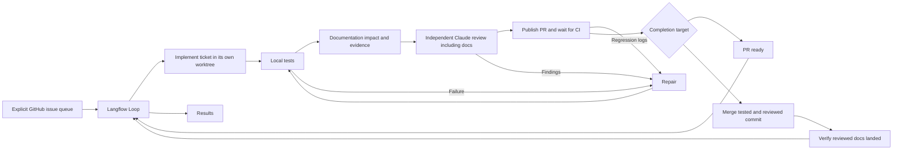
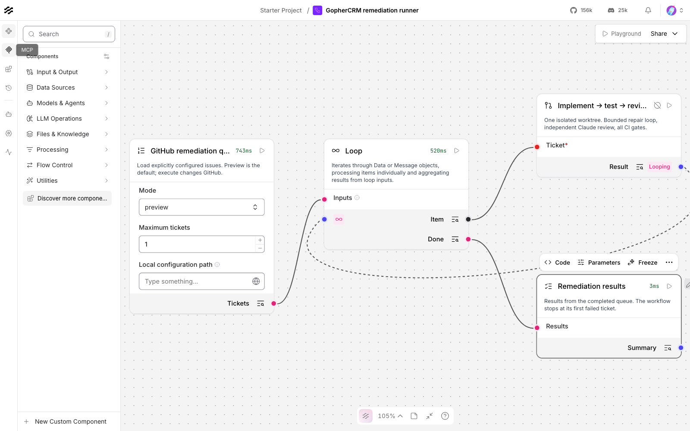
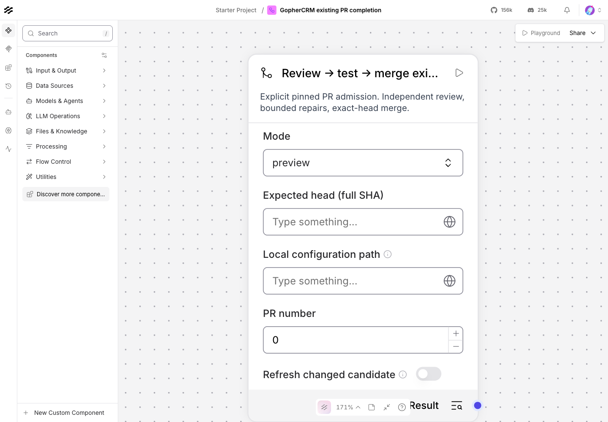

# GopherCRM Langflow remediation runner

This workflow processes the validated tickets in [tracking issue #94](https://github.com/florinel-chis/GopherCRM/issues/94). It defaults to **preview**. Execution implements one ticket at a time, tests it, asks an independent Claude process for an adversarial review, repairs findings, retests, opens a PR, waits for CI, and merges the reviewed commit. Newly generated configurations explicitly select `completion_target: "merge"`. Select `"pr"` for an optional **PR-ready** stop. Setup preserves existing configurations, including the original PR-ready pilot; preview and status display the effective target. No ticket execution is scheduled automatically.



The importable [workflow](flows/remediation.json) contains a queue component, Langflow's native sequential Loop, a ticket component, and a results component. The ticket component owns the bounded repair cycle and merge gates in [engine.py](gophercrm_runner/engine.py). The CLI executes this same serialized Langflow graph. macOS or Linux, Python 3.12, Langflow/LFX 1.12.6, `git`, authenticated `gh`, authenticated `claude`, Go 1.25+, Node 20+, and the repository's test prerequisites are required. The runner uses the existing CLI logins; it does not need an Anthropic API key in the flow.



## Install and preview

New configurations enable `documentation_mode: "reviewed"`: update affected docs in the same
PR, explain unchanged documents, and require the existing reviewer to assess each decision.
After merge, document contents are verified before completion. Include needed doc paths in
the frozen task scope; the map never grants extra write permission. Existing configurations
omitting the field keep legacy evidence and must migrate explicitly after active work finishes.
See the [documentation workflow](../../docs/DOCUMENTATION_WORKFLOW.md).
If a merged ticket fails documentation verification, inspect its evidence and either restore
verification prerequisites or explicitly use `abandon-issue` with a reason. This retains the
unverified result and leaves the queue stopped; it does not close issues or claim a successful
handoff. Existing PR completions retain their `abandon-pr` recovery path.

Run these commands from the repository root. Use an isolated environment outside the checkout:

```sh
uv venv --python 3.12 "$HOME/.local/share/gophercrm-langflow/venv"
uv pip install --python "$HOME/.local/share/gophercrm-langflow/venv/bin/python" './automation/langflow[ui]'
source "$HOME/.local/share/gophercrm-langflow/venv/bin/activate"
gophercrm-runner setup --checkout "$PWD" --directory "$HOME/.local/share/gophercrm-runner"
gophercrm-runner run --config "$HOME/.local/share/gophercrm-runner/config.json" --limit 2
```

Preview reads GitHub and writes private command logs. It does not call Claude, create branches or PRs, or change issues. The [example policy](gophercrm_runner/config.example.json) lists all 27 validated tickets explicitly. Queue limits default to one; closed tickets are skipped. An unfinished active ticket is resumed first.

When updating an existing local installation from source, force reinstall the package even if its version has not changed:

```sh
uv pip install --python "$HOME/.local/share/gophercrm-langflow/venv/bin/python" \
  --no-deps --reinstall-package gophercrm-remediation-runner ./automation/langflow
```

Verify the installed source against the reviewed checkout and restart Langflow only when no execution is active. A successful installer exit can otherwise leave an older build of the same version loaded.

## Use the visual workflow

```sh
gophercrm-runner serve --directory "$HOME/.local/share/gophercrm-runner"
```

Open <http://127.0.0.1:7860>. Log in as `runner`, using the generated password in the private `server.env` file printed by setup. Import `automation/langflow/flows/remediation.json`. The queue component uses `GOPHERCRM_RUNNER_CONFIG` from the server environment when its configuration field is blank. Leave **Mode = preview** for the first run. Set **Maximum tickets** to the desired batch size.

The server binds to loopback, disables signup, and restricts custom component authoring to administrators. Keep it local: this workflow can edit code and merge PRs using the host's credentials. A worktree is not an operating-system sandbox. The implementation agent has Read/Glob/Grep/Edit/Write tools; its independent reviewer has only Read/Glob/Grep. Shell commands and GitHub mutations belong to the runner. Repository and issue text are task data, never command or merge policy. Existing validation commands, workflow files, and the runner itself are protected from agent edits. The local policy explicitly allows issue #121 to add a new workflow for migration coverage; it cannot weaken an existing workflow.

## Execute the queue

Every new execution requires a frozen task contract. The operator owns its objective, boundaries, scope, dependencies and acceptance criteria; issue prose and model output cannot supply commands. Start with [task.example.json](task.example.json), expand it to cover the actual issue, and register its check IDs in the private policy. For example:

```json
{
  "acceptance_checks": {
    "dashboard-activity": {
      "argv": ["go", "test", "-json", "-count=1", "./internal/integration", "-run", "^TestDashboardActivityVisibility(SQLite|MySQL)$"],
      "tests": [
        {"package": "github.com/florinel-chis/gophercrm/internal/integration", "name": "TestDashboardActivityVisibilitySQLite"},
        {"package": "github.com/florinel-chis/gophercrm/internal/integration", "name": "TestDashboardActivityVisibilityMySQL"}
      ]
    }
  }
}
```

These example test names are acceptance requirements for the task to implement, not a claim that they already exist. A generic success exit cannot replace their exact Go JSON pass events; missing, skipped, failed, wrong-package or duplicate results fail acceptance. A required suite with any skipped or failing descendant also fails, even if its parent reports success. Database profiles additionally require the selected browser tests on SQLite/MySQL and migration tests. The backend MVP rejects manual/UI profiles and frontend edits explicitly.

```sh
gophercrm-runner freeze --config "$HOME/.local/share/gophercrm-runner/config.json" --issue 96 --manifest /absolute/path/to/task.json
```

Freeze records the current issue, base commit, selected check definitions, and bounded explicit guidance under `state_dir/tasks/<issue>/contract.json`. Include `AGENTS.md` in the trusted checkout: it may be operator-local and ignored by Git, in which case it is labelled and hashed as such. Other selected Markdown guidance must match the chosen Git base. The runner supplies this snapshot explicitly because Claude safe mode disables automatic guidance discovery. Context above 128 KiB is refused rather than truncated.

Dependencies need a pinned merged PR associated with the prerequisite issue, whose merge commit is present in the selected base. A closed issue or PR-ready result is insufficient; cyclic local contracts are rejected. The example pins the completed #95 dependency. The task manifest cannot change protected runner/validation paths, agent permissions, repository identity or completion policy.

First inspect `config.json`, authenticate `gh` and `claude`, install Playwright Chromium in the repository, and configure disposable test databases. For backend persistence changes, the runner requires:

- core commands selected by the contextual policy (explicit full/legacy uses `make verify`);
- SQLite and MySQL browser tests from `database_test_commands`;
- `TEST_MYSQL_DSN` pointing to a reachable disposable MySQL/MariaDB server, and successful fresh/upgrade migration tests; skipped migration tests fail the gate;
- the E2E database environment described in [the E2E guide](../../gocrm-ui/e2e/README.md). `make e2e` resets its configured test database, so use the dedicated E2E database, never an application database.

Set `disposable_database: true` only after provisioning that disposable server, and set `chromium_path` to the absolute installed Playwright Chromium executable. Supply an environment `JWT_SECRET` of at least 32 bytes for browser tests; fresh validation checkouts contain no application `.env`. Supply explicit `DB_HOST`, `DB_PORT`, `DB_USER`, `DB_PASSWORD`, and `E2E_DB_NAME` (`*_e2e`); the readiness probe does not load application `.env` files. `TEST_MYSQL_DSN` must target a TCP server without a database name so the migration suites can create isolated schemas.

```sh
gophercrm-runner doctor --config "$HOME/.local/share/gophercrm-runner/config.json"
```

Doctor checks tool versions, CLI authentication, private writable state, free disk (4 GiB by default), Chromium, the browser JWT prerequisite, required migration test names, and database connectivity using `SELECT 1`. It never resets a database, calls the coding model, or writes GitHub. Unavailable branch-protection metadata is reported as unknown. The same checks run before execution from either the CLI or Langflow; disk capacity is checked again before each fresh validation checkout. Environment failures stop for operator correction without consuming a code-repair round.

These environment variables must be present in the process running the CLI or starting the Langflow server. Keep credentials in the local environment/private files, never in exported flow JSON. Validation uses a fresh checkout of each committed candidate, with frontend dependencies installed using `npm ci`. Ignored files in the agent's worktree are rejected so they cannot change test inputs.

General application profiles use `make verify`, which installs frontend dependencies itself. Runner, auth, transaction and migration profiles use their targeted checks and install frontend dependencies separately for health smoke. Application `DB_*` settings are removed from core/hygiene verification so default-configuration tests are independent of the runtime server. `TEST_MYSQL_DSN` remains available, and database/browser commands retain the operator's full environment.

To process one issue through its configured completion target:

```sh
gophercrm-runner run --config "$HOME/.local/share/gophercrm-runner/config.json" --limit 1 --execute
```

The legacy queue requires a frozen contract for every ticket. Pre-freezing multiple tickets does not make an unattended merge batch: the first merge advances main and invalidates the next frozen base. Use the opt-in [prepared batch workflow](BATCHES.md) for up to three explicitly selected backend tickets. The full audit queue includes unsupported UI work and must not be enabled as an unattended batch. No batch is enabled by installing the runner.

The default repair budget is three rounds shared by local test failures, review findings, and actionable CI failures. Every repair creates a new commit and repeats local validation and independent review. Authentication failures, missing database coverage, cancellation, exhausted repairs, missing CI checks, and unrecognized failures stop execution and preserve the journal/worktree.

All six existing repository CI checks must succeed. Additional failing checks also block merging. Tests and review must reference the exact PR head. The runner checks the base commit, draft state, mergeability, and GitHub review requirements, then uses `gh pr merge --squash --match-head-commit`. It never uses an admin bypass or force push. GitHub branch protection/merge queue remains responsible for an atomic check against concurrent changes to main.

## Inspect and resume

For a single restart report, worker identity/heartbeat, batch budget extensions, validation
cost previews and safe dependency cleanup, use the [operations runbook](OPERATIONS.md).
`handoff --config ... --markdown` reports the active candidate and next action without
resuming execution. `report` and `report-pr` also accept `--markdown`.

```sh
gophercrm-runner status --config "$HOME/.local/share/gophercrm-runner/config.json"
gophercrm-runner run --config "$HOME/.local/share/gophercrm-runner/config.json" --limit 1 --execute
```

State, private logs, and worktrees live under the configured `state_dir`. A process lock prevents simultaneous execution, and an active-issue journal prevents moving on from an unfinished ticket. A repeated run reconciles an already merged PR before doing more work. Published branches/PRs are reused. Worktrees and logs are retained for inspection; the runner does not reset or remove them.

Each validation attempt records private output and digest-checked receipts under `artifacts/<execution>/<head>/<attempt>/`, binding policy, contract, guidance, base, head, command and result. Independent review must cover every criterion exactly once and cite its matching receipt. Its own verdict also receives a bound receipt, rechecked before publication/completion. Structured implementation reports remain claims, never acceptance. The provider schema permits only unique frozen criterion IDs in `addressed_criteria` (an empty list for existing PRs without criteria); descriptions belong in `summary` or `remaining_gaps`. Invalid reports still stop execution and retain edits, spent calls and elapsed time. Resume re-enters the provider call; report-only recovery is not implemented. A no-change response stops for explicit operator disposition rather than creating an empty commit or rerunning the model on resume.

Stop after the admitted ticket, including when Langflow has already loaded more tickets:

```sh
gophercrm-runner stop-after-current --config "$HOME/.local/share/gophercrm-runner/config.json"
# Only when another ticket is intended:
gophercrm-runner resume-queue --config "$HOME/.local/share/gophercrm-runner/config.json"
```

With no active ticket, a stop request blocks new issue admission. A separate short control lock makes this command usable while execution holds the runner lock. Completed PR-ready executions are skipped by queue discovery. Repeating one only checks its recorded remote result; editing the configuration to `merge` cannot promote it. Use the explicit PR completion workflow below to promote it.

## Inspected validation misclassification

Failed commands retain complete bounded, redacted diagnostics in private logs. Go assertion
blocks are included in the repair summary even when later passing tests fill the output.
When Go reports an assertion failure, JSON and logrus text service records from mocked calls do
not by themselves establish an environment failure. Actual SQL/readiness errors, disk and
network errors, occupied ports, missing tools and configuration errors still stop execution.

If an older execution stopped at validation with an environment classification, inspect the
full retained log and verify that the failure is a source assertion and prerequisites work.
The shared recovery command records that finding against the exact failed commit:

```sh
gophercrm-runner repair-validation --config /absolute/private/config.json --issue 123 \
  --head FULL_FAILED_HEAD_SHA --reason 'Inspected assertion failure; unrelated mock logs matched the environment classifier'
# Existing PR completion uses --pr NUMBER instead of --issue NUMBER.
# For a batch child, also supply --batch ORIGINAL_BATCH_ID.
```

This only queues a normal bounded repair for the active, clean, unchanged source after a
failed environment-classified validation. It cannot override a review rejection, orphaned
provider, exhausted limit, changed policy, dirty worktree or different commit. The original
batch owner, prepared plan and current allocation must match when `--batch` is supplied.
An owned batch cannot be bypassed by omitting that option. The original
failed attempt, receipts, spent calls/repairs and deadline remain unchanged. Resume with the
original `run`, `start-batch --resume` or `complete-pr` command; the repair then spends its
normal round/call and the changed candidate requires fresh validation and independent review.
It does not rerun the same failed candidate first or turn the operator finding into passing
evidence. `report` and `report-pr` include the recorded repair request. Actual environment
failures must still have their prerequisites restored before normal resume.

## Resume validation of an unchanged candidate

Normal resume retains successful checks from an interrupted validation when the source,
original validation checkout and receipt identities still match. It verifies the execution,
head, base, policy, contract, context, check command, receipt digest and output digest before
reuse, and checks named-test and migration coverage again. If the old checkout was removed or
changed, or the receipts/outputs cannot be verified, resume records the reason and old receipt
references in `validation_restarts`, starts a new validation attempt and reruns every selected
check in a fresh checkout. It never treats the unusable checkpoint as passing evidence or
overwrites its old artifacts. The source and policy must still match, and expired budgets
still stop execution; this fallback does not reset the deadline, calls or repairs.

Remaining checks run in a fresh checkout. Browser checks install locked frontend dependencies
there when the earlier installation/core check was already completed. Ignored files and
application data are not copied from the previous checkout. A failed full browser command
must pass in full; an isolated diagnostic rerun does not replace it. The original receipts,
failed/cancelled attempts, spent calls and deadline remain recorded, and `report`/`report-pr`
include `validation_resumptions`. Source repairs and explicit base refresh invalidate the
earlier checks; a new candidate still requires all selected checks and independent review.

Implementation agents cannot edit runner code or validation gates. When a review of a runner
PR requires those changes, a maintainer must prepare and push the corrected commit, then use
`complete-pr --refresh --head FULL_NEW_HEAD_SHA` with the original configuration. This retains
spent budgets and requires fresh validation and independent review. An automatic repair's
documentation-only edits do not resolve a protected-code finding.

## Complete existing PRs through merge

Import [pr-completion.json](flows/pr-completion.json) into Langflow for the **Review → test → merge existing PR** component. Enter the local policy path, PR number and full current head SHA. Preview is the default. Execute authorizes completion of that specific PR through merge, independently of the issue policy's `completion_target`. The CLI runs this same serialized graph:



```sh
gh pr view 127 --repo florinel-chis/GopherCRM --json headRefOid
gophercrm-runner complete-pr --config /absolute/path/to/config.json --pr 127 --head FULL_HEAD_SHA
gophercrm-runner complete-pr --config /absolute/path/to/config.json --pr 127 --head FULL_HEAD_SHA --execute
gophercrm-runner report-pr --config /absolute/path/to/config.json --pr 127
```

The workflow accepts open, non-draft PRs from the same repository targeting main. It uses a separate private completion journal and shares the execution/admission locks with the issue workflow. It never resumes a stopped issue queue or admits another issue. Select each PR explicitly; it does not merge every open PR merely because CI is green.

Inspect the pinned external contribution before execution: its code, build scripts and validation definitions execute locally with the host's filesystem access. This workflow is not a sandbox. External runner or validation changes can be reviewed, but repair agents cannot modify those protected paths.

For an unchanged PR-ready ticket, the workflow verifies its original contract, named-test receipts and independent review before reusing them. The original ticket's call counts, limits and artifacts remain intact. Its eventual merge result is recorded alongside the separate completion execution. Existing PRs without reusable evidence receive fresh checks selected by the validation policy, applicable database checks, and a fresh independent read-only Claude review. Runner/workflow changes also require local `make verify-runner` and the **Langflow runner tests** CI check. Criteria from a linked local ticket remain required during fresh validation.

Review or test failures enter the bounded repair → test → review cycle. Repair agents cannot modify runner code or validation gates; blockers in those paths require a maintainer fix. Missing/failed CI, stale evidence, unresolved GitHub review requirements, changed PR inputs, forks, draft PRs and changed head/base commits block merging. The final merge uses `--squash --match-head-commit`, with no admin bypass. A lost push or merge response is reconciled before repeating work. Merge reconciliation requires the recorded merge stage and rechecks the exact candidate's test/review receipts. Other remote merges are reported as `external_merge`, release the slot, and never satisfy a linked ticket's acceptance criteria. Failure to update a linked ticket after a verified merge is reported separately and can be retried without holding the PR slot.

The candidate must contain current main. If main or the remote head changes, inspect the changes and incorporate main into the source branch, then run `complete-pr` with its new full SHA and **`--execute --refresh`**. Refresh retains the old candidate/evidence and all spent calls, repairs and elapsed time; it invalidates tests and review. Refreshing an unchanged head/base cannot reroll a rejected review. Conflicts and external changes are never silently adopted. As with the ticket workflow, GitHub branch protection or a merge queue must enforce atomic protection against main advancing concurrently with the final merge request.

An unfinished completion can receive an explicit, recorded budget extension:

```sh
gophercrm-runner extend-pr-budget --config /absolute/path/to/config.json --pr 127 \
  --calls 1 --seconds 3600 --reason 'Inspected the blocked completion and authorized another attempt'
```

`status` includes PR completion journals. `report-pr` includes attempts and provider calls. Cancellation preserves the journal and worktrees; repeat `complete-pr` with the current head to resume an interrupted repair, spending another provider call within the same repair round. Authentication, environment and exhausted-budget failures remain stops, never merge approval.

A repair that makes no changes stops for inspection. `retry-pr-repair --config ... --pr NUMBER --reason '...'` records an explicit retry; the next execution consumes a new repair round and provider call. If a PR is closed, unwanted, or cannot be completed, `abandon-pr --config ... --pr NUMBER --reason '...'` records abandonment and releases its admission slot without closing or modifying GitHub. It preserves all artifacts and the stopped-queue setting. Abandoned completions cannot silently restart. A matching confirmed remote merge is reconciled; a merge at another head is recorded as an external disposition, never as this runner's validated result.

If a repair edits protected paths or leaves an unusable dirty checkout, use `restart-pr-repair --config ... --pr NUMBER --reason '...'` after inspection. It retains the rejected checkout and creates a clean one at the recorded commit. The next execution charges another provider call in the same already-spent repair round. Tests and review are invalidated, never bypassed. A refresh after an inspected remote head/base change also retains dirty superseded worktrees, rather than requiring manual cleanup. Neither operation refunds calls, repairs or elapsed time.

After a hard crash, inspect and stop orphaned processes from that execution (including provider and test processes), then use **`recover-pr --config ... --pr NUMBER --processes-stopped --reason '...'`** to resume the same completion. The operator acknowledgement resolves unknown running invocations without refunding calls, changing the deadline, discarding receipts or inventing an end time. Run `complete-pr` again; normal tests, review and budgets still apply. If admission crashed before its first journal save, recovery records the interrupted admission separately and releases its slot, allowing the same PR to be admitted later.

Use `abandon-pr --processes-stopped` instead only when deliberately ending the completion after inspecting orphaned processes. Abandonment also supports an interrupted admission without a journal, and remains terminal. Neither command kills an arbitrary recorded PID. Preflight failures that unwind normally release their slot automatically. A held PR slot is reported as a blocked issue queue, never an empty one.

An external merge never bypasses the orphaned-process acknowledgement. Already completed merges retain their historical result; an abandonment request cannot relabel them as failed or erase the linked ticket outcome.

Journals use schema version 2. Reading a legacy journal preserves its exact bytes in an immutable, private backup before conversion. A matching completed remote merge can be reconciled, but unfinished legacy work must use its matching old runner and saved journal; automatic adoption is unsupported. Unknown newer schemas are refused. Never restore a backup without checking for later remote actions.

If main advances while a PR is waiting, the runner stops. Merge current main into the active worktree and invalidate previous gates with:

```sh
gophercrm-runner revalidate --config "$HOME/.local/share/gophercrm-runner/config.json" --issue 95
gophercrm-runner freeze --config "$HOME/.local/share/gophercrm-runner/config.json" --issue 95 --manifest /absolute/path/to/task.json --refresh
gophercrm-runner run --config "$HOME/.local/share/gophercrm-runner/config.json" --limit 1 --execute
```

Issue, guidance, check-registry or contract changes stop execution. Inspect them, update the operator manifest when needed, then use `freeze --refresh`. Refresh preserves old contract snapshots/history and spent work, invalidates prior tests/review/receipts, and requires fresh validation. It cannot silently adopt a changed executable policy or promote a completed PR-ready execution. If main changed, revalidate the candidate first and update the trusted checkout's guidance to that base before refreshing.

Any merge conflicts are left for the next implementation pass. Interrupted worktree creation and commit responses are reconciled when their recorded branch/tree match. Unexpected external commits, changed validation policy, and exhausted repair budgets require inspecting the journal before recovery; they are not silently accepted. Queue additions and per-command timeout changes are permitted during an active ticket; validation policy changes are not. Editing configured total limits never changes an admitted execution’s persisted limits. Cancellation terminates the active command process group and releases the lock; already completed remote actions are reconciled on resume.

An issue repair reserved before main advances can use `revalidate` followed by `freeze --refresh`; both preserve its reserved stage and spent budget. A conflicting main merge retains rejected-review findings and still enforces the repair limit. If that limit is exhausted, the worktree remains in conflict for maintainer inspection; automatic execution does not resolve it or grant another round. Revalidation also refuses an already dirty cancelled issue repair. These are explicit operator boundaries, not successful completion.

## Limits and operational reports

New executions default to eight provider CLI invocations and a four-hour total deadline. Each
implementation or review invocation reserves one call durably before process launch. These are
CLI invocation counts, not underlying API-request or token limits. The deadline includes downtime
and bounds subprocess timeouts. The three-repair ceiling remains independent. No hard monetary
or token limit is supported; unknown configuration fields fail rather than imply enforcement.

Resuming never refunds calls or resets the deadline. Normal cancellation and CLI SIGTERM terminate
the child process group. A hard crash leaving a running invocation blocks further mutation; inspect
its process and private journal before recovery. A call reservation remains spent even if no result
was captured. Confirmed remote merges can still be reconciled after budget expiry.

```sh
gophercrm-runner report --config /absolute/path/to/config.json --issue 96
gophercrm-runner report --config /absolute/path/to/config.json --issue 96 --json
# Only after explicitly deciding to extend this unfinished execution:
gophercrm-runner extend-budget --config /absolute/path/to/config.json --issue 96 --calls 1 --seconds 3600 --reason 'Reviewed the blocked execution and approved another attempt'
# Record actual active time; do not substitute elapsed wall time:
gophercrm-runner note --config /absolute/path/to/config.json --issue 96 --minutes 5 --category intervention --reason 'Restored the disposable database connection'
```

Extensions add to the original deadline/ceiling and retain history, spent calls, repairs and evidence.
Reports retain failed stage attempts and distinguish environment, implementation/test, review, CI,
budget and recovery failures. Interrupted attempts have unknown active duration. Provider-reported
cost is labelled separately from actual billing; incomplete cost has no fabricated total. Missing
operator minutes stay unknown, and explicit entries are labelled partial rather than exhaustive.
Configured and observed model identities are separate. The MVP uses one optional `agent_model`
setting for both roles, with separate fresh processes and unchanged permissions.

A successful implementation is saved before formatting/commit recovery; a review verdict is saved
before post-review checks. Resume can finalize those results without paying for a duplicate call or
rerolling a rejection. Logs, contracts and receipts remain private. The report is a selected,
redacted summary; raw `status` journals are intended for local inspection.

The [MVP process report](workflow-mvp-process.md) contains the refined execution prompt,
coverage boundaries, observed failures and follow-up priorities. It distinguishes the single
operational canary from the deferred controlled benchmark.

The [2026-10-23 workflow retrospective](retrospective-2026-10-23.md) reviews recent sessions
and retained execution evidence, separates delivered fixes from remaining gaps, and proposes
prioritized improvements to recovery, resource management, browser reliability and reporting.
Its proposals do not change current execution or validation policy.

## Maintain and test the runner

Install the `flows` extra in the active Python environment before validation.
Both `flows` and `ui` explicitly declare the JSON Schema validator used by the
provider-format regressions, so tests do not rely on the workflow engine's
transitive dependencies. CI installs `flows` with the same declared dependency.

```sh
python -m pip install './automation/langflow[flows]'
make verify-hygiene
make verify-runner RUNNER_PYTHON=python
npm ci --prefix gocrm-ui
make e2e E2E_DB_DRIVER=sqlite SPECS='e2e/tests/health-smoke.spec.ts'
# Only after intentionally changing workflow components:
gophercrm-runner export automation/langflow/flows/remediation.json
gophercrm-runner export --pr automation/langflow/flows/pr-completion.json
gophercrm-runner export --batch automation/langflow/flows/batch.json
```

Tests use real temporary Git worktrees and commits with deterministic Claude/GitHub boundaries, plus the real LFX engine for serialized workflow execution. They do not merge live PRs or spend Claude quota. The separate `Remediation runner` CI workflow calls the same `make verify-runner` target, including on merge-group events. Verification compares the export without rewriting it; the target also tests the read-only Go database probe. Changes to the runner itself are excluded from the automated issue agent's writable paths.

Langflow references: [custom components](https://docs.langflow.org/components/custom/), [Loop](https://docs.langflow.org/loop), [installation](https://docs.langflow.org/get-started-installation), and [workflow API](https://docs.langflow.org/concepts-publish).

## Contextual validation (migration profile added in 0.7.2)

New configurations select `validation_mode: "contextual"`: application changes run core
verification and all frozen acceptance checks, then health smoke plus affected browser
suites. Runner-only changes use hygiene/runner tests plus health smoke, without unrelated
application suites. Bounded auth service/handler changes use targeted auth/session race tests,
API/frontend build checks, and health/login/registration browsers. Repository, schema,
middleware and mixed application changes retain the full fallback; explicit database
acceptance contracts still apply. Transaction-helper-only changes use the shared Go checker
for SQLite/MySQL boundaries and affected callers, configured migration checks and health smoke.
CI also exercises transaction boundaries on MariaDB. Migration-workflow/checker-only changes
use the shared migration Go profile and health smoke; CI migration results feed its required
Backend check. Actual schema and migration SQL changes retain full fallback. Unmapped shared application changes retain
full fallback; the transaction profile does not run unrelated feature browsers or frontend units.
Both ticket and existing-PR workflows use the
same selector; review, CI, repair/retest and merge gates remain mandatory. Configurations
without this field use `legacy` and retain the original v0.3 behavior and policy hashes.
Explicit `full` requires the entire local browser/database matrix even for UI-only changes. Finish admitted runs, or explicitly stop and preserve a superseded execution with its remaining
budgets, before migrating to a fresh contextual configuration/state directory and fresh checks. See the [policy, release runbook and
lessons](../../docs/VALIDATION_RELEASE.md). Release validation always runs the full matrix.
