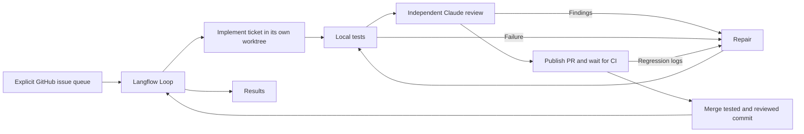

# GopherCRM Langflow remediation runner

This workflow processes the validated tickets in [tracking issue #94](https://github.com/florinel-chis/GopherCRM/issues/94). It defaults to **preview**. Execution implements one ticket at a time, tests it, asks an independent Claude process for an adversarial review, repairs findings, retests, opens a PR, waits for CI, and merges the reviewed commit. It then advances to the next ticket. No ticket execution is scheduled automatically.



The importable [workflow](flows/remediation.json) contains a queue component, Langflow's native sequential Loop, a ticket component, and a results component. The ticket component owns the bounded repair cycle and merge gates in [engine.py](gophercrm_runner/engine.py). The CLI executes this same serialized Langflow graph. macOS or Linux, Python 3.12, Langflow/LFX 1.12.6, `git`, authenticated `gh`, authenticated `claude`, Go 1.25+, Node 20+, and the repository's test prerequisites are required. The runner uses the existing CLI logins; it does not need an Anthropic API key in the flow.


## Install and preview

Run these commands from the repository root. Use an isolated environment outside the checkout:

```sh
uv venv --python 3.12 "$HOME/.local/share/gophercrm-langflow/venv"
uv pip install --python "$HOME/.local/share/gophercrm-langflow/venv/bin/python" -e './automation/langflow[ui]'
source "$HOME/.local/share/gophercrm-langflow/venv/bin/activate"
gophercrm-runner setup --checkout "$PWD" --directory "$HOME/.local/share/gophercrm-runner"
gophercrm-runner run --config "$HOME/.local/share/gophercrm-runner/config.json" --limit 2
```

Preview reads GitHub and writes private command logs. It does not call Claude, create branches or PRs, or change issues. The [example policy](gophercrm_runner/config.example.json) lists all 27 validated tickets explicitly. Queue limits default to one; closed tickets are skipped. An unfinished active ticket is resumed first.

## Use the visual workflow

```sh
gophercrm-runner serve --directory "$HOME/.local/share/gophercrm-runner"
```

Open <http://127.0.0.1:7860>. Log in as `runner`, using the generated password in the private `server.env` file printed by setup. Import `automation/langflow/flows/remediation.json`. The queue component uses `GOPHERCRM_RUNNER_CONFIG` from the server environment when its configuration field is blank. Leave **Mode = preview** for the first run. Set **Maximum tickets** to the desired batch size.

The server binds to loopback, disables signup, and restricts custom component authoring to administrators. Keep it local: this workflow can edit code and merge PRs using the host's credentials. A worktree is not an operating-system sandbox. The implementation agent has Read/Glob/Grep/Edit/Write tools; its independent reviewer has only Read/Glob/Grep. Shell commands and GitHub mutations belong to the runner. Repository and issue text are task data, never command or merge policy. Existing validation commands, workflow files, and the runner itself are protected from agent edits. The local policy explicitly allows issue #121 to add a new workflow for migration coverage; it cannot weaken an existing workflow.

## Execute the queue

First inspect `config.json`, authenticate `gh` and `claude`, install Playwright Chromium in the repository, and configure disposable test databases. For backend persistence changes, the runner requires:

- `make verify`, always;
- SQLite and MySQL browser tests from `database_test_commands`;
- `TEST_MYSQL_DSN` pointing to a reachable disposable MySQL/MariaDB server, and successful fresh/upgrade migration tests; skipped migration tests fail the gate;
- the E2E database environment described in [the E2E guide](../../gocrm-ui/e2e/README.md). `make e2e` resets its configured test database, so use the dedicated E2E database, never an application database.

These environment variables must be present in the process running the CLI or starting the Langflow server. Keep credentials in the local environment/private files, never in exported flow JSON. Validation uses a fresh checkout of each committed candidate, with frontend dependencies installed using `npm ci`. Ignored files in the agent's worktree are rejected so they cannot change test inputs.

To process one issue through merge:

```sh
gophercrm-runner run --config "$HOME/.local/share/gophercrm-runner/config.json" --limit 1 --execute
```

To process the full current queue, use `--limit 27 --execute`, or select **Mode = execute** and **Maximum tickets = 27** in the visual workflow. The default repair budget is three rounds shared by local test failures, review findings, and actionable CI failures. Every repair creates a new commit and repeats local validation and independent review. Authentication failures, missing database coverage, cancellation, exhausted repairs, missing CI checks, and unrecognized failures stop execution and preserve the journal/worktree.

All six existing repository CI checks must succeed. Additional failing checks also block merging. Tests and review must reference the exact PR head. The runner checks the base commit, draft state, mergeability, and GitHub review requirements, then uses `gh pr merge --squash --match-head-commit`. It never uses an admin bypass or force push. GitHub branch protection/merge queue remains responsible for an atomic check against concurrent changes to main.

## Inspect and resume

```sh
gophercrm-runner status --config "$HOME/.local/share/gophercrm-runner/config.json"
gophercrm-runner run --config "$HOME/.local/share/gophercrm-runner/config.json" --limit 1 --execute
```

State, private logs, and worktrees live under the configured `state_dir`. A process lock prevents simultaneous execution, and an active-issue journal prevents moving on from an unfinished ticket. A repeated run reconciles an already merged PR before doing more work. Published branches/PRs are reused. Worktrees and logs are retained for inspection; the runner does not reset or remove them.

If main advances while a PR is waiting, the runner stops. Merge current main into the active worktree and invalidate previous gates with:

```sh
gophercrm-runner revalidate --config "$HOME/.local/share/gophercrm-runner/config.json" --issue 95
gophercrm-runner run --config "$HOME/.local/share/gophercrm-runner/config.json" --limit 1 --execute
```

Any merge conflicts are left for the next implementation pass. Interrupted worktree creation and commit responses are reconciled when their recorded branch/tree match. Unexpected external commits, changed validation policy, and exhausted repair budgets require inspecting the journal before recovery; they are not silently accepted. Queue additions and timeout changes are permitted during an active ticket; validation policy changes are not. Cancellation terminates the active command process group and releases the lock; already completed remote actions are reconciled on resume.

## Maintain and test the runner

```sh
python -m unittest discover -s automation/langflow/tests -v
gophercrm-runner export automation/langflow/flows/remediation.json
make verify
```

Tests use real temporary Git worktrees and commits with deterministic Claude/GitHub boundaries, plus the real LFX engine for serialized workflow execution. They do not merge live PRs or spend Claude quota. The separate `Remediation runner` CI workflow runs these tests and checks that the exported graph matches its source. Changes to the runner itself are excluded from the automated issue agent's writable paths.

Langflow references: [custom components](https://docs.langflow.org/components/custom/), [Loop](https://docs.langflow.org/loop), [installation](https://docs.langflow.org/get-started-installation), and [workflow API](https://docs.langflow.org/concepts-publish).
