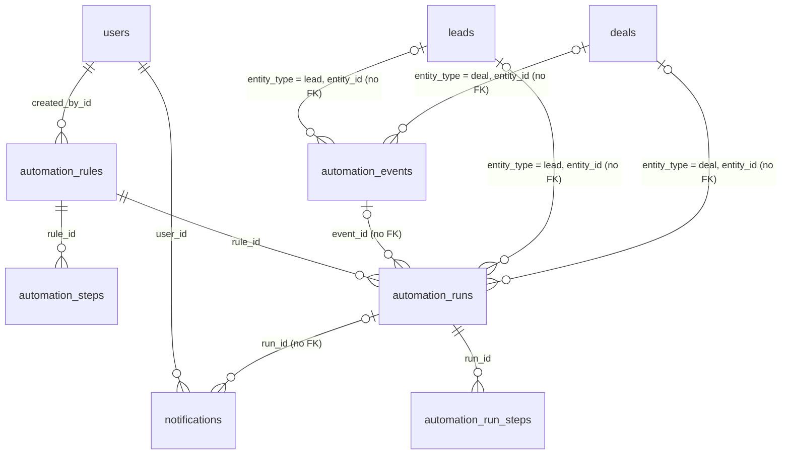

# GopherCRM Data Model Documentation

This document describes the complete data model for the GopherCRM application based on the backend implementation.

## Base Model

All entities inherit from a common base model with the following fields:

| Field | Type | Required | Description |
|-------|------|----------|-------------|
| id | uint | Yes | Auto-generated unique identifier |
| created_at | timestamp | Yes | Record creation timestamp |
| updated_at | timestamp | Yes | Last update timestamp |
| deleted_at | timestamp | No | Soft delete timestamp |

## User Model

Represents system users with different roles and permissions.

### Fields

| Field | Type | Required | Default | Constraints | Description |
|-------|------|----------|---------|-------------|-------------|
| email | string | Yes | - | unique, max 255 | User's email address |
| password | string | Yes | - | max 255 | Hashed password (hidden in API responses) |
| first_name | string | Yes | - | max 100 | User's first name |
| last_name | string | Yes | - | max 100 | User's last name |
| role | enum | Yes | 'customer' | max 20 | User role (see below) |
| is_active | boolean | Yes | true | - | Account active status |
| last_login_at | timestamp | No | - | - | Last login timestamp |

### User Roles
- `admin` - Full system access
- `sales` - Access to leads and customers
- `support` - Access to tickets and customer support
- `customer` - Limited access to own data

### Relationships
- Has many Leads (as owner)
- Has many Tasks (as assignee)
- Has many APIKeys

## Lead Model

Represents potential customers in the sales pipeline.

### Fields

| Field | Type | Required | Default | Constraints | Description |
|-------|------|----------|---------|-------------|-------------|
| first_name | string | Yes | - | max 100 | Lead's first name |
| last_name | string | Yes | - | max 100 | Lead's last name |
| email | string | Yes | - | max 255, indexed, not unique | Lead's email address |
| phone | string | No | - | max 50 | Phone number |
| company | string | No | - | max 200 | Company name |
| position | string | No | - | max 100 | Job position/title |
| source | string | No | - | max 100 | Lead source (e.g., website, referral) |
| status | enum | Yes | 'new' | max 20 | Lead status (see below) |
| classification | string | No | 'unclassified' | max 20, indexed | `unclassified`, `test`, `spam`, `lead`, `hot_lead` |
| external_id | string | No | - | max 255, indexed, not unique | Identifier from an external source |
| notes | text | No | - | - | Additional notes |
| owner_id | uint | Yes | - | FK to users | Assigned sales user |
| customer_id | uint | No | - | FK to customers | ID when converted to customer |
| company_id | uint | No | - | FK to companies | Linked company record (independent of the text `company`) |

### Lead Status Values
- `new` - Newly created lead
- `contacted` - Initial contact made
- `qualified` - Qualified as potential customer
- `unqualified` - Not a good fit
- `converted` - Converted to customer

### Lead Sources (Common Values)
- `website` - Company website
- `referral` - Customer referral
- `cold_call` - Sales outreach
- `advertisement` - Ad campaigns
- `social_media` - Social platforms
- `email_campaign` - Email marketing
- `trade_show` - Events/trade shows
- `other` - Other sources

## Company Model

An organisation that leads and customers link to through `company_id`. Holds no personal data;
deleting one soft-deletes the row and clears the links. `domain` is unique among live rows,
checked in the service rather than by a unique index; a plain (non-unique) index serves that
check.

### Fields

| Field | Type | Required | Default | Constraints | Description |
|-------|------|----------|---------|-------------|-------------|
| name | string | Yes | - | max 200 | Company name (trimmed; not unique) |
| domain | string | No | - | max 255, indexed, unique among live rows | Normalised lower-case host, e.g. `acme.example` |
| website | string | No | - | max 255, http(s) URL | Website |
| industry | string | No | - | max 100 | Free text |
| employee_range | string | No | - | one of `1-10`, `11-50`, `51-200`, `201-500`, `501-1000`, `1000+` | Head-count band |
| phone | string | No | - | max 50 | Phone number |
| address | string | No | - | max 255 | Street address |
| city | string | No | - | max 100 | City |
| state | string | No | - | max 100 | State/Province |
| country | string | No | - | max 100 | Country |
| postal_code | string | No | - | max 20 | ZIP/Postal code |
| notes | text | No | - | max 65535 bytes | Free text |
| owner_id | uint | No | - | FK to users | Account manager |

`customer_count`, `lead_count` and `deal_count` are computed on read (live rows only) and are not
columns.

## Lookup Indexes and Query Plans

Four non-unique single-column indexes back the lead and company lookups (#109). The names are
the ones GORM AutoMigrate derives from the model tags, and the MySQL/MariaDB migration
`20261029140000_add_lead_company_lookup_indexes` creates the same ones; `cmd/migrate`
`TestLookupIndexesMigration` compares the two, and `internal/repository`
`TestLookupIndexesServeLookupsSQLite` fails if a lookup stops using its index on SQLite.

| Index | Serves |
|-------|--------|
| `idx_leads_email` | `GetLatestByEmail` (the form double opt-in match): `email = ?`, newest first |
| `idx_leads_classification` | `GET /leads?classification=` and its count |
| `idx_leads_external_id` | `GetByExternalID` |
| `idx_companies_domain` | the live-row duplicate-domain check (`ExistsByDomain`) |

None is unique: the same email may legitimately belong to several leads, and a soft-deleted
company keeps its domain while a live company may reuse it. The domain check compares the
column with plain equality against the lower-cased argument; the stored domain is always lower
case (the service normalises it, and both the SQL migration and `models.MigrateDatabase`, on
every start and every driver, lower-case any row written outside the application). Lower-casing
cannot create a live duplicate the application did not already treat as one, because its check
was case-insensitive before the change as well. The previous `LOWER(domain) = LOWER(?)` predicate cannot use a plain index on
SQLite or on MySQL/MariaDB, and the functional indexes that could serve it are not portable
(MariaDB 10.11 has none).

Measured on 2026-10-29 with 20,000 leads (15,000 distinct emails, five classifications, unique
external ids) and 5,000 companies, the tables analysed, on SQLite (glebarez driver) and MySQL 8
(the runner container). This is a lab measurement, not a production incident.

| Lookup | SQLite before | SQLite after | MySQL before | MySQL after |
|--------|---------------|--------------|--------------|-------------|
| lead by email, newest first | `SCAN leads` + temp B-tree for ORDER BY | `SEARCH leads USING INDEX idx_leads_email (email=?)` + temp B-tree over the matching rows | `ref` on `idx_leads_deleted_at`, ~9,756 rows examined, filesort | `ref` on `idx_leads_email`, 2 rows, filesort of those rows |
| leads by classification, one page | `SCAN leads` | `SEARCH leads USING INDEX idx_leads_classification (classification=?)` | `ref` on `idx_leads_deleted_at`, ~9,756 rows | `range` on `idx_leads_classification`, ~4,000 rows (one fifth of the table) |
| count by classification | `SCAN leads` | `SEARCH ... USING INDEX idx_leads_classification` | `ref` on `idx_leads_deleted_at`, ~9,756 rows | index intersection of `idx_leads_classification` and `idx_leads_deleted_at`, index only |
| lead by external id | `SCAN leads` | `SEARCH leads USING INDEX idx_leads_external_id (external_id=?)` | `ref` on `idx_leads_deleted_at`, ~9,756 rows | `ref` on `idx_leads_external_id`, 1 row |
| company domain check | `SCAN companies` | `SEARCH companies USING INDEX idx_companies_domain (domain=?)` | `range` on `PRIMARY`, ~2,476 rows | `range` on `idx_companies_domain`, 2 rows |

With the index in place, `LOWER(domain) = LOWER(?)` still produced `SCAN companies` on SQLite and
a primary-key range over ~2,550 rows on MySQL, which is why the predicate changed. The email
lookup keeps a sort step because `created_at` lives in the shared base model and cannot join a
composite tag; the index narrows the sort to the few rows that share one address.

Migration cost. Each index costs one scan of its table. MySQL 8 and MariaDB 10.11 build a
secondary index as in-place online DDL: reads and writes continue during the build, but the
statement takes a brief exclusive metadata lock at its start and end. A long-running transaction
that touched the table delays that lock, and statements arriving behind the waiting DDL queue
until it is granted, so run the upgrade when no long transaction or report is open on `leads` or
`companies`. The domain normalisation `UPDATE` in the SQL migration is a separate, one-time
write: it scans `companies` once, and under InnoDB REPEATABLE READ it locks every record it scans,
not only the ones it changes, until the migration statement finishes; on a large table run it in
the same quiet window. `models.MigrateDatabase` repeats the normalisation on every start on every
driver (which is how SQLite installs get it) without that cost: it finds the rows with a plain,
non-locking `SELECT id`, a full read of `companies` on each boot, and only when that returns ids
lower-cases those rows by primary key in chunks of 500. Writes and row locks are therefore limited
to the rows that need normalising, and a normalised database takes none. SQLite builds the indexes during the startup
AutoMigrate, holding the database write lock while it does.

## Deal Model

A sales opportunity, optionally linked to a company, a customer and the lead it grew from, always
owned by a user. Holds no personal data; deleting one is a soft delete that keeps the history.
Money is an integer amount in minor units next to an ISO 4217 code — sums are only meaningful per
currency.

### Fields

| Field | Type | Required | Default | Constraints | Description |
|-------|------|----------|---------|-------------|-------------|
| title | string | Yes | - | max 200 | Deal title (trimmed) |
| stage | string | Yes | `qualification` | one of the stage values below | Pipeline stage |
| amount_cents | int64 | Yes | 0 | ≥ 0 | Amount in minor units |
| currency | string | Yes | `deals.default_currency` (EUR) | `^[A-Z]{3}$` | ISO 4217 code |
| probability | int | Yes | per stage | 0–100; won is 100, lost is 0 | Chance of closing |
| expected_close_date | date | No | - | `YYYY-MM-DD` on the wire | Expected close |
| closed_at | datetime | No | - | set on entering won or lost, cleared on leaving them | When the deal closed |
| lost_reason | string | No | - | max 255; stored only while lost | Why the deal was lost |
| source | string | No | - | max 100 | Free text |
| notes | text | No | - | max 65535 bytes | Free text |
| company_id | uint | No | - | FK to companies | Linked company |
| customer_id | uint | No | - | FK to customers | Linked customer |
| lead_id | uint | No | - | FK to leads | Lead it grew from |
| owner_id | uint | Yes | the caller | FK to users | Staff account working the deal |

### Deal Stage Values
- `qualification` (default probability 10)
- `proposal` (40)
- `negotiation` (70)
- `won` (100, closed)
- `lost` (0, closed)

### Deal Stage Change

`deal_stage_changes` is append-only: one row per stage the deal entered, written in the same
transaction as the create or the change, never updated, kept when the deal is soft-deleted.

| Field | Type | Required | Constraints | Description |
|-------|------|----------|-------------|-------------|
| deal_id | uint | Yes | FK to deals, indexed | The deal |
| from_stage | string | No | null on the creating row | Stage left |
| to_stage | string | Yes | a stage value | Stage entered |
| changed_by_id | uint | Yes | FK to users | Who made the change |
| changed_at | datetime | Yes | - | When |

## Product Model

One entry of the catalogue a quote line is priced from. Products hold no personal data and are
not erased; deleting one is a soft delete, and the quote lines that reference it keep the name and
price they copied. Money is an integer amount in minor units next to an ISO 4217 code, the deal
convention.

### Fields

| Field | Type | Required | Default | Constraints | Description |
|-------|------|----------|---------|-------------|-------------|
| name | string | Yes | - | max 200, trimmed | Display name, copied into `quote_lines.description` when a line is added |
| sku | string | No | - | max 64, indexed, not unique | Stock-keeping code |
| description | text | No | - | max 65535 bytes | Free text |
| unit_price_cents | int64 | Yes | - | 0 to 10^12 (`models.QuoteAmountCentsMax`); no column default, so an explicit 0 is kept | Price in minor units |
| currency | string | Yes | `deals.default_currency` (EUR) | `^[A-Z]{3}$`, `char(3)` | ISO 4217 code |
| is_active | boolean | Yes | true (set by the service) | no column default, so an explicit false is kept | Whether new quote lines may be priced from it |

The SKU is deliberately not unique: a unique index over a soft-deleted table either blocks the
reuse of a code or, scoped by `deleted_at`, stops meaning anything (see the gotchas in
[DEVELOPMENT.md](DEVELOPMENT.md)).

## Quote Model

A priced offer to a customer, optionally grown from a deal, always owned by a user. A quote
carries its lines and server-computed totals; everything, lines included, is editable only while
the status is `draft`. Quotes copy no personal data: the recipient of the email is read from the
linked customer at send time, so erasing the customer leaves the quote, its lines and its history
untouched, with `customer_id` in place as a business link (as deals keep theirs).

### Fields

| Field | Type | Required | Default | Constraints | Description |
|-------|------|----------|---------|-------------|-------------|
| title | string | Yes | - | max 200, trimmed | Free text (the same accepted limitation as deal titles) |
| status | enum | Yes | `draft` | one of the status values below, max 20 | Lifecycle status |
| currency | string | Yes | `deals.default_currency` (EUR) | `^[A-Z]{3}$`; immutable once the quote has lines | Currency of every line and total |
| subtotal_cents | int64 | Yes | 0 | Σ quantity × unit_price_cents over the lines; never taken from a request | |
| discount_cents | int64 | Yes | 0 | subtotal − total | |
| total_cents | int64 | Yes | 0 | Σ line_total_cents, at most 10^12 | |
| valid_until | date | No | - | `YYYY-MM-DD` on the wire, stored as local midnight (the deal date convention) | Acceptance is refused once this date has passed; expiry itself is a manual status |
| notes | text | No | - | max 65535 bytes | Free text shown on the document and in the email |
| sent_at | datetime | No | - | set on draft→sent, cleared on sent→draft | UTC |
| closed_at | datetime | No | - | set on accepted, rejected and expired; cleared on sent→draft | UTC |
| last_emailed_at | datetime | No | - | set by the conditional update that follows a successful email | UTC |
| deal_id | uint | No | - | FK to deals; at least one of `deal_id` and `customer_id` on create; not editable | The deal it grew from |
| customer_id | uint | No | - | FK to customers; taken from the deal when omitted; must be the deal's customer when the deal has one | The recipient, read live at send time and never copied |
| owner_id | uint | Yes | the caller | FK to users; only an admin may name another | Owning staff account |

The JSON adds `number` (`Q-` followed by the id zero-padded to six digits, `Q-000042`) and
replaces the preloaded `customer`, `deal` and `owner` by summaries (`{id, first_name, last_name,
company}`, `{id, title, stage}` and `{id, first_name, last_name}`): no email address or phone
number is ever disclosed through a quote. Lists carry quotes without their lines.

### Quote Status Values and Transitions
- `draft` — editable; the only status in which the fields and the lines may change
- `sent` — entered from draft, only when the quote has at least one line
- `accepted`, `rejected`, `expired` — final; entered from sent

The allowed moves are exactly `draft → sent`, `sent → accepted`, `sent → rejected`,
`sent → expired` and `sent → draft` (revise). Any other pair, the same status again included, is
refused with 400 `INVALID_STATUS_TRANSITION` and writes nothing. Each move claims the row with a
conditional update (`WHERE id = ? AND status = <from>`, exactly one row, which is also what settles
two competing moves) and writes one history row in the same transaction; `draft → sent` then counts
the lines with a locking read and rolls the claim back with 409 when there are none; `accepted` is
refused with 409 once `valid_until` lies in the past in the server's local zone. Accepting a quote
does not change its deal.

### Quote Line

`quote_lines` — one priced row of a quote. The line copies the product's name and price when it is
added, so a later change to the catalogue never alters an existing quote; both copies may be
overridden in the request and edited while the quote is a draft. Lines are hard-deleted (no
`deleted_at`).

| Field | Type | Required | Constraints | Description |
|-------|------|----------|-------------|-------------|
| quote_id | uint | Yes | FK to quotes, indexed | The quote |
| product_id | uint | Yes | FK to products, indexed; a soft-deleted product still resolves | The product it was priced from |
| position | int64 | Yes | 1-based, assigned max+1 on insert | Display order |
| description | string | Yes | max 255 | Copied from `products.name` unless overridden |
| quantity | int64 | Yes | 1 to 1,000,000 | |
| unit_price_cents | int64 | Yes | 0 to 10^12, and quantity × unit_price_cents at most 10^12 | Copied from `products.unit_price_cents` unless overridden |
| discount_bp | int64 | Yes | 0 to 10000 | Per-line percentage in basis points (12.5 % = 1250) |
| line_total_cents | int64 | Yes | - | `(gross × (10000 − discount_bp) + 5000) / 10000`: round half up on minor units |

A quote holds at most 100 lines, and the gross of a line is checked against the bound before the
discount arithmetic, so nothing the server multiplies can leave an int64.

### Quote Status Change

`quote_status_changes` is append-only, the `deal_stage_changes` pattern: one row per status the
quote entered, the create included (`from_status` null), written in the same transaction as the
change, never updated, kept when the quote is soft-deleted. There is no foreign key to `quotes`.
Its id is also the marker the email stamp compares against: `last_emailed_at` is set only when no
row of the quote with `to_status = 'draft'` and an id above the one read before the send exists.

| Field | Type | Required | Constraints | Description |
|-------|------|----------|-------------|-------------|
| quote_id | uint | Yes | indexed, no FK | The quote |
| from_status | string | No | null on the creating row | Status left |
| to_status | string | Yes | a status value | Status entered |
| changed_by_id | uint | Yes | FK to users | Who made the change |
| changed_at | datetime | Yes | UTC | When |

## Follow-up Automation

Six tables added by issue #164: the rules an admin defines, their ordered steps, the outbox
events a lead or deal write records in its own transaction, the persisted runs the worker
executes with their per-step log, and the in-app notifications a `notify` step creates. None of
them stores personal data: events and run logs carry ids, types, statuses, outcomes and error
codes; the only free text is what an admin typed into a rule and the rendered title and body of
a notification addressed to a staff user (deleted with the lead it refers to and with its
recipient).



### Automation Rule

`automation_rules` — one rule with its trigger. Soft-deleted; a deleted rule's runs and logs stay.

| Field | Type | Required | Default | Constraints | Description |
|-------|------|----------|---------|-------------|-------------|
| name | string | Yes | - | max 200, trimmed | Display name |
| description | text | No | - | max 65535 bytes | Free text |
| entity_type | string | Yes | - | `lead` or `deal`, max 20 | What the rule runs on |
| trigger_type | string | Yes | - | `lead_created`, `lead_updated`, `lead_status_changed`, `deal_created`, `deal_updated`, `deal_stage_changed` or `schedule`, max 40 | When a run starts |
| trigger_config | text (JSON) | No | - | decoded as `trigger` | `from`/`to` for a status or stage change (empty = any); `hour_utc` 0–23, `filters {status|stage}` and `stale_days` for a schedule |
| enabled | boolean | Yes | false | - | Disabled rules start no run |
| version | int | Yes | 1 | incremented by every update | Every run records the version it started from |
| schedule_pass_on | string | No | - | `YYYY-MM-DD` | UTC day of the schedule pass in progress |
| schedule_cursor | uint | Yes | 0 | - | Last record id handed out in that pass |
| schedule_completed_on | string | No | - | `YYYY-MM-DD` | UTC day whose pass finished (a batch shorter than 500 sets it) |
| created_by_id | uint | No | - | FK to users | The admin who created the rule |

The three `schedule_*` columns are the persisted cursor of the schedule trigger: each tick inserts
one run per record above the cursor (at most 500, id order) and advances the cursor with a
conditional update on `(schedule_pass_on, schedule_cursor)`, so a racing worker commits nothing.

### Automation Step

`automation_steps` — the ordered steps of a rule, numbered 1..n and replaced wholesale by every
rule update (hard-deleted, no `deleted_at`).

| Field | Type | Required | Constraints | Description |
|-------|------|----------|-------------|-------------|
| rule_id | uint | Yes | FK to automation_rules, indexed | The rule |
| position | int | Yes | 1-based | Execution order |
| step_type | string | Yes | `wait`, `condition`, `create_task`, `assign_owner`, `send_email`, `notify`, max 20 | |
| config | text (JSON) | No | decoded as `config`; validated per type | `duration_minutes`; `field`, `operator`, `value`, `currency`, `else` (stop|jump), `else_position` (forward only); `recipient` (owner|user), `user_id`; `title`, `description`, `priority`, `due_in_days`; `subject`, `body` |

Limits checked when a rule is saved: at most 20 steps, at most 90 days of waits in total, a
forward `else_position` within the rule, allowlisted condition fields and operators with a value
of the matching JSON type, known `{{placeholders}}` only, and every named user a live, active
staff account.

The placeholders an email subject or body and a notification title or body may use are scoped
to the rule's entity type. A lead rule knows `lead.id`, `lead.first_name`, `lead.last_name`,
`lead.email`, `lead.phone`, `lead.company`, `lead.status` and `lead.source`; a deal rule knows
`deal.id`, `deal.title`, `deal.stage`, `deal.amount` (formatted with its currency),
`deal.currency` and `deal.source`; both know `owner.first_name`, `owner.last_name` and
`owner.email` of the record's owner at execution time. Anything else, including a `lead.*`
placeholder in a deal rule, is an unknown placeholder and the rule is refused. A mail is not
stored, and a notification is hard-deleted with the lead it refers to and with its recipient, so
neither rendering outlives the person.

A task title or description is narrower: `lead.id`, `lead.status` and `lead.source` for a lead
rule, the six `deal.*` placeholders for a deal rule, and nothing of the owner. A task is a
business record that is kept when its lead is erased (the link resolves, the person does not), so
the name, email, phone and company placeholders are refused in it when the rule is validated, and
the task renderer blanks them even in a rule stored before the allowlist was narrowed. The
rendered text goes into the task, the mail or the notification, never into a log line.

### Automation Event

`automation_events` — the outbox row of one committed lead or deal write. No foreign keys: the
row outlives nothing and refers to the record by type and id.

| Field | Type | Required | Constraints | Description |
|-------|------|----------|-------------|-------------|
| entity_type | string | Yes | `lead` or `deal`; composite index with entity_id | |
| entity_id | uint | Yes | - | The record |
| event_type | string | Yes | one of the event trigger types, max 40 | |
| from_value | string | No | max 50 | Previous status or stage of a `*_status_changed` / `*_stage_changed` event |
| to_value | string | No | max 50 | New status or stage (`deal_created` carries the stage) |
| origin | string | Yes | `user`, `form`, `bulk`, `conversion` or `automation`, max 20 | `automation` events are claimed and start no run (loop guard) |
| actor_id | uint | No | - | The acting user, when known |
| created_at | datetime | Yes | UTC | |
| processed_at | datetime | No | indexed | Set by the dispatcher's conditional claim (`WHERE processed_at IS NULL`) |

### Automation Run

`automation_runs` — one execution of a rule against one record.

| Field | Type | Required | Default | Constraints | Description |
|-------|------|----------|---------|-------------|-------------|
| rule_id | uint | Yes | - | FK to automation_rules, indexed | |
| rule_version | int | Yes | - | - | The rule version the run started from; a changed rule cancels its runs |
| entity_type | string | Yes | - | composite index with entity_id | |
| entity_id | uint | Yes | - | - | The record |
| event_id | uint | No | - | no FK | The event that started it (empty for schedule runs) |
| dedupe_key | string | Yes | - | unique, max 100 | `evt:<event_id>:rule:<rule_id>` or `sch:<rule_id>:<YYYY-MM-DD>:<entity_id>`; inserted with `ON CONFLICT DO NOTHING` / `ON DUPLICATE KEY UPDATE id=id` |
| status | string | Yes | `pending` | `pending`, `running`, `waiting`, `completed`, `failed`, `cancelled`; indexed | |
| next_position | int | Yes | 1 | - | The step to execute next; every advance is `WHERE status = 'running' AND next_position = ?` |
| attempts | int | Yes | 0 | - | Failed step attempts; the third failure fails the run with `step_failed` |
| resume_at | datetime | No | - | indexed, UTC | When a waiting run becomes claimable |
| claimed_at | datetime | No | - | - | When the executor claimed it |
| finished_at | datetime | No | - | - | Set on completed, failed and cancelled |
| cancel_reason | string | No | - | `rule_changed`, `rule_disabled`, `rule_deleted`, `manual`, `record_deleted`, max 30 | |
| error_code | string | No | - | `email_unconfirmed`, `step_failed`, max 40 | |

### Automation Run Step

`automation_run_steps` — the log row of one executed step; `(run_id, position)` is unique, which
is what keeps a second executor from recording a second `sending` row for an email step.

| Field | Type | Required | Constraints | Description |
|-------|------|----------|-------------|-------------|
| run_id | uint | Yes | FK to automation_runs; unique with position | |
| position | int | Yes | - | The step's position in the rule |
| step_type | string | Yes | max 20 | |
| outcome | string | Yes | `succeeded`, `skipped`, `failed`, `sending`, `waiting`, max 20 | |
| error_code | string | No | `recipient_unavailable`, `mail_failed`, `email_unconfirmed`, max 40 | |
| detail | text (JSON) | No | decoded as `details`; ids and statuses only | `task_id`, `notification_id`, `assignee_id`, `recipient_id`, `from_owner_id`, `to_owner_id`, `lead_id`, `customer_id`, `due_date`, `resume_at`, `result`, `branch`, `next_position` |
| executed_at | datetime | Yes | UTC | |

### Notification

`notifications` — an in-app message addressed to one staff user, created by a `notify` step.
Hard-deleted with the lead it refers to and with its recipient.

| Field | Type | Required | Constraints | Description |
|-------|------|----------|-------------|-------------|
| user_id | uint | Yes | FK to users, indexed | The recipient |
| title | string | Yes | max 255 | Rendered from the step's title |
| body | text | No | - | Rendered from the step's body |
| entity_type | string | Yes | composite index with entity_id | The record the run acted on |
| entity_id | uint | Yes | - | |
| run_id | uint | No | no FK | The run that created it |
| read_at | datetime | No | - | Set by `POST /notifications/{id}/read` and `read-all` |

## Customer Model

Represents confirmed customers in the system.

### Fields

| Field | Type | Required | Default | Constraints | Description |
|-------|------|----------|---------|-------------|-------------|
| first_name | string | Yes | - | max 100 | Customer's first name |
| last_name | string | Yes | - | max 100 | Customer's last name |
| email | string | Yes | - | unique, max 255 | Customer's email |
| phone | string | No | - | max 50 | Phone number |
| company | string | No | - | max 200 | Company name |
| position | string | No | - | max 100 | Job position |
| address | string | No | - | max 255 | Street address |
| city | string | No | - | max 100 | City |
| state | string | No | - | max 100 | State/Province |
| country | string | No | - | max 100 | Country |
| postal_code | string | No | - | max 20 | ZIP/Postal code |
| notes | text | No | - | - | Additional notes |
| user_id | uint | No | - | FK to users | The customer's own login (a `customer`-role account). Erasure treats the two as one person and erases them together; a staff account here is never followed (#108). Not the account manager, which is `assigned_to_id` |
| company_id | uint | No | - | FK to companies | Linked company record (independent of the text `company`) |

### Relationships
- May have an associated User account
- Has many Tickets

## Ticket Model

Represents customer support tickets.

### Fields

| Field | Type | Required | Default | Constraints | Description |
|-------|------|----------|---------|-------------|-------------|
| title | string | Yes | - | max 255 | Ticket title/subject |
| description | text | Yes | - | - | Detailed description |
| status | enum | Yes | 'open' | max 20 | Ticket status (see below) |
| priority | enum | Yes | 'medium' | max 20 | Priority level (see below) |
| customer_id | uint | Yes | - | FK to customers | Customer who created ticket |
| assigned_to_id | uint | No | - | FK to users | Assigned support user |
| resolution | text | No | - | - | Resolution notes |

### Ticket Status Values
- `open` - New/unassigned ticket
- `in_progress` - Being worked on
- `resolved` - Solution provided
- `closed` - Ticket closed

### Ticket Priority Values
- `low` - Low priority
- `medium` - Normal priority
- `high` - High priority
- `urgent` - Urgent/critical

## Task Model

Represents tasks and to-dos for users.

### Fields

| Field | Type | Required | Default | Constraints | Description |
|-------|------|----------|---------|-------------|-------------|
| title | string | Yes | - | max 255 | Task title |
| description | text | No | - | - | Task details |
| status | enum | Yes | 'pending' | max 20 | Task status (see below) |
| priority | enum | Yes | 'medium' | max 20 | Priority level (see below) |
| due_date | timestamp | No | - | - | Due date |
| assigned_to_id | uint | Yes | - | FK to users | Assigned user |
| lead_id | uint | No | - | FK to leads | Related lead |
| customer_id | uint | No | - | FK to customers | Related customer |

### Task Status Values
- `pending` - Not started
- `in_progress` - Being worked on
- `completed` - Finished
- `cancelled` - Cancelled

### Task Priority Values
- `low` - Low priority
- `medium` - Normal priority
- `high` - High priority

## APIKey Model

Represents API keys for programmatic access.

### Fields

| Field | Type | Required | Default | Constraints | Description |
|-------|------|----------|---------|-------------|-------------|
| name | string | Yes | - | max 100 | Descriptive name |
| key_hash | string | Yes | - | unique, max 128 | Hashed API key (hidden); `hmac$` + 64 hex characters |
| prefix | string | Yes | - | max 8 | Key prefix for identification |
| user_id | uint | Yes | - | FK to users | Key owner |
| last_used_at | timestamp | No | - | - | Last usage timestamp |
| expires_at | timestamp | No | - | - | Expiration timestamp |
| is_active | boolean | Yes | true | - | Active status |

## Configuration Model

Represents system configuration settings that control application behavior.

### Fields

| Field | Type | Required | Default | Constraints | Description |
|-------|------|----------|---------|-------------|-------------|
| config_key | string | Yes | - | unique, max 255 | Configuration key identifier |
| value | string | Yes | - | - | Configuration value (JSON string) |
| type | enum | Yes | 'string' | max 20 | Value type (see below) |
| category | string | Yes | - | max 50 | Configuration category |
| description | string | Yes | - | max 500 | Human-readable description |
| default_value | string | Yes | - | - | Default value for reset operations |
| is_system | boolean | Yes | false | - | Whether it's a system configuration |
| is_read_only | boolean | Yes | false | - | Whether value can be modified |
| valid_values | string | No | - | - | JSON array of valid values |

### Configuration Types
- `string` - Text value
- `boolean` - True/false value
- `integer` - Numeric value
- `array` - JSON array

### Configuration Categories
- `general` - General application settings
- `ui` - User interface settings
- `security` - Security-related settings
- `leads` - Lead management settings
- `customers` - Customer management settings
- `deals` - Deals settings
- `tickets` - Ticket system settings
- `tasks` - Task management settings
- `integration` - Third-party integrations

### Key Configuration Settings
- `general.company_name` - Company name. Stored and served on `GET /configurations/ui`, but no screen or mail uses it yet: the UI shows `VITE_APP_NAME` and mail subjects are fixed in code (#221)
- `ui.theme.primary_color` - Primary theme color. Stored and served, but the MUI palette is fixed in `gocrm-ui/src/theme/index.ts`, so changing it has no visible effect yet (#221)
- `security.session_timeout_hours` - Seeded (`internal/models/configuration.go:333`) but not read by the application: session length comes from `JWT_ACCESS_TOKEN_MINUTES` and `REFRESH_TOKEN_EXPIRY_DAYS`. Whether to implement or retire it is #224
- `leads.conversion.allowed_statuses` - Lead statuses that allow conversion (any of `new`, `contacted`, `qualified`, `unqualified`; enforced by the convert endpoint; also served on `GET /configurations/ui`)
- `leads.conversion.require_notes` - Whether non-blank conversion notes are required (enforced; also on `GET /configurations/ui`)
- `leads.conversion.auto_assign_owner` - Make the lead owner the customer's `assigned_to_id` on conversion (enforced; also on `GET /configurations/ui`)
- `deals.default_currency` - Currency a new deal, product or quote takes when none is sent (three upper-case letters; EUR as shipped; also served on `GET /configurations/ui`)
- `tickets.auto_assign_support` - Seeded (`internal/models/configuration.go:354`) but not read by the application, so it distributes nothing among support users. Independently of it, `POST /tickets` without `assigned_to_id` assigns the ticket to the user who created it (`internal/handler/ticket_handler.go:107-110`). Whether to implement or retire the setting is #224

## API Request/Response Format

### Frontend to Backend Field Mapping

The frontend uses different field names for some models. Here's the mapping:

#### Lead Model
- Frontend: `company_name` → Backend: `company`
- Frontend: `contact_name` → Backend: `first_name` + `last_name`

#### Customer Model
- Frontend: `company_name` → Backend: `company`
- Frontend: `contact_name` → Backend: `first_name` + `last_name`

### Response Envelope

All API responses are wrapped in a standard envelope:

```json
{
  "success": boolean,
  "data": object | array,    // Only on success
  "error": {                  // Only on error
    "code": string,
    "message": string,
    "details": object
  },
  "meta": {
    "request_id": string,
    "page": number,           // For paginated responses
    "per_page": number,       // For paginated responses
    "total": number,          // For paginated responses
    "total_pages": number     // For paginated responses
  }
}
```

### Dashboard Statistics Response

The dashboard stats endpoint returns aggregated statistics:

```json
{
  "success": true,
  "data": {
    "total_leads": 25,
    "total_customers": 18,
    "open_tickets": 3,
    "pending_tasks": 7,
    "conversion_rate": 72.0
  }
}
```

### Deal Pipeline Response

`GET /deals/pipeline` returns every stage in pipeline order, empty ones included; totals are per
currency (sorted by code) and never summed across currencies. `weighted_cents` is round half up of
Σ `amount_cents × probability` / 100 over the stage's deals in that currency.
`GET /dashboard/pipeline` returns the same `stages` plus `won_this_month`: the deals in the `won`
stage whose `closed_at` falls in the current calendar month in UTC.

```json
{
  "success": true,
  "data": {
    "stages": [
      { "stage": "qualification", "count": 1,
        "totals": [ { "currency": "EUR", "amount_cents": 100000, "weighted_cents": 10000 } ] },
      { "stage": "proposal", "count": 3,
        "totals": [ { "currency": "EUR", "amount_cents": 1000333, "weighted_cents": 400110 },
                    { "currency": "USD", "amount_cents": 5000, "weighted_cents": 2000 } ] },
      { "stage": "negotiation", "count": 0, "totals": [] },
      { "stage": "won", "count": 1,
        "totals": [ { "currency": "EUR", "amount_cents": 250000, "weighted_cents": 250000 } ] },
      { "stage": "lost", "count": 0, "totals": [] }
    ],
    "won_this_month": {
      "count": 1,
      "totals": [ { "currency": "EUR", "amount_cents": 250000 } ]
    }
  }
}
```

`won_this_month` is present on `/dashboard/pipeline` only.

### Error Codes
- `VALIDATION_ERROR` - Input validation failed
- `UNAUTHORIZED` - Authentication required
- `FORBIDDEN` - Access denied
- `NOT_FOUND` - Resource not found
- `CONFLICT` - Resource conflict (e.g., duplicate, a quote that is not a draft, a closed deal)
- `INTERNAL_ERROR` - Server error
- `BAD_REQUEST` - Invalid request
- `TOO_MANY_REQUESTS` - Rate limit exceeded
- `INVALID_REFERENCE` - A body names a row that does not exist (an unknown company, deal, customer, owner or product)
- `INVALID_STATUS_TRANSITION` - A quote status move that is not allowed, or lost its race (400); a cancel of a finished automation run (409)
- `INVALID_INPUT` - An automation rule that fails validation (bad trigger or step config, more than 20 steps, more than 90 days of waits, a backward or out-of-range `else_position`, an unknown placeholder), or a dry run on a record of the wrong entity type
- `MAIL_DELIVERY_FAILED` - The mailer refused or failed to deliver a quote email (502)

## Data Validation Rules

### Email Validation
- Must be valid email format
- Maximum 255 characters
- Must be unique (for User and Customer models)

### Password Requirements
- Minimum 8 characters
- Stored as bcrypt hash
- Never returned in API responses

### String Length Limits
- Names: 100 characters
- Email: 255 characters
- Company: 200 characters
- Phone: 50 characters
- Address: 255 characters
- Title fields: 255 characters
- Text fields: No limit

### Required Field Validation
All fields marked as "Required" must be provided on creation. Updates can be partial.

## Business Logic Rules

### Lead Conversion
- When a lead is converted to a customer, the `customer_id` field is populated
- Lead status changes to 'converted'
- A new customer record is created with data from the lead

### User Assignment
- Sales users can only assign leads to themselves unless they're admin
- Support users are assigned to tickets
- Tasks can be assigned to any active user

### Soft Deletes
- Records are not physically deleted
- `deleted_at` timestamp is set
- Deleted records are excluded from normal queries

### Timestamps
- All timestamps are stored in UTC
- `created_at` and `updated_at` are automatically managed
- Custom timestamps (like `last_login_at`) must be explicitly set