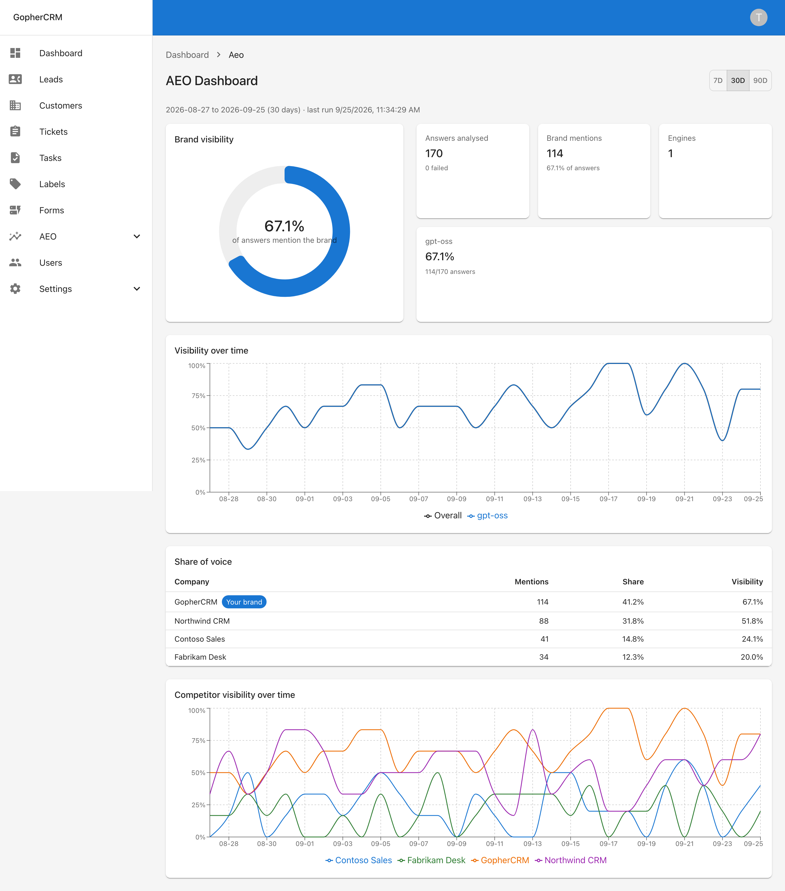
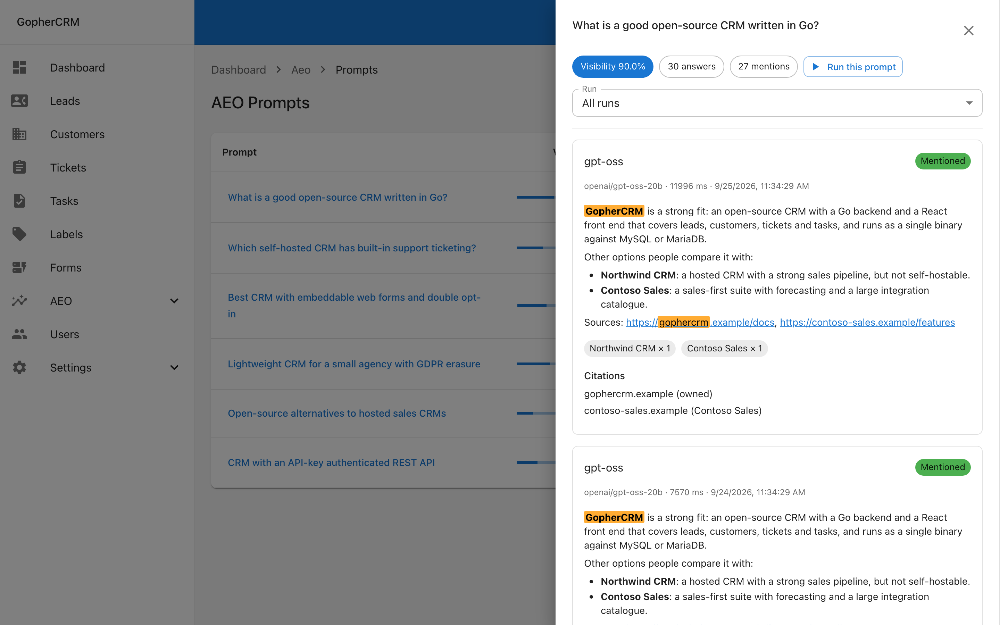

# Answer Engine Optimization (AEO)

AEO tracks how visible your brand is in the answers large language models give to buyer questions.
You describe the brand and its competitors once, track a list of prompts, and a daily run asks every
configured answer engine each prompt and records what came back: whether the brand was mentioned,
how early, which competitors appeared alongside it, and which sources were cited.

## Who can use it

AEO is under **AEO** in the sidebar. Access follows permissions; the defaults of the system roles
are those of the matrix in [docs/AUTHORIZATION.md](../AUTHORIZATION.md):

- `aeo.view` opens the screens, the reports and the export: admin, sales and support. The
  `customer` role holds no AEO permission and cannot reach it.
- `aeo.manage` saves the brand profile, adds, generates and edits prompts and starts a run: admin
  and sales.
- `aeo.delete_prompts` deletes a prompt: admin only.

The provider API keys, the generation engine and the **Models and endpoints** overrides are
configuration entries, written through the configuration API, so they need `settings.update` (and
reading them needs `settings.view`); only the admin system role holds those, so in practice they
are admin-only. Without `settings.update` the Settings page does not show the key card.

## Screens

1. **Settings** (`/aeo/settings`) — brand name, aliases, owned domains and competitors, the provider
   API keys (admin only; stored encrypted and never echoed back, so a chip per engine reports only
   whether a key is present) and which engine prompt generation runs on. Save the profile before
   anything else: a run has nothing to detect without it.
2. **Prompts** (`/aeo/prompts`) — the questions to track (up to 100 active). Add them by hand or ask
   the configured generation engine to suggest some. Each row shows the visibility percentage over
   the selected window; opening a row shows the recorded answers with every brand mention
   highlighted.
3. **Dashboard** (`/aeo`) — overall visibility, a per-engine timeline, share of voice against the
   competitors and their trend, over 7, 30 or 90 days.
4. **Citations** (`/aeo/citations`) — how often each company's domains are cited, and how often a
   citation coincides with a brand mention.
5. **Export** — the dashboard's **Export CSV** / **Export JSON** buttons download the selected 7,
   30 or 90-day window, and the answer drawer's **Export run as CSV** / **Export run as JSON**
   buttons download the run picked in its run filter (every prompt of that run). Both call
   `GET /api/v1/aeo/export` (`run_id` or `days`), which integrations can use directly: CSV (one
   row per citation, formula-guarded cells) or JSON (with the full answer text), for client
   reporting. Admin, sales and support; at most 10,000 answers per file.

Every recorded answer is kept verbatim — the drawer above shows one engine's answer with the brand
mentions highlighted and a selector to walk earlier runs. The full screen-by-screen tour lives in
[docs/SCREENSHOTS.md](../SCREENSHOTS.md#aeo).

## Provider keys, models and endpoints

Provider keys come from **Settings** (`/aeo/settings`) first and fall back to the environment
variables below when no key is stored, so a key entered in the UI takes effect from the next run
without restarting the process. An engine with no key from either source is simply skipped.
Admins can also override each hosted engine's **model and base URL** in **Models and endpoints**;
blank values restore environment/default behavior. These settings apply to both tracking runs and
prompt generation. The custom engine, schedule and egress policy remain environment-only, so a
stored base URL selects an endpoint but cannot make an untrusted one reachable.

## Where your data goes

**Where your data goes.** CRM records and stored prompt sets are kept on your server. Each tracking
run sends every active prompt to every configured engine. Queries stay on your network only when
all configured endpoints are local; in that setup, tracking measures those local models. Queries
to hosted endpoints leave your network. Prompt generation is separate: it sends your brand name,
description and competitor names to the selected generation provider. That request also leaves
your network if the provider's endpoint is hosted.

| Engine | Key | Model override |
|---|---|---|
| Anthropic | `ANTHROPIC_API_KEY` | `AEO_ANTHROPIC_MODEL` |
| OpenAI | `OPENAI_API_KEY` | `AEO_OPENAI_MODEL` |
| Gemini | `GEMINI_API_KEY` | `AEO_GEMINI_MODEL` |
| Kimi (Moonshot) | `MOONSHOT_API_KEY` | `AEO_KIMI_MODEL` |
| Perplexity | `PERPLEXITY_API_KEY` | `AEO_PERPLEXITY_MODEL` |
| Any OpenAI-compatible server (e.g. LM Studio) | `AEO_CUSTOM_BASE_URL` (+ optional `AEO_CUSTOM_API_KEY`) | `AEO_CUSTOM_MODEL`, `AEO_CUSTOM_NAME` |

Each hosted engine also accepts `AEO_<PROVIDER>_BASE_URL` (for example,
`AEO_GEMINI_BASE_URL=https://generativelanguage.googleapis.com/v1beta/openai/`). Use the
OpenAI-compatible base for Gemini/OpenAI/Kimi/Perplexity, and the Messages API root for Anthropic.
Do not include credentials, query parameters, or the final `/chat/completions` or `/v1/messages`
path. A provider's 503 may mean temporary overload.

## Egress policy

**Egress policy.** Each engine may send its key only to its official HTTPS origin. Any other
endpoint must be trusted explicitly in the environment. This applies to a gateway or regional
host, a stored Settings override, and every custom engine. Use `AEO_EGRESS_ALLOWED_ORIGINS` for
public HTTPS origins and `AEO_EGRESS_LOCAL_ORIGINS` for narrowly scoped loopback/LAN servers, for
example `AEO_EGRESS_LOCAL_ORIGINS=custom=http://10.0.1.21:1234`. An untrusted endpoint fails with
`endpoint_not_permitted` before any request. Destinations are checked again at connection time;
redirects are never followed and `HTTP(S)_PROXY` is ignored. Failed answers record only a bounded
category and the numeric HTTP status, never the provider's response text. See
[docs/AEO_SECURITY.md](../AEO_SECURITY.md) for the syntax and the migration checklist.

## Daily schedule

`AEO_SCHEDULE_ENABLED` (default `true`) and `AEO_SCHEDULE_HOUR` (default `6`, server local time)
control the daily run. The scheduler is armed whenever it is enabled, with or without a key at
boot: engines are resolved when the hour arrives, so a key saved in Settings is used by the next
scheduled run without a restart. With no key set at all the module still boots; starting a run
then returns 503 instead of recording a run that could never produce an answer, and a scheduled
tick that finds no profile, key or active prompt is logged once and skipped until the next day.

## Shutdown

**Shutdown.** On SIGINT/SIGTERM the process stops admitting runs (a run requested while draining
answers 503 `SHUTTING_DOWN`), cancels the scheduler and every run in flight, waits for them to
finalize, and only then closes the database. An interrupted run ends `failed`, or `partial` when
some answers were already recorded; queries cut short count as failed and are not stored as
answers. A failed finalizing write leaves its row for recovery even if the
work drains successfully. The AEO drain waits at most 15 seconds. If a provider call or database write still has not
released by then, the process exits without closing the database and the run row left in
`running` is failed once its heartbeat is older than 3 minutes, by the next boot or start on any
replica, exactly as after a crash (see [Known Limitations](../../README.md#known-limitations)).

## Prompt generation

Prompt generation (`POST /aeo/prompts/generate`) deliberately runs on one named engine rather than
whatever happens to be configured, so its output keeps a consistent shape. Anthropic is the default;
the `Settings` page selects any of Anthropic, OpenAI, Gemini, Kimi or Perplexity instead. If the
selected engine has no key, generation answers 503 naming that engine rather than silently falling
back to another one.

## Cost

**Cost.** One run is *active prompts × configured engines* API calls — 25 prompts across 5 engines
is 125 calls a day. The 100-prompt cap exists for this reason. Only one run may be in flight at a
time; a second request is refused with 409.

## Live verification

`scripts/aeo_live_smoke.sh` walks the whole module against real providers for manual verification.
It spends real credit, so it is never part of CI. Test cases: `docs/testing/11-aeo.md`.
