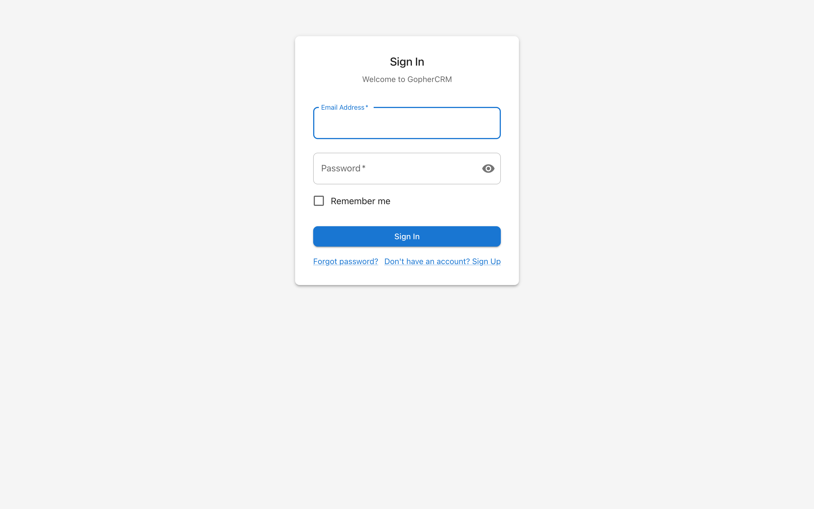
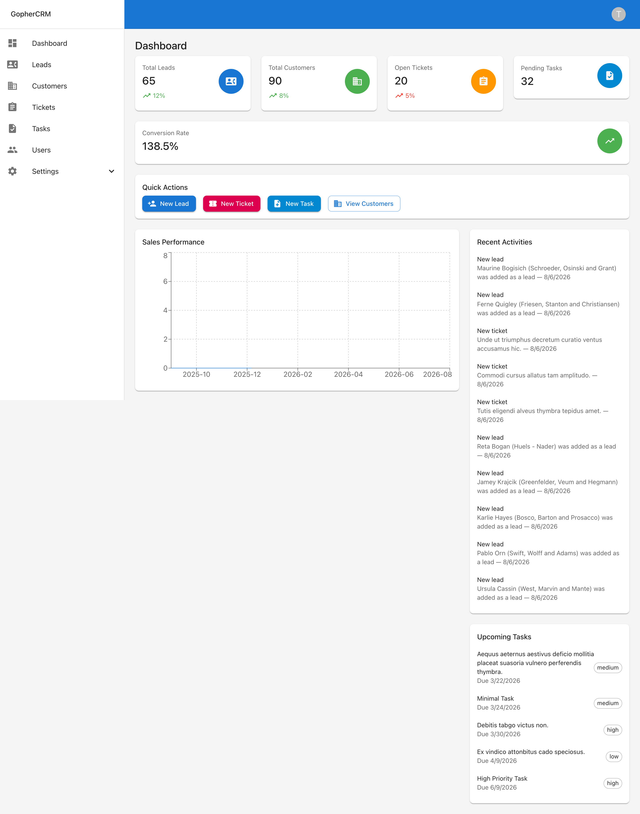

# Getting started

This page is for someone who has been given an account on a GopherCRM installation that is already
running. If you are setting up a new installation and need the first administrator account, see
[Create the first admin](../SETUP.md#6-create-the-first-admin) in the setup walkthrough, or the
[Docker quick start](../DOCKER.md#quick-start) for the Compose stacks.

## Where to sign in

Open the web address your administrator gave you. GopherCRM shows the login screen:

1. Enter your **Email Address** and **Password** and click **Sign In**.
2. Tick **Remember me** if you want to stay signed in after closing the browser tab. Without it,
   closing the tab signs you out. Leave it unticked on a shared computer.

**Result:** the dashboard opens.

- **Forgot password?** under the form asks for your email address and sends a link to set a new
  password. The link works once and only for a limited time. For privacy, the screen gives the
  same answer whether or not the address has an account.
- **Sign in with single sign-on** appears only when your installation offers it. It signs you in
  through your organisation's identity provider instead of a GopherCRM password; see
  [Single sign-on](permissions-access/single-sign-on.md).
- After five wrong passwords in a row the account is locked for 15 minutes. The screen does not
  say so (it gives the same message as a wrong password); wait, or ask your administrator.

How the web app keeps your session in the browser is described for developers in
[Web client](../DEV_AUTH.md#web-client).

## The main screens

The sidebar on the left lists the screens: Dashboard, Leads, Deals, Products, Quotes, Customers,
Companies, Tickets, Tasks, Labels and further entries such as Forms, AEO, Users and Settings. The
dashboard shows summary cards (leads, customers, open tickets, pending tasks and the conversion
rate), quick actions, recent activities and upcoming tasks, and the deal pipeline for roles that
work with deals.

What each person sees depends on their role. The sidebar shows only the screens your role may
open, and the lists show only the records you may see: a salesperson sees their own leads, a
support agent their own tickets. The roles and what each may do are described in
[Roles and permissions](permissions-access/roles-and-permissions.md).

## What to do first

- **Sales:** follow [Everyday sales work](sales-walkthrough.md), from a new lead to a customer, a
  deal and a quote.
- **Support:** follow [Everyday support work](support-walkthrough.md), from a new ticket through
  comments to its resolution.
- **Everyone with tasks:** [Tasks and labels](tasks-and-labels.md) shows how to plan work and
  group it with labels.
- **Administrators:** the [settings guide](settings-and-configuration.md) and the
  [permissions and access guide](permissions-access/overview.md).

## Public sign-up

Public sign-up is off by default: the login screen then has no sign-up link. An administrator can
turn it on in the settings. When it is on, anyone who signs up gets a login on the Customer role,
which can only follow the tickets of its own customer record. The other roles (Admin, Sales,
Support or a custom role) are given only by an administrator; see
[Assign a role to a user](permissions-access/roles-and-permissions.md#assign-a-role-to-a-user).
