# Everyday sales work

This page follows one piece of business from a new lead to a quote the client can keep as a PDF:
create the lead, qualify it, convert it into a customer, link a company, open a deal and move it
through the stages, and send a quote. It is written for the Sales role; administrators see the
same screens with every record.

What sales may do, in short: a salesperson sees and changes only the leads they own, but may
create new ones. Companies and deals are for administrators and sales: sales sees and changes the
deals it owns and may create new ones, and reads and edits every company; only an administrator
deletes a company or a deal. Sales may read the product catalogue but not change it. The full
table is in [Roles and permissions](permissions-access/roles-and-permissions.md).

## Create a lead

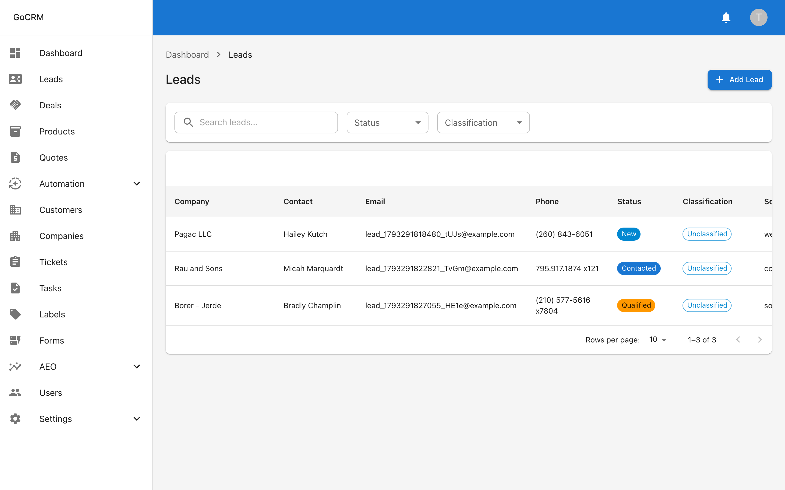

1. Open **Leads** in the sidebar and click **Add Lead**.
2. Fill in **Company (as entered)** and **Contact Name**, and at least one of **Email** and
   **Phone**: a lead needs one of the two.
3. Optionally link a company record (see [Link or create a company](#link-or-create-a-company)),
   pick a **Status** (a new lead starts as New) and a **Lead Source**, and add **Notes**.
4. Click **Create Lead**.

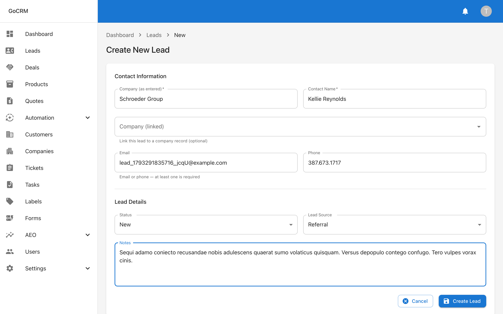

**Result:** the leads list opens and shows the new lead. If neither an email nor a phone number
was given, the form marks both fields with "Provide an email address or a phone number" and
creates nothing.

## Qualify the lead

1. Click the lead in the list to open it.
2. Click **Edit**, set **Status** to **Qualified** and click **Update Lead**.

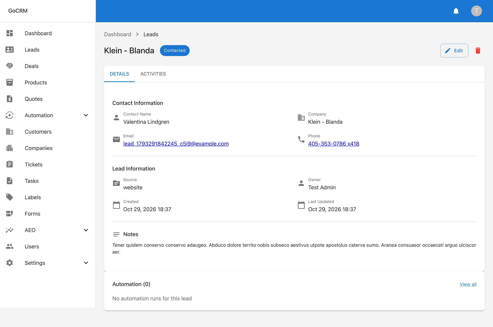

**Result:** the lead's page shows the Qualified status chip. With the default settings, a
Qualified or Contacted lead now offers **Convert to Customer**.

## Convert the lead to a customer

Which statuses offer **Convert to Customer** is a setting of the installation. As shipped, Qualified
and Contacted leads can be converted; an administrator can change the list, and can also require
conversion notes (see
[Lead conversion settings](settings-and-configuration.md#lead-conversion-settings)). A lead that
was already converted no longer offers the button.

1. On the lead's page, click **Convert to Customer**.
2. The **Convert Lead to Customer** dialog shows the lead's contact, email, phone and company. It
   asks for optional **Company Name** (empty keeps the lead's company), **Website**, **Address**
   and **Conversion Notes**. When the installation requires notes, the notes field is marked
   required.
3. Click **Convert to Customer** in the dialog.

**Result:** a customer record is created from the lead, the lead is marked Converted and linked to
it, and the new customer's page opens. If the installation makes the lead's owner the customer's
assigned user, the dialog says so before you confirm.

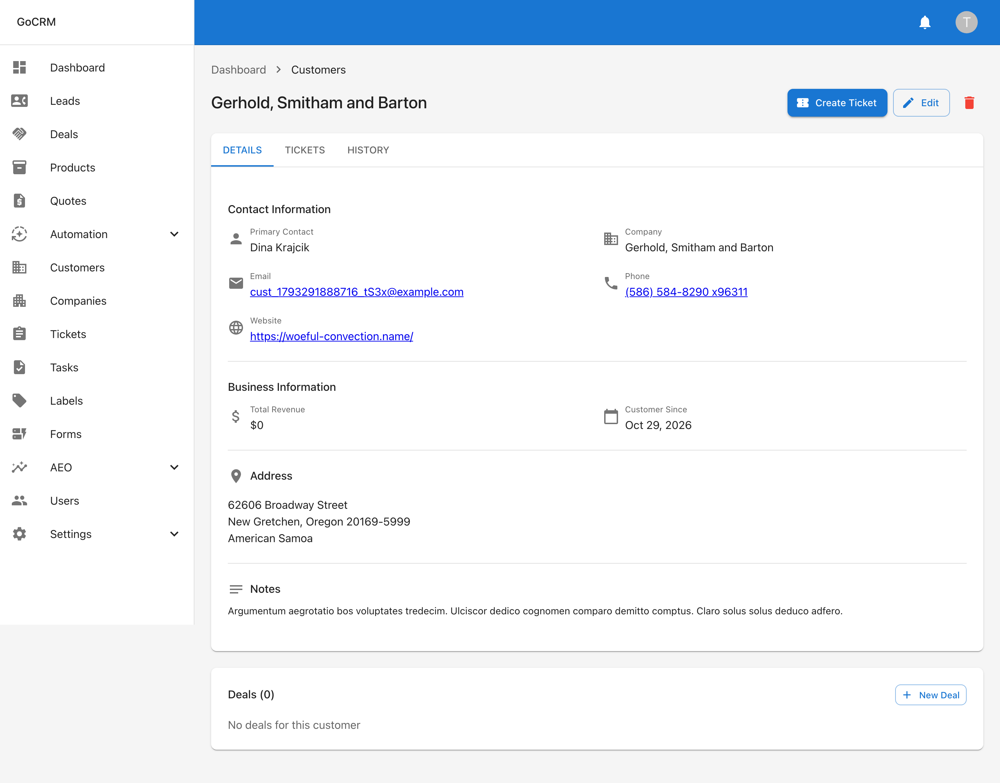

Two leads cannot be converted, and the dialog then shows why and creates nothing:

- a lead without an email address, because every customer needs one: add an email to the lead
  first;
- a lead whose email address already belongs to a customer: that customer already exists, so work
  with the existing record instead.

## Link or create a company

A company record groups the leads, customers and deals of one organisation. The free-text
**Company (as entered)** field on a lead or customer stays as typed; the link to a company record
is a separate field next to it.

1. To create one, open **Companies** in the sidebar, click **New Company**, enter at least the
   **Name** (a **Domain** is optional, and unique among companies) and click **Create Company**.
2. To link it, edit the lead, customer or deal and pick the company in its **Company** field, then
   save.

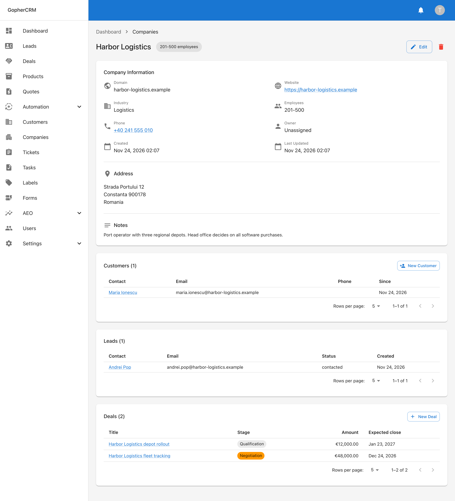

**Result:** the company's page lists the customers and leads linked to it, and for sales and
administrators its deals. A lead converted after being linked
carries the link over to its customer.

## Create a deal and move it through the stages

1. Open **Deals** and click **New Deal**.
2. Enter a **Title** and pick the **Customer**, **Company** or **Lead** it belongs to, if any.
   Optionally set the **Stage** (Qualification by default), the **Amount** and **Currency** (the
   installation's default currency is filled in), the **Expected close** date, a **Source** and
   **Notes**.
3. Click **Create Deal**.

**Result:** the deal's page opens in the stage you picked, with that stage's probability (10 % for
Qualification) unless you entered another.

Move the deal on as the conversation progresses, either from its page or from the board:

1. On the deal's page, pick the next stage in **Stage**. On the board (the **Board** view of
   **Deals**), open a card's menu and choose **Move to** a stage.
2. When a deal is lost, choosing Lost asks for a **Lost reason**.

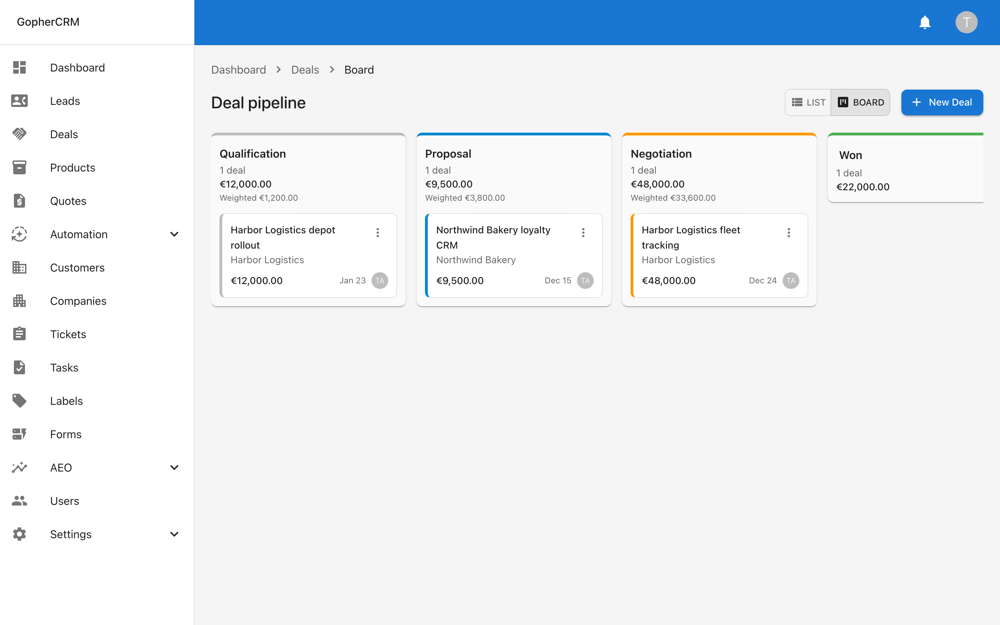

**Result:** the stage chip and the probability change, and the board shows the card in its new
column. The default probabilities are 10 % (Qualification), 40 % (Proposal) and 70 %
(Negotiation). Won is always 100 % and Lost is always 0 %, whatever was entered. Every stage change
is kept in the deal's history.

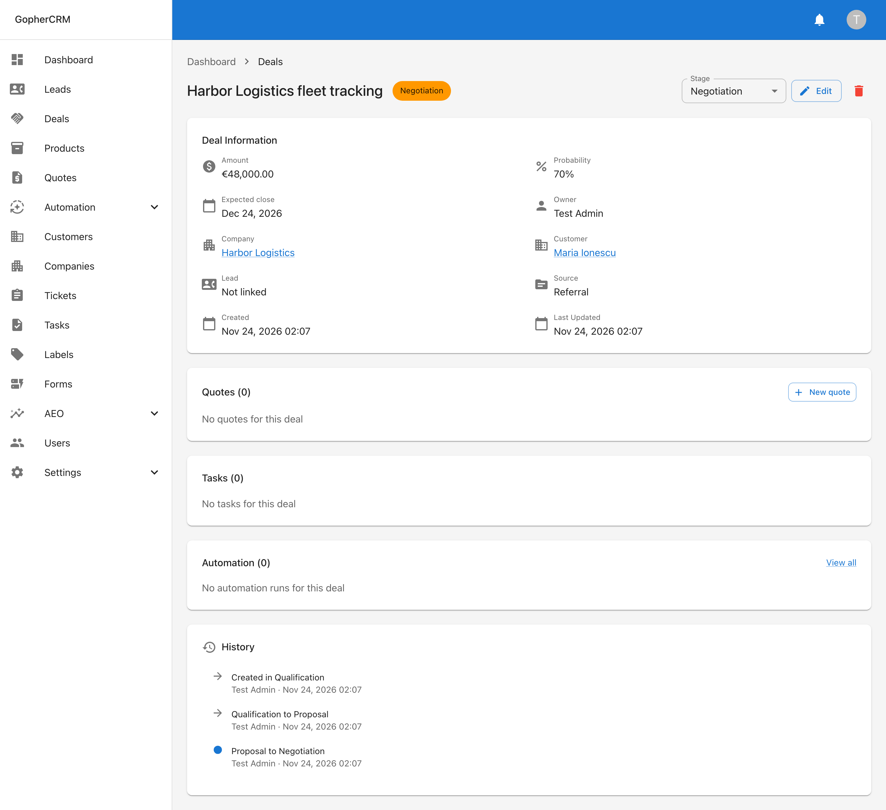

## Create a quote, send it and download the PDF

A quote is priced from the product catalogue, which an administrator maintains under **Products**.

1. Open **Quotes** and click **New Quote** (or **New quote** in the Quotes section of a deal's
   page, which fills in the deal).
2. In the **New quote** dialog, enter a **Title** and pick a **Deal** (open deals only; the quote
   is then addressed to the deal's customer) or a **Customer**. Check the **Currency**, and
   optionally set **Valid until** (acceptance is refused after that date) and **Notes**.
3. Click **Create**.

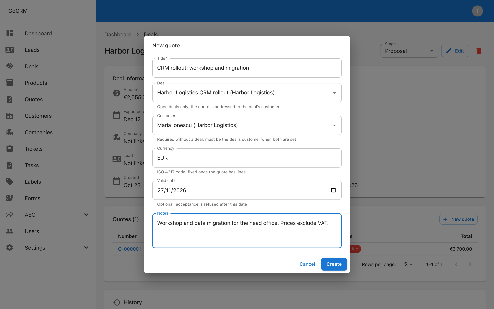

**Result:** the quote's page opens as a draft with no lines.

4. Click **Add line**, pick a **Product** (only active products priced in the quote's currency are
   offered), set the **Quantity** and, if needed, a **Discount (%)**, a **Tax (%)** and a
   **Unit price override**, and save. Repeat for each line.

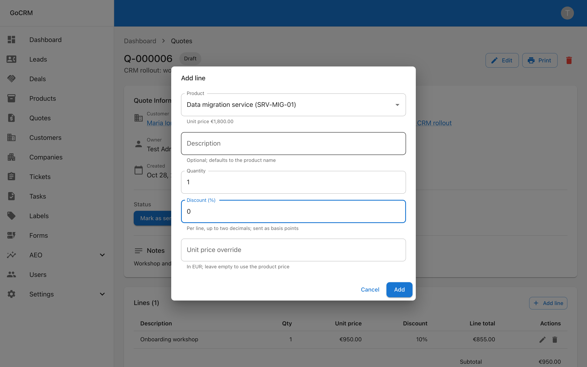

**Result:** the lines table and the totals update after each line. A draft can still be edited and
its lines changed.

5. Click **Mark as sent** when the quote is ready. To email it to the client, click
   **Email quote**.

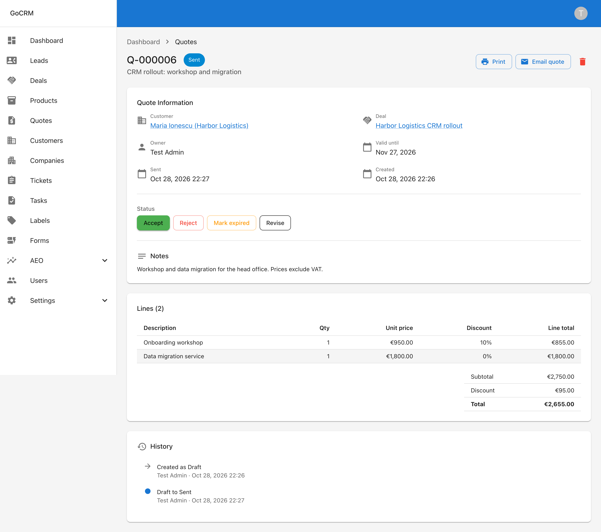

**Result:** the quote shows the Sent status and can no longer be edited. It now offers
**Accept**, **Reject**, **Mark expired** and **Revise** (back to draft for changes).

6. To give the client a document, click **Print**, or **Download PDF** where it is shown.
   **Download PDF** appears only when the installation has PDF output switched on; otherwise click
   **Print** and use the browser's print dialog to save the page as a PDF.

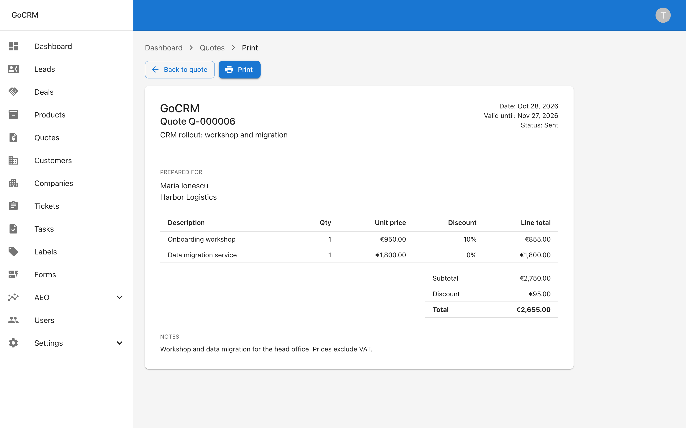

**Result:** **Print** opens the printable quote; **Download PDF** saves a file named after the
quote number.

## A customer record is not a customer login

Two different things are both called "customer" in GopherCRM:

- A **customer record** is an entry in the CRM that sales manages: a client you sell to, with its
  contact details, deals and quotes. Converting a lead creates a customer record.
- A **Customer-role login** is a user account that can sign in. It sees only the tickets of the
  customer record linked to it, and nothing of sales.

Converting a lead creates a record, never a login. The link between a login and a customer record
is not made through the application's screens. The user a customer record is assigned to (for
example by a conversion that makes the lead's owner the customer's assigned user) is the member of
staff responsible for it, not the customer's own login. What a Customer-role
login sees of its tickets is described in [Everyday support work](support-walkthrough.md).
