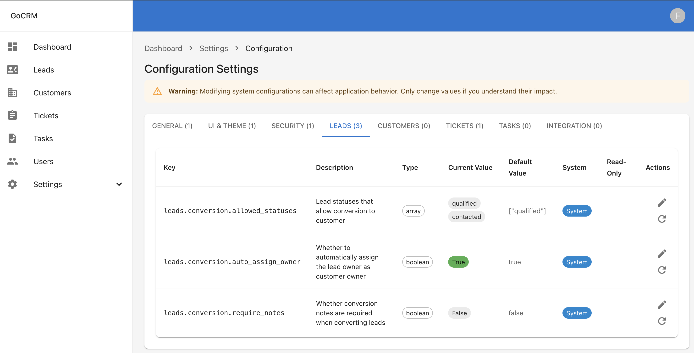

# Settings and configuration

## Administration and settings

Screens are shown by permission, not by role: a user sees a screen when their role holds the
permission it needs, and the system Admin role holds all of them. Roles, custom roles and which
permission each system role holds are described in
[Roles and permissions](permissions-access/roles-and-permissions.md); the administrator guide
starts at the [Permissions and access overview](permissions-access/overview.md).

- **Users** (`users.view`): the user list and user pages; activating and deactivating an account
  needs `users.activate`. Giving a user a role is described in
  [Assign a role to a user](permissions-access/roles-and-permissions.md#assign-a-role-to-a-user).
- **Profile** (all users): your account details and the password change.
- **API Keys** (own keys, staff accounts only): create and revoke your own API keys; a key
  expires after at most one year; see [API keys](permissions-access/api-keys.md).
- **Configuration** (`settings.view`; changes need `settings.update`): the system settings by
  category tab (see [Configuration management](#configuration-management)).
- **Roles** (`roles.view`; creating, cloning, editing and deleting need `roles.manage`): system and
  custom roles and their permissions; see
  [Custom roles](permissions-access/roles-and-permissions.md#custom-roles).
- **Webhooks** (`webhooks.manage`): outbound webhook endpoints and the delivery log; see
  [Webhooks](permissions-access/webhooks.md).
- **Single sign-on** (`settings.sso_manage`): the OpenID Connect issuer, client and role mapping;
  see [Single sign-on](permissions-access/single-sign-on.md).
- **Sign-in audit** (`audit.sign_ins_view`): password, single sign-on, refresh and API-key sign-in
  outcomes; see [Sign-in audit](permissions-access/sign-in-audit.md).
- **Role audit** (`roles.audit_view`): role changes and account activation, deactivation, erasure
  and email changes; see [Audit trail](permissions-access/roles-and-permissions.md#audit-trail).
- **SCIM tokens** (`settings.scim_manage`): the bearer tokens an identity provider's SCIM client
  uses; see [SCIM provisioning](permissions-access/scim-provisioning.md#tokens).

## Configuration management

GopherCRM includes a configuration management system that lets administrators customize system
behavior through the web interface.

### Accessing configuration settings

1. Sign in as a user whose role holds `settings.view` (the admin system role does). Changing or
   resetting a value needs `settings.update`.
2. Navigate to **Settings > Configuration**.
3. Browse settings by category tabs:
   - **General**: Company information and basic settings
   - **UI & Theme**: User interface customization
   - **Security**: Security-related settings
   - **Leads**: Lead management behavior
   - **Customers**: Customer management settings
   - **Tickets**: Support ticket configuration
   - **Tasks**: Task management settings
   - **Deals**: Deal settings (default currency)
   - **Integration**: Third-party integrations

A tab with no settings says so; the single sign-on settings are not on the Security tab but on
their own screen (see [Single sign-on](permissions-access/single-sign-on.md)).

### Configuration features

- **Type-Safe Editing**: Different input types based on configuration type (boolean, string, array,
  etc.)
- **Validation**: the server checks every value against the setting's type, and against its list
  of allowed values where the setting has one (for example `leads.conversion.allowed_statuses`); a
  refused value is a 400 and nothing is saved.
- **No deletion**: settings are seeded by the server; neither the screen nor the API can create or
  delete one.
- **Read-only settings**: an entry marked read-only shows a Read-Only chip, its edit and reset
  buttons are disabled and the server refuses to change it. No setting the server seeds is
  read-only today.
- **Default values**: each setting has a reset button that, after a confirmation, restores its
  default value.
- **No restart needed**: the server reads a setting from the database when it uses it, so a saved
  value applies to the next request that needs it. The screen refreshes the UI settings cached in
  your own browser session; other open sessions pick them up when they reload.

### Lead conversion settings

The configuration system includes specific settings for lead conversion, enforced by the server on
every `POST /leads/:id/convert` before anything is written (a refusal is 400 `VALIDATION_ERROR`):

- `leads.conversion.allowed_statuses`: Which lead statuses allow conversion to customer
  (any of `new`, `contacted`, `qualified`, `unqualified`; seeded as `qualified` and `contacted`)
- `leads.conversion.require_notes`: Whether non-blank conversion notes are required
- `leads.conversion.auto_assign_owner`: Make the lead's owner the customer's assigned user

If the `leads.conversion.allowed_statuses` row is missing (seeding never ran), conversion falls back
to `qualified` only, the entry's default value, rather than the seeded `qualified, contacted`; the
next start re-seeds the row. A lead reaches `converted` only through the convert endpoint: lead
create/update and the bulk status endpoint refuse it. The lead's company link is carried over to
the customer as well. `GET /configurations/ui` exposes the three settings read-only, and the web
UI follows them: Convert to Customer is offered on the allowed statuses, the conversion dialog
requires notes when they are required and says when the lead's owner becomes the customer's
assigned user.
