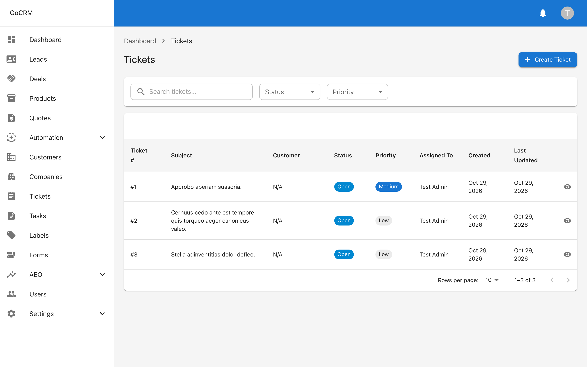
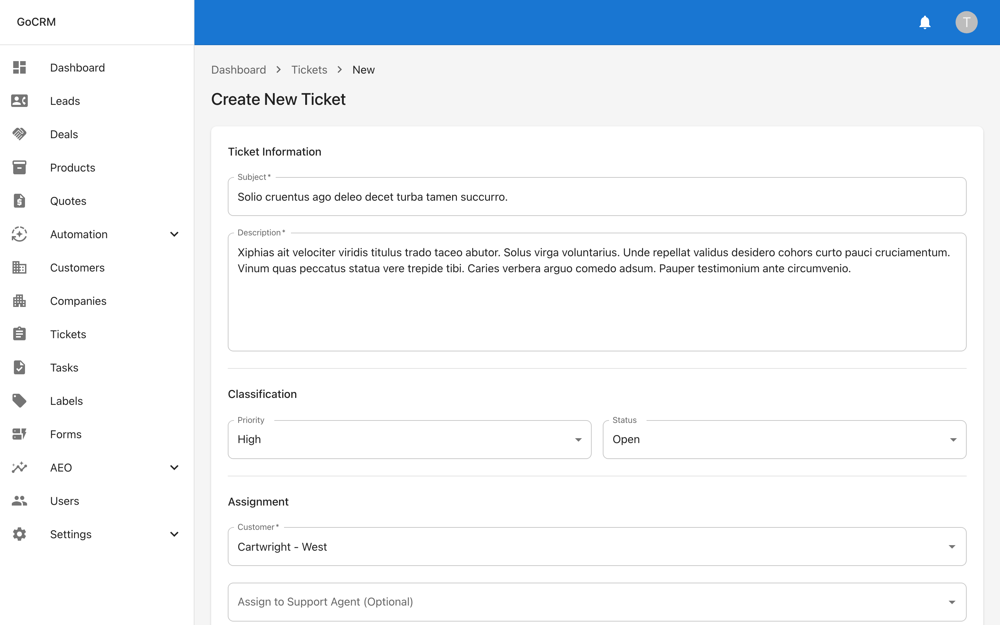
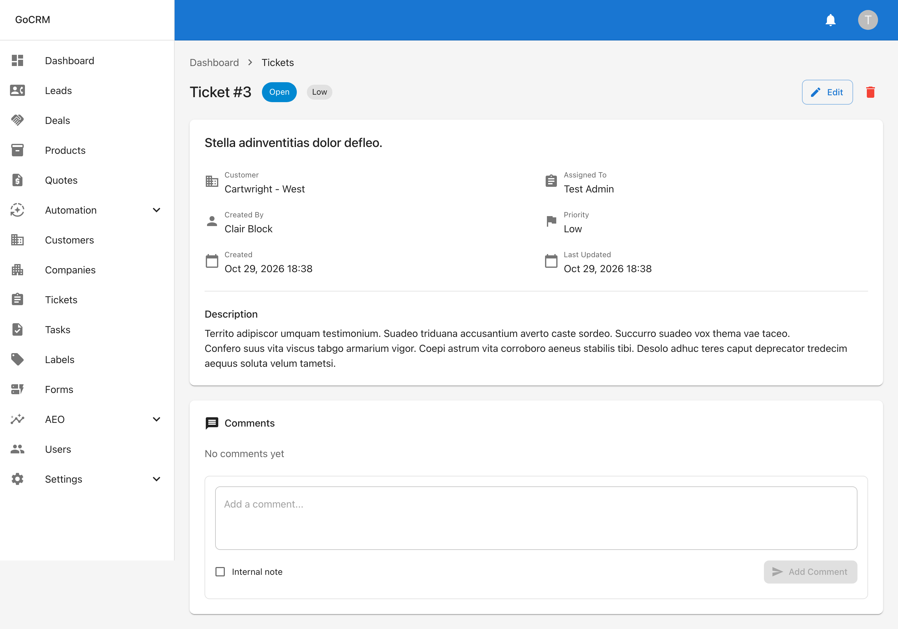

# Everyday support work

This page follows one support request from the moment it is opened to its resolution: open a
ticket for a customer, discuss it in comments and internal notes, and move its status through to
Closed. It is written for the Support role; administrators see the same screens with every ticket.

What each role may do with tickets, in short:

- **Support** may create tickets, and sees, edits and comments on only the tickets assigned to
  them.
- **Sales** may read every ticket but cannot change one or comment on it.
- **Administrators** may do everything, and only they delete a ticket.
- A **Customer-role login** sees only the tickets of the customer record linked to it, and only
  the comments that are not internal notes.

The full table is in [Roles and permissions](../administration/roles-and-permissions.md).

## Open a ticket

1. Open **Tickets** in the sidebar and click **Create Ticket**.
2. Enter a **Subject** and a **Description** of the request.
3. Under Classification, pick the **Priority** (Low, Medium, High or Urgent) and the **Status**
   (Open for a new request).
4. Under Assignment, pick the **Customer** the ticket is for and, in
   **Assign to Support Agent (Optional)**, the agent who will handle it.
5. Click **Create Ticket**.

**Result:** the tickets list opens and shows the new ticket. A support agent sees it in the list
only when it is assigned to them, so assign it to yourself if you will handle it.

Tickets can also be opened by a form on your website; how that works, and how such a ticket gets
its title, is described in [Forms](forms.md).

## Comments and internal notes

1. Click the ticket in the list to open it. The page shows the customer, the assignee, the
   dates, the description and the comments.
2. Type into **Add a comment...** at the bottom of the Comments section.
3. Tick **Internal note** when the text is for staff only, for example a note to a colleague or a
   reminder of what was tried. Leave it unticked for a reply the customer may read.
4. Click **Add Comment**.

**Result:** the comment appears in the list with its author and time. An internal note carries an
**Internal Note** chip. The customer never sees internal notes, not even through their own login;
staff who may read the ticket see both kinds.

The comment box is shown only to those who may change the ticket: support on its own assignments
and administrators. Sales reads the comments but has no comment box.

## Move the ticket to its resolution

A ticket has four statuses: **Open**, **In Progress**, **Resolved** and **Closed**.

1. On the ticket's page, click **Edit**.
2. Set **Status** to **In Progress** while you work on it and click **Update Ticket**.
3. When the problem is solved, open the ticket, add a comment (not an internal note) saying what
   was done, so the customer can read the answer, then edit it and set **Status** to
   **Resolved**.
4. When nothing more is expected, set **Status** to **Closed**.

**Result:** after each save the tickets list opens, and its Status column (and the status chip on
the ticket's page) shows the new status.

## What a customer sees

A customer who signs in with a Customer-role login sees the tickets of the customer record linked
to that login, and on each ticket only the comments that are not internal notes. The customer can
read but cannot edit a ticket or add a comment. The sidebar shows such a login no Tickets entry:
the ticket list opens at the `/tickets` address of the installation. A customer record
and a customer login are different things, and converting a lead never creates a login; see
[A customer record is not a customer login](sales-walkthrough.md#a-customer-record-is-not-a-customer-login).
