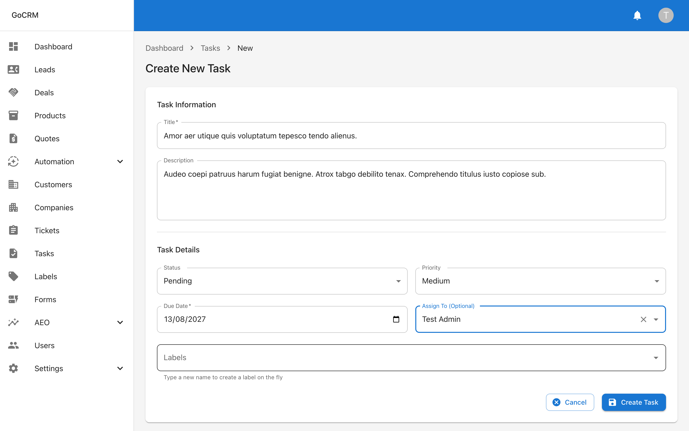
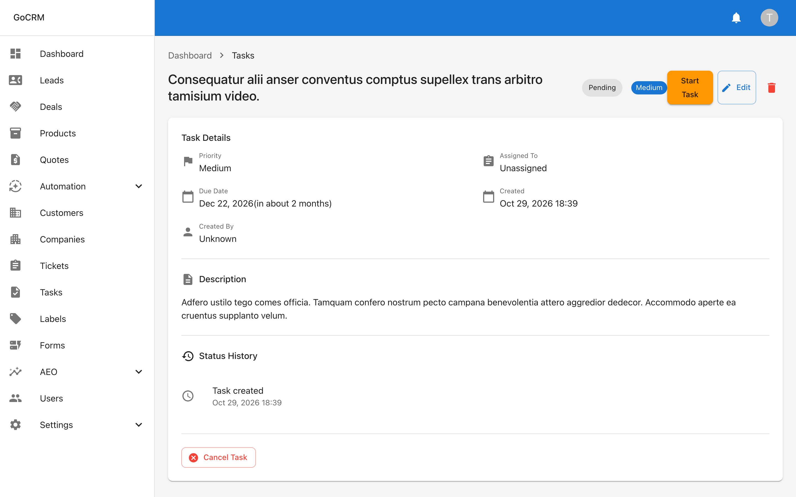
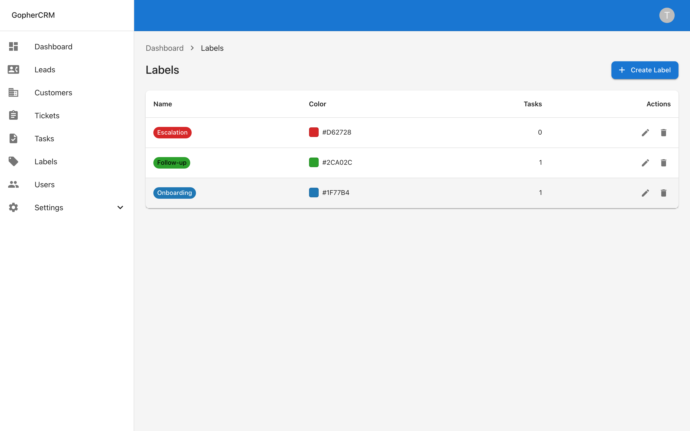
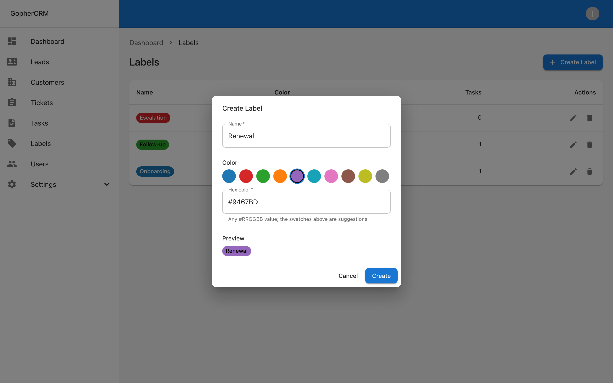
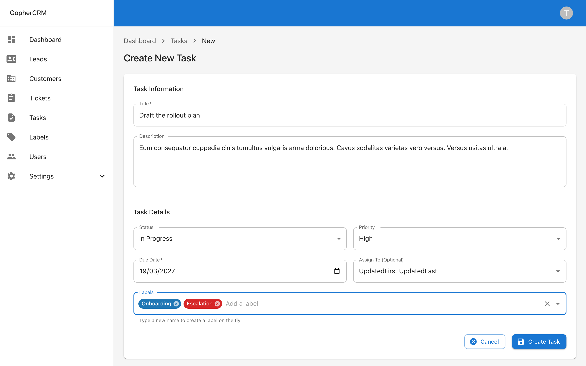
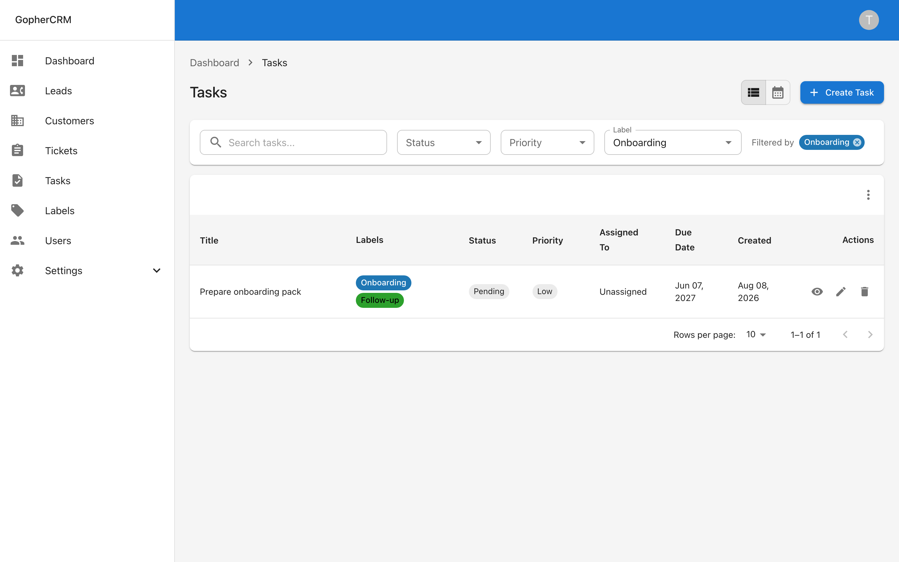

# Tasks and labels

Tasks are the to-do list of the CRM: a call to make, an offer to prepare, a check to run. Labels
are coloured tags that group tasks across people and deals, such as "Follow-up" or "Urgent
review". Every role that works in the CRM can use tasks; what each role sees is described at the
end of this page.

## Create a task

1. Open **Tasks** in the sidebar and click **Create Task**.
2. Enter a **Title** and, if useful, a **Description**.
3. Under Task Details, pick the **Status** (Pending for new work), the **Priority** (Low, Medium
   or High) and the **Due Date**, which is required.
4. In **Assign To (Optional)**, pick the person who should do it.
5. To tie the task to a sale, pick the **Deal** (shown to roles that work with deals; closed deals
   can be linked too). The task form has no field for a lead or a customer: link the task to the
   deal of that lead or customer instead.
6. Pick **Labels** if you want (see [Pick labels on a task](#pick-labels-on-a-task)).
7. Click **Create Task**.

**Result:** the tasks list opens and shows the new task with its status, priority, due date and
labels.

## Work on a task

1. Click the task in the list to open it.
2. Click **Start Task** on a pending task, or **Complete** on a task in progress.
3. To change anything else, click **Edit**, change the fields and click **Update Task**.

**Result:** the task's page shows the new status chip and adds the change to its Status History. A
task past its due date that is not completed carries an **Overdue** chip.

## Labels

### Create a label

1. Open **Labels** in the sidebar. The list shows each label with its colour and the number of
   tasks that carry it.
2. Click **Create Label**, enter a **Name** (unique, at most 50 characters), pick a colour or type
   a **Hex color**, and save.

**Result:** the new label appears in the list with no tasks yet. A name that another label already
has, in any mix of upper and lower case, is refused.

### Pick labels on a task

1. In the task form, click into **Labels** and pick one or more labels from the list.
2. If the label does not exist yet, type its name and choose **Add "…"**: the label is created on
   the spot and added to the task. Roles that may not create labels can only pick existing ones.
3. Save the task.

**Result:** the task shows its labels as coloured chips on its page and in the tasks list. To take
a label off a task, remove its chip in the form and save.

### Filter tasks by label

1. In the tasks list, pick a label in the **Label** filter.

**Result:** the list shows only the tasks carrying that label. The label filter does not combine
with search: while a label is picked, the search box is disabled with "Clear the label filter to
search". Clear the label to search again.

### Delete a label

Only an administrator may delete a label. Deleting it removes it from every task that carries it
and cannot be undone; the confirmation says how many tasks will lose it. Sales and support may
create and rename labels but not delete them.

## Who sees which tasks

Administrators see every task. Sales and support see and change the tasks they own or are assigned
and may create new ones. A Customer-role login sees and updates only its own tasks. Everyone
signed in can see the labels. The full table is in
[Roles and permissions](../administration/roles-and-permissions.md).
